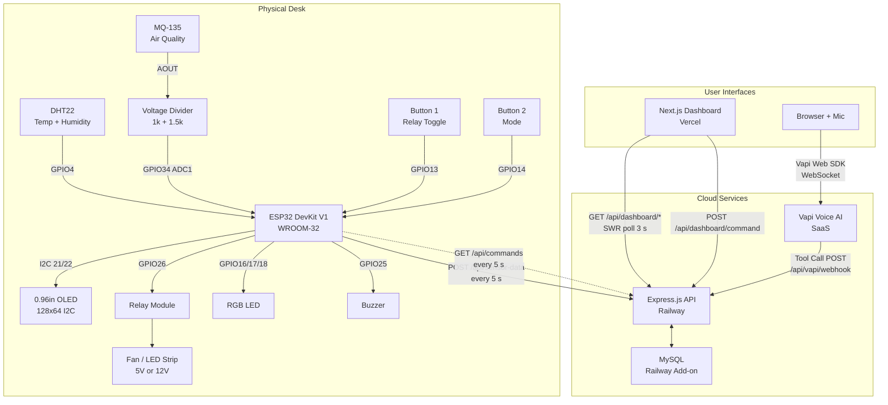
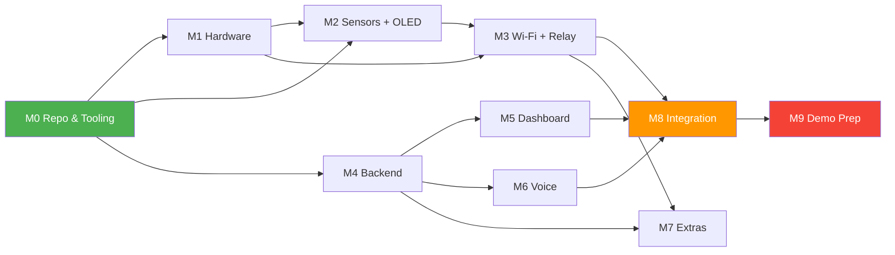

# Desk Station — Project Overview

> **Start:** November 12, 2026 (Thursday) · **Showcase:** December 12, 2026 (Saturday) · **Team:** 4 · **Budget:** ~6 000 BDT

---

## 1. Project Summary

**Desk Station** is a voice-controlled smart study desk that monitors temperature, humidity and air quality, automates a comfort device (fan or LED strip), and is controllable by voice (in a browser), a live web dashboard, and physical buttons. It is built for a university IoT showcase.

### 1.1 Success Definition

The project **passes** when every MUST item is demonstrable during a 3-minute showcase visit:

| Tier | # | Criterion | Verified by |
|------|---|-----------|-------------|
| **MUST** | 1 | Sensors display on OLED with refresh ≤ 3 s | Visual check |
| **MUST** | 2 | Relay toggles via physical button | Press button, hear relay click |
| **MUST** | 3 | Relay toggles via dashboard toggle | Click toggle on laptop screen |
| **MUST** | 4 | Relay toggles via voice ("turn the fan on") | Speak into browser mic |
| **MUST** | 5 | Voice query answered ("what's the temperature?") | Hear spoken reply |
| **MUST** | 6 | Auto-threshold: fan ON when temp > 30 °C | Heat sensor with hand / hairdryer |
| **MUST** | 7 | Offline mode: sensors + OLED + button + auto work with **no Wi-Fi** | Disconnect Wi-Fi, demo still works |
| **MUST** | 8 | Sensor data appears on dashboard within 5 s of reading | Compare OLED and dashboard |
| **SHOULD** | 9 | RGB LED shows green / yellow / red for air quality | Blow on MQ-135, colour changes |
| **SHOULD** | 10 | Buzzer beeps on "poor" air quality | Blow on MQ-135 |
| **SHOULD** | 11 | Telegram alert when temp > threshold | Show phone notification |
| **SHOULD** | 12 | Voice-managed to-do list | "Add finish lab report" → list on dashboard |
| **SHOULD** | 13 | Pomodoro timer on OLED | "Start Pomodoro" → countdown on OLED |
| **STRETCH** | 14 | A few Bangla commands | "ফ্যান চালাও" → relay toggles |
| **STRETCH** | 15 | Time / weather line on OLED | OLED shows current time |
| **STRETCH** | 16 | Enclosure / cable polish | Visual assessment |

---

## 2. System Architecture

### 2.1 High-Level Architecture Diagram



### 2.2 Data-Flow Walkthrough

#### Path A — Sensor data to dashboard

```
DHT22 / MQ-135
  → ESP32 reads every 2 s, updates OLED
  → ESP32 bundles readings into JSON
  → HTTP POST to Express API every 5 s
  → Express writes row to MySQL via Prisma
  → Next.js dashboard polls Express every 3 s (SWR)
  → Dashboard renders live gauges
```

#### Path B — Voice command to relay

```
User speaks "turn the fan on" into browser mic
  → Vapi Web SDK streams audio to Vapi servers (WebSocket)
  → Vapi transcribes, matches intent, calls tool "set_relay"
  → Vapi POSTs tool call JSON to Express /api/vapi/webhook
  → Express creates a Command row (status = "pending") in MySQL
  → ESP32 polls GET /api/commands every 5 s
  → ESP32 picks up command, toggles relay GPIO, ACKs back
  → Express marks command "acked"
  → Dashboard shows updated relay state on next poll
```

#### Path C — Dashboard command to relay

```
User clicks "Fan ON" toggle on Next.js dashboard
  → Dashboard POSTs to Express /api/dashboard/command
  → Express creates Command row (status = "pending")
  → ESP32 polls, picks up, executes, ACKs (same as Path B)
```

#### Path D — Physical button (fully offline)

```
User presses Button 1
  → ESP32 detects LOW on GPIO13 (debounced)
  → ESP32 toggles relay GPIO26
  → OLED updates relay status line
  → If Wi-Fi connected: include new relay state in next sensor POST
```

#### Path E — Local automation (fully offline)

```
ESP32 reads temperature from DHT22
  → If autoMode == true AND temp > 30 °C → relay ON
  → If autoMode == true AND temp < 28 °C → relay OFF
  → 2 °C hysteresis prevents oscillation
  → Manual button or remote command sets autoMode = false (sticky override)
```

---

## 3. Key Design Decisions

### 3.1 HTTP Polling vs WebSocket (ESP32 ↔ Backend)

| | HTTP Polling (every 5 s) | WebSocket |
|---|---|---|
| Code complexity | Simple: two HTTP calls in a loop | Complex: connection state, reconnect, heartbeat |
| Debugging | Easy: use curl / Postman to test | Hard: need WS tools |
| ESP32 library | Built-in HTTPClient | Needs extra library, memory-hungry |
| Latency | Up to 5 s | Near-instant |
| Reliability | Stateless: each request is independent | Must handle disconnects gracefully |
| Beginner-friendly | ✅ Yes | ❌ No |

**Decision: HTTP Polling every 5 seconds.** A 5-second delay for a study desk fan is imperceptible. The massive simplicity win is worth it for a beginner team on a 3-week deadline. The ESP32 POSTs sensor data and GETs pending commands in the same 5-second cycle.

### 3.2 Backend Reachability by Vapi

Vapi's tool calls require a publicly reachable HTTPS URL. Options:

| | Public Deploy (Railway) | Tunnel (ngrok) |
|---|---|---|
| URL stability | Permanent `*.up.railway.app` | Changes on restart (free tier) |
| Demo-day reliability | High: runs in cloud, no laptop dependency | Medium: depends on laptop + internet |
| Setup complexity | Medium: one-time deploy | Low: one command |
| Cost | Free tier ($5/mo credit) ample for this project | Free tier sufficient |
| Latency | ~50-100 ms | ~100-200 ms |

**Decision: Deploy Express backend on Railway for production / demo day.** Use ngrok only during local development. Railway gives a stable URL that Vapi can call reliably, independent of any team member's laptop. The Next.js dashboard deploys to Vercel (free tier, optimised for Next.js).

### 3.3 Database Strategy

| | SQLite (local dev) | MySQL (Railway, prod) |
|---|---|---|
| Setup | Zero: just a file | Needs Railway or Docker |
| Cross-platform | ✅ Works everywhere | Varies by OS |
| Prisma support | ✅ Full | ✅ Full |

**Decision: SQLite for local development, MySQL on Railway for production.** Prisma abstracts the difference. Switch by changing one line in `schema.prisma`. This avoids every team member installing MySQL locally.

### 3.4 Why Not MQTT / Cloud IoT

MQTT is the standard IoT protocol, but it requires a broker, adds a new concept, and provides pub/sub that we don't need (we have one ESP32 and one backend). Plain HTTP + JSON is something the Cloud Lead already knows from Express, and the Firmware Lead can learn in one exercise. **Simplicity wins.**

---

## 4. Technology Stack

| Layer | Technology | Version | Why |
|-------|-----------|---------|-----|
| Microcontroller | ESP32 DevKit V1 (WROOM-32, 30-pin) | — | Most common, cheapest, has Wi-Fi + ADC |
| Firmware IDE | Arduino IDE 2.x **or** PlatformIO (VS Code) | Latest stable | Arduino IDE is simpler for beginners; PlatformIO better for team collab [VERIFY which the Firmware Lead prefers] |
| Firmware language | Arduino C++ | — | Huge library ecosystem, team knows basic C |
| Sensor lib | `DHT sensor library` by Adafruit + `Adafruit Unified Sensor` | Latest | Most-used DHT library, well documented |
| OLED lib | `Adafruit SSD1306` + `Adafruit GFX` | Latest | De facto standard for SSD1306 OLEDs |
| HTTP lib | `HTTPClient` (built into ESP32 Arduino core) | — | No extra install needed |
| JSON lib | `ArduinoJson` by Benoît Blanchon | v7.x | Efficient, well-documented JSON for embedded |
| Backend runtime | Node.js | 20 LTS | Stable, matches Cloud Lead's experience |
| Backend framework | Express.js | 4.x | Cloud Lead already knows it |
| ORM | Prisma | 5.x | Cloud Lead already knows it |
| Database (dev) | SQLite | — | Zero setup |
| Database (prod) | MySQL | 8.x (Railway) | Cloud Lead already knows it |
| Frontend | Next.js | 14.x (App Router) | Cloud Lead already knows it |
| UI components | Tailwind CSS + shadcn/ui | Latest | Fast, good-looking, free |
| Charts | Recharts or Chart.js via react-chartjs-2 | Latest | Simple, React-friendly |
| Voice AI | Vapi Web SDK | Latest | Cloud Lead has built a Vapi agent before |
| Deployment (API) | Railway | Free tier | Stable URL, easy Express deploy |
| Deployment (frontend) | Vercel | Free tier | Optimised for Next.js |
| Version control | Git + GitHub | — | Industry standard |

---

## 5. Module Map (Summary)

Each module is detailed in its own file. Here is the overview:

| Module | Name | Primary Owner | Backup |
|--------|------|---------------|--------|
| M0 | Repo, Tooling, Conventions | Integration Lead | Cloud Lead |
| M1 | Hardware & Power | Hardware Lead | Firmware Lead |
| M2 | Firmware: Sensors + OLED | Firmware Lead | Hardware Lead |
| M3 | Firmware: Wi-Fi, HTTP, Relay, Local Automation | Firmware Lead | Integration Lead |
| M4 | Backend API + Database | Cloud Lead | Integration Lead |
| M5 | Dashboard | Cloud Lead | Integration Lead |
| M6 | Voice Agent | Cloud Lead | Firmware Lead |
| M7 | Extras (Telegram, To-Do, Pomodoro, RGB) | Integration Lead | Hardware Lead |
| M8 | Integration & Testing | Integration Lead | Everyone |
| M9 | Demo Prep, Fallbacks, Documentation | Integration Lead | Hardware Lead |

### 5.1 Dependency Graph



### 5.2 Critical Path

```
M0 → M1 → M2 → M3 → M8 → M9
                 ↑
M0 → M4 → M5 ──┘
         ↘ M6 ─┘
```

The critical path runs through **firmware** (M1→M2→M3) and **backend** (M4) converging at **integration** (M8). Both paths must reach M8 by end of Week 3. This is why firmware and backend start in parallel from Day 1.

### 5.3 Day-1 Unblocking

Nobody is idle on Day 1:

| Person | Day 1 Activity | Blocked on? |
|--------|---------------|-------------|
| Cloud Lead | Set up Express project, Prisma schema, stub all endpoints | Nothing (M0 and M4 are independent) |
| Firmware Lead | Install Arduino IDE, flash blink LED, read DHT22 on breadboard | Nothing (only needs ESP32 + DHT22 + USB cable) |
| Hardware Lead | Inventory components, draw wiring diagram on paper, start perfboard layout | Nothing (only needs components + multimeter) |
| Integration Lead | Create GitHub repo, set up branch rules, write `fake-esp32.py` mock | Nothing (only needs a laptop) |

---

## 6. Communication Between Modules (Stubs and Mocks)

To prevent blocking, each interface has a mock/stub that the other side can develop against:

| Interface | Mock / Stub | Created by | Used by |
|-----------|------------|------------|---------|
| ESP32 → Backend | `fake-esp32.py`: Python script that POSTs random sensor data and GETs commands every 5 s | Integration Lead (Day 1-2) | Cloud Lead (backend dev) |
| Backend → ESP32 | `fake-backend.py`: Python Flask server on localhost:3001 that accepts POSTs and returns canned commands | Integration Lead (Day 1-2) | Firmware Lead (firmware dev) |
| Backend → Dashboard | Express stubs return hardcoded JSON | Cloud Lead (Day 2) | Cloud Lead (dashboard dev) |
| Vapi → Backend | `test-vapi-call.sh`: curl script that POSTs a fake Vapi tool-call payload | Cloud Lead (Day 3) | Cloud Lead (voice dev) |

The mock scripts live in `/tools/mocks/` and are documented in their own README.

---

## 7. File & Folder Structure

```
IoT/
├── docs/                          # ← You are here
│   ├── 00-overview.md
│   ├── 01-interface-contracts.md
│   ├── 02-module-M0-repo-tooling.md
│   ├── ...
│   └── 99-schedule.md
├── firmware/                      # Arduino / PlatformIO project
│   ├── desk-station/
│   │   ├── desk-station.ino       # Main sketch
│   │   ├── config.h               # Pin definitions, thresholds, Wi-Fi creds
│   │   ├── sensors.h / sensors.cpp
│   │   ├── display.h / display.cpp
│   │   ├── network.h / network.cpp
│   │   ├── relay.h / relay.cpp
│   │   ├── commands.h / commands.cpp
│   │   └── extras.h / extras.cpp  # RGB, buzzer, pomodoro
│   └── platformio.ini             # If using PlatformIO
├── backend/                       # Express.js API
│   ├── src/
│   │   ├── index.js               # Express app entry
│   │   ├── routes/
│   │   │   ├── sensor.js
│   │   │   ├── command.js
│   │   │   ├── dashboard.js
│   │   │   └── vapi.js
│   │   ├── middleware/
│   │   │   └── auth.js            # API key check
│   │   └── lib/
│   │       └── prisma.js          # Prisma client singleton
│   ├── prisma/
│   │   └── schema.prisma
│   ├── package.json
│   ├── .env.example               # Template (never commit .env!)
│   └── Dockerfile                 # For Railway
├── dashboard/                     # Next.js app
│   ├── src/
│   │   ├── app/
│   │   │   ├── page.tsx           # Main dashboard
│   │   │   └── layout.tsx
│   │   ├── components/
│   │   │   ├── SensorGauge.tsx
│   │   │   ├── RelayToggle.tsx
│   │   │   ├── HistoryChart.tsx
│   │   │   └── VoicePanel.tsx     # Vapi Web SDK widget
│   │   └── lib/
│   │       └── api.ts             # Fetch helpers
│   ├── package.json
│   └── .env.local.example
├── tools/
│   ├── mocks/
│   │   ├── fake-esp32.py          # Simulates ESP32 for backend dev
│   │   ├── fake-backend.py        # Simulates backend for firmware dev
│   │   └── test-vapi-call.sh      # Simulates Vapi tool call
│   └── scripts/
│       └── setup.sh               # One-command dev setup
├── hardware/
│   ├── pin-map.md                 # Canonical pin assignments
│   ├── wiring-diagram.png         # Photo or Fritzing export
│   └── voltage-divider.md         # Calculation
├── .gitignore
├── README.md
└── .env.example
```

> [!IMPORTANT]
> The `hardware/pin-map.md` file is the **single source of truth** for pin assignments. If you change a pin, change it there FIRST, then update `firmware/desk-station/config.h`.

