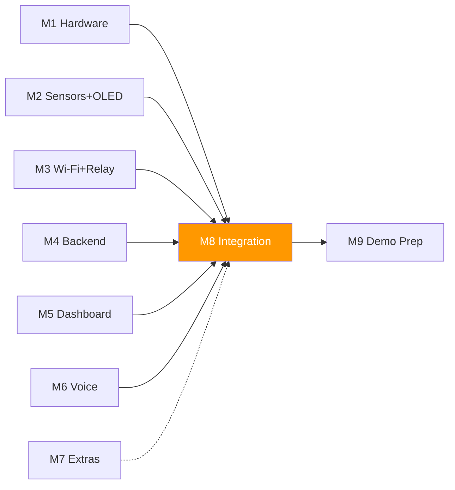

# Module M8: Integration & Testing

> **Owner:** Integration & Testing Lead (Person D)
> **Backup:** Everyone (all team members participate in integration testing)
> **Tier:** MUST — No module ships without integration verification
> **Timeline:** Week 3–4 (Nov 26 – Dec 11) · **Total: ~10 h**

---

## 1. Purpose

Wire **every module** together end-to-end and verify that each data path works correctly before the showcase. This module is the single gate between "modules work in isolation" and "the project works as a product."

Data paths to verify:

| # | Path | Direction | Modules touched |
|---|------|-----------|-----------------|
| A | Sensor → OLED | Local | M2 → M2 |
| B | Sensor → Backend → Dashboard | Cloud | M2 → M3 → M4 → M5 |
| C | Dashboard → Command → Relay | Cloud → HW | M5 → M4 → M3 → M1 |
| D | Voice → Backend → Command → Relay | Cloud → HW | M6 → M4 → M3 → M1 |
| E | Button → Relay | Local | M1 → M3 |
| F | Auto-threshold → Relay | Local | M2 → M3 |
| G | Offline mode: A + E + F work with no Wi-Fi | Local | M2 → M3 (no M4/M5/M6) |

---

## 2. Inputs / Outputs

### Inputs (what M8 consumes)

| Source | Artifact | Format |
|--------|----------|--------|
| M1 | Completed wired perfboard with all sensors, relay, OLED, buttons | Physical hardware |
| M2 | `firmware/desk-station/` — sensor reading + OLED code, compiles and runs | `.ino` + `.h/.cpp` |
| M3 | Firmware Wi-Fi, HTTP POST/GET, relay control, auto-threshold, command execution | `.ino` + `.h/.cpp` |
| M4 | Express backend deployed on Railway (or running locally), all endpoints working | `backend/` |
| M5 | Next.js dashboard deployed on Vercel (or running locally), shows data + command toggle | `dashboard/` |
| M6 | Vapi voice agent configured, webhook endpoint working | Vapi dashboard + `routes/vapi.js` |
| M7 | (Optional) Extras: RGB LED, buzzer, Telegram, Pomodoro — if built | `firmware/` + `backend/` |

### Outputs (what M8 produces)

| Artifact | Description | Delivered to |
|----------|-------------|--------------|
| `docs/integration-checklist.md` | Checklist with pass/fail for every test | Team + M9 |
| `docs/bug-log.md` | Bugs found, steps to reproduce, status (open / fixed) | Team |
| `docs/soak-test-report.md` | Results of 2-hour soak test | Team + M9 |
| Verified system | All MUST data paths working end-to-end | M9 (Demo Prep) |

---

## 3. Dependencies



| Dependency | Hard / Soft | Unblocking strategy |
|------------|-------------|---------------------|
| M3 firmware complete | Hard | Use `fake-esp32.py` (from `tools/mocks/`) to test backend + dashboard paths before real firmware is ready |
| M4 backend deployed | Hard | Use `fake-backend.py` to test firmware HTTP cycle before real backend is ready |
| M5 dashboard deployed | Hard | Test backend endpoints with curl / Postman first |
| M6 voice working | Soft | Voice is tested last; dashboard + button paths are higher priority |
| M7 extras | Soft | Only test extras if they exist. Not blocking integration pass |

> [!IMPORTANT]
> **Start integration testing as soon as ANY two adjacent modules are ready.** Don't wait for everything. Example: firmware + fake-backend can be tested in Week 2.

---

## 4. Task List

| # | Task | Est. Hours | When | Who | Deliverable |
|---|------|-----------|------|-----|-------------|
| T1 | Write integration checklist (all 9 tests below, with exact steps and expected results) | 0.5 h | Week 3, Day 1 | D | `docs/integration-checklist.md` |
| T2 | **First integration pass** — run through all 9 tests, record pass/fail | 2.0 h | Week 3, Day 2–3 | D + everyone | Annotated checklist |
| T3 | File bugs and fix — create bug entries, coordinate with module owners, verify fixes | 2.0 h | Week 3, Day 3–5 | D + affected owner | `docs/bug-log.md` |
| T4 | **Soak test** — run entire system for 2 hours straight, monitor for crashes / memory leaks / frozen OLED | 2.5 h (2 h passive + 0.5 h analysis) | Week 4, Day 1 | D | `docs/soak-test-report.md` |
| T5 | **Noise test** — play music nearby, try voice commands at 0.5 m / 1 m / 2 m distances | 0.5 h | Week 4, Day 1 | D + A | Notes in soak test report |
| T6 | **Judge simulation** — run the full 3-minute demo script 5 times consecutively, check for flakiness | 1.5 h | Week 4, Day 2–3 | D + everyone | Pass/fail log per run |
| T7 | **Regression test** — re-run full checklist after all bug fixes from T3/T6 | 1.0 h | Week 4, Day 3–4 | D | Final checklist (all green) |
| | **Total** | **~10 h** | Week 3–4 | | |

> [!NOTE]
> The soak test (T4) is mostly passive — set it up, let it run, check every 30 minutes. Use the time to work on M9 or fix bugs.

---

## 5. Integration Test Procedure

### Test 1: Cold Start Test

**Goal:** System boots from power-off to fully operational.

| Step | Action | Expected Result | Max Time |
|------|--------|----------------|----------|
| 1.1 | Plug in USB power to ESP32 | Blue LED on ESP32 lights up | Immediate |
| 1.2 | Watch Serial Monitor (115200 baud) | "Desk Station ready." printed, no crash dump | 5 s |
| 1.3 | Watch OLED | Sensor data appears (temp, humidity, air quality) | 5 s |
| 1.4 | Watch OLED Wi-Fi indicator | "Wi-Fi: OK" appears | 10 s |
| 1.5 | Open dashboard in browser | Live sensor data appears on dashboard | 15 s from power-on |
| 1.6 | Compare OLED temp with dashboard temp | Values match (within 1 reading cycle — 5 s lag) | 10 s |

**Pass criterion:** OLED shows data within 5 s of boot; dashboard shows data within 15 s of boot.

---

### Test 2: Voice Command Test

**Goal:** Voice command reaches ESP32 and toggles relay.

| Step | Action | Expected Result | Max Time |
|------|--------|----------------|----------|
| 2.1 | Open voice page in browser (Chrome, mic permission granted) | Vapi widget visible, microphone active | — |
| 2.2 | Say clearly: "Turn the fan on" | Vapi transcribes and calls `set_relay` tool | 3 s |
| 2.3 | Wait for relay to click | Relay physically clicks, fan turns on | 5 s from speech |
| 2.4 | Check OLED | "Fan: ON" displayed | Next OLED refresh (2 s) |
| 2.5 | Check dashboard | Relay toggle shows ON | Next poll cycle (3 s) |
| 2.6 | Say: "What's the temperature?" | Vapi speaks current temperature aloud | 5 s |
| 2.7 | Say: "Turn the fan off" | Relay clicks off | 5 s |

**Pass criterion:** Relay toggles within 5 seconds of voice command. Vapi speaks sensor data correctly.

---

### Test 3: Dashboard Command Test

**Goal:** Dashboard toggle reaches ESP32 and toggles relay.

| Step | Action | Expected Result | Max Time |
|------|--------|----------------|----------|
| 3.1 | Open dashboard on laptop | Live data visible | — |
| 3.2 | Click "Fan ON" toggle | Toggle shows "Pending..." | Immediate |
| 3.3 | Wait for relay to click | Relay physically clicks, fan turns on | 5 s |
| 3.4 | Check OLED | "Fan: ON" displayed | 2 s |
| 3.5 | Check dashboard | Toggle shows ON, "Pending..." gone | 5 s |
| 3.6 | Click "Fan OFF" toggle | Relay clicks off within 5 s | 5 s |

**Pass criterion:** Relay toggles within 5 seconds of dashboard click.

---

### Test 4: Button Test

**Goal:** Physical button toggles relay instantly.

| Step | Action | Expected Result | Max Time |
|------|--------|----------------|----------|
| 4.1 | Ensure relay is OFF | OLED shows "Fan: OFF" | — |
| 4.2 | Press Button 1 (GPIO13) once firmly | Relay clicks ON instantly | < 200 ms |
| 4.3 | Check OLED | "Fan: ON" displayed | 2 s |
| 4.4 | Check dashboard | Relay state updates to ON | 5 s |
| 4.5 | Press Button 1 again | Relay clicks OFF instantly | < 200 ms |
| 4.6 | Rapidly press 5 times | Relay toggles exactly 5 times (no bounce) | 5 s |

**Pass criterion:** Each button press toggles relay exactly once. Dashboard updates within 5 seconds.

---

### Test 5: Auto-Threshold Test

**Goal:** Relay turns on automatically when temperature exceeds 30 °C.

| Step | Action | Expected Result | Max Time |
|------|--------|----------------|----------|
| 5.1 | Ensure auto mode is ON (check OLED: "Auto: ON") | — | — |
| 5.2 | Note current temperature on OLED | Baseline temp (likely 25–28 °C) | — |
| 5.3 | Use hairdryer on low or cup hands around DHT22 | Temperature starts rising on OLED | 10 s |
| 5.4 | Watch for relay click when temp crosses 30 °C | Relay clicks ON automatically | When temp > 30 °C |
| 5.5 | Remove heat source | Temperature starts dropping | 30 s |
| 5.6 | Watch for relay click when temp drops below 28 °C | Relay clicks OFF (hysteresis at 28 °C) | When temp < 28 °C |

**Pass criterion:** Relay turns ON above 30 °C and OFF below 28 °C automatically. 2 °C hysteresis prevents oscillation.

> [!TIP]
> If you can't reach 30 °C easily, temporarily lower `TEMP_ON_THRESHOLD` in `config.h` to 27 °C and `TEMP_OFF_THRESHOLD` to 25 °C for testing. **Change it back before demo!**

---

### Test 6: Offline Test

**Goal:** Core functionality works without Wi-Fi.

| Step | Action | Expected Result | Max Time |
|------|--------|----------------|----------|
| 6.1 | Verify system is running normally (Wi-Fi connected, dashboard updating) | Baseline working state | — |
| 6.2 | Disconnect Wi-Fi: turn off phone hotspot or unplug router | ESP32 built-in LED turns OFF | 10 s |
| 6.3 | Check OLED | "Wi-Fi: ✗" or "OFFLINE" displayed; sensor data still updating | 2 s |
| 6.4 | Read DHT22 values on OLED | Temperature and humidity still refresh every 2 s | 5 s |
| 6.5 | Press Button 1 | Relay toggles instantly | < 200 ms |
| 6.6 | Warm DHT22 above threshold | Auto-threshold still triggers relay | — |
| 6.7 | Check Serial Monitor | "POST failed" or "Wi-Fi not connected" messages (expected) | — |
| 6.8 | Check dashboard | "Device offline" or "Connecting..." badge shown | 60 s |
| 6.9 | Re-enable Wi-Fi: turn hotspot back on | ESP32 reconnects, built-in LED turns ON | 15 s |
| 6.10 | Check dashboard | Data flow resumes, new readings appear | 10 s after reconnect |

**Pass criterion:** Sensors, OLED, button, and auto-threshold all work without Wi-Fi. Data flow resumes automatically after reconnect.

---

### Test 7: Soak Test (2 Hours)

**Goal:** System runs continuously without crashes, memory leaks, or frozen OLED.

**Setup:**
1. Power on ESP32, connect Wi-Fi, open dashboard
2. Start a timer for 2 hours
3. Open Serial Monitor and leave it recording

**Check every 30 minutes:**

| Time | Check | What to look for |
|------|-------|-----------------|
| T+0 min | Baseline | Record: free heap memory (`ESP.getFreeHeap()`), temp, relay state |
| T+30 min | OLED alive? | Display updating? Not frozen? |
| | Serial Monitor | Any crash dumps (guru meditation errors)? Any watchdog timer resets? |
| | Dashboard | Still showing data? No "Connecting..." banner? |
| | Free heap | Compare to baseline — should not drop more than 10 KB |
| T+60 min | Same checks | Plus: send one voice command, one dashboard command |
| T+90 min | Same checks | Plus: press button, verify relay toggles |
| T+120 min | Final check | All checks above. Record final free heap. Calculate memory drift |

**Analysis (30 min after soak):**
- Compare initial vs final heap: if free heap decreased by > 20 KB, there is a memory leak → find it
- Count total Serial errors: how many HTTP failures? How many were transient (recovered)?
- Count OLED freezes: if any, investigate display update code
- Count ESP32 reboots: should be ZERO

**Pass criterion:** Zero crashes, zero reboots, heap drift < 20 KB, OLED never frozen, dashboard never permanently disconnected.

> [!TIP]
> Add `Serial.printf("Free heap: %d bytes\n", ESP.getFreeHeap());` to your sensor read cycle to track memory continuously.

---

### Test 8: Noise Test

**Goal:** Voice commands work with ambient noise.

| Step | Action | Expected Result |
|------|--------|----------------|
| 8.1 | Quiet room: say "Turn the fan on" from 0.5 m | Works |
| 8.2 | Quiet room: say it from 1 m | Works |
| 8.3 | Quiet room: say it from 2 m | May or may not work — note distance limit |
| 8.4 | Play music at moderate volume (phone speaker) | Try voice command — note if it works |
| 8.5 | Crowded room simulation: have teammates talk nearby | Try voice command — note if it works |

**Record:** For each scenario, note: worked / partially worked / failed. Determine **minimum reliable distance** and **maximum ambient noise level**.

**Pass criterion:** Voice commands work reliably at 0.5 m in a moderately noisy environment (typical showcase hall). If not, the fallback ladder (M9) covers this.

---

### Test 9: Judge Simulation

**Goal:** The full 3-minute demo runs flawlessly 5 times in a row.

| Run # | Start the demo script (M9) | Record issues |
|-------|-----------------------------|---------------|
| Run 1 | Full 3-minute demo as scripted | Note: any relay that didn't click, any voice timeout, any dashboard lag |
| Run 2 | Full demo | Reset relay to OFF before starting |
| Run 3 | Full demo | — |
| Run 4 | Full demo | Try from a different angle (simulating different judge position) |
| Run 5 | Full demo | This must be perfect |

**Between runs:**
- Reset relay to OFF state
- Verify OLED shows fresh data
- Verify dashboard is responsive
- Clear any pending commands

**Pass criterion:** 5 consecutive successful runs. Zero relay failures. Voice works ≥ 4 out of 5 runs. Dashboard works 5/5.

---

## 6. Files & Folders

```
docs/
├── integration-checklist.md   # Checklist with pass/fail (T1 output)
├── bug-log.md                 # Bugs found during integration (T3)
└── soak-test-report.md        # 2-hour soak test results (T4)

tools/mocks/
├── fake-esp32.py              # Already exists — used for early testing
└── fake-backend.py            # Already exists — used for early testing
```

---

## 7. Acceptance Criteria

| # | Criterion | Verified by |
|---|-----------|-------------|
| AC1 | All 9 integration tests have been run at least once | Completed `integration-checklist.md` |
| AC2 | All MUST-tier tests (1–7) pass | Checklist shows ✅ for tests 1–7 |
| AC3 | Soak test ran for ≥ 2 hours with zero crashes | `soak-test-report.md` |
| AC4 | Judge simulation completed 5 consecutive successful runs | Run log in checklist |
| AC5 | All critical bugs are fixed and regression-tested | `bug-log.md` shows all critical bugs as "fixed" |
| AC6 | Noise test completed and fallback plan updated if needed | Notes in test report |

---

## 8. Risks & Mitigations

| Risk | Likelihood | Impact | Mitigation |
|------|-----------|--------|------------|
| ESP32 and backend JSON formats don't match (field names, types) | Medium | High — data doesn't flow | Test early with `fake-esp32.py`. Freeze JSON schema in `01-interface-contracts.md` by Day 3. Both sides validate against the same spec |
| Wi-Fi drops during demo | Medium | High — voice and dashboard stop | Test offline mode thoroughly (Test 6). Bring backup phone hotspot. Practice the fallback ladder |
| MQ-135 not warmed up at showcase | Low | Medium — air quality reads "good" always | Add to setup checklist: power on MQ-135 30 min before judges. Consider pre-warming at home |
| ESP32 runs out of heap memory after many HTTP cycles | Low | High — crash during demo | Monitor with `ESP.getFreeHeap()` during soak test. Fix any leaks found. Reboot ESP32 before showcase if needed |
| Voice works in quiet lab but not in noisy showcase hall | Medium | Medium — voice demo fails | Noise test (Test 8). Fallback: push-to-talk button or typed command. Have judge lean closer to mic |
| Relay oscillates on auto-threshold (temp hovers at 30 °C) | Low | Low — annoying clicking | Hysteresis already built in (30 °C on / 28 °C off). Verify in Test 5 |
| Different team members' code has conflicting pin usage | Low | High — hardware conflict | All pins defined in `hardware/pin-map.md` and `config.h`. M8 verifies no conflicts |
| Dashboard shows stale data (SWR cache issue) | Low | Medium — judges see old readings | Verify SWR `refreshInterval: 3000` is working. Hard refresh browser before demo |
