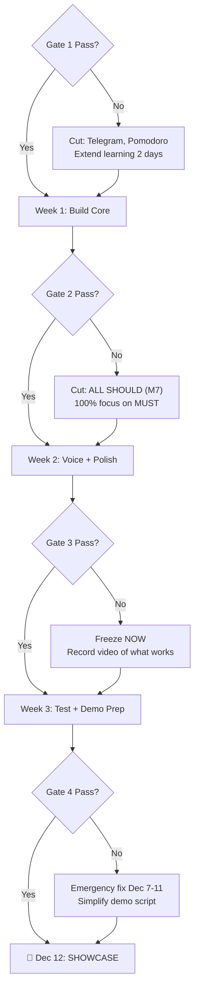

# Gates — End-of-Week Checkpoints

Each gate is a go/no-go moment. If the gate is missed, specific features get cut to protect the demo deadline.

---

## Gate 1 — Nov 15 (Sunday evening, end of Week 0)

### Must Be Working

| # | Check | Demonstrated by | Pass? |
|---|-------|-----------------|-------|
| 1 | All 4 team members can flash code to ESP32 | Everyone uploads blink sketch | ☐ |
| 2 | DHT22 reads temperature + humidity (not NaN) | B shows Serial Monitor | ☐ |
| 3 | OLED displays text | B shows "Hello" on OLED | ☐ |
| 4 | Backend accepts POST /api/sensor-data and stores it | A runs curl, checks DB | ☐ |
| 5 | fake-esp32.py sends data to backend successfully | D demonstrates | ☐ |
| 6 | Breadboard prototype has all components wired | C shows breadboard | ☐ |
| 7 | GitHub repo exists, everyone can push to a branch | Everyone pushes a test commit | ☐ |

### If Missed

- **Extend learning to Nov 18 (Tue)**. Use weekday evenings to catch up.
- **Cut:** Telegram bot, Pomodoro timer — these are the lowest-priority SHOULD features.
- **Risk:** If someone can't install Arduino IDE: pair-program on someone else's machine. If ESP32 doesn't connect: try different USB cable, install correct driver (CP2102 or CH340).

---

## Gate 2 — Nov 22 (Sunday evening, end of Week 1)

### Must Be Working

| # | Check | Demonstrated by | Pass? |
|---|-------|-----------------|-------|
| 1 | ESP32 sends REAL sensor data to Railway backend every 5 s | B + A verify: Serial Monitor + Railway logs | ☐ |
| 2 | Dashboard shows live temp, humidity, air quality | A shows laptop screen | ☐ |
| 3 | Relay toggles via physical button | C presses button, relay clicks | ☐ |
| 4 | Relay toggles via dashboard toggle | A clicks toggle, relay clicks within 5 s | ☐ |
| 5 | Auto-threshold: temp > 30°C → relay ON | B warms sensor, relay activates | ☐ |
| 6 | Perfboard assembly complete and tested | C shows multimeter continuity | ☐ |
| 7 | Backend deployed on Railway with stable URL | A shows Railway dashboard | ☐ |

### If Missed

- **This is the most critical gate.** If the core data path doesn't work, voice won't work either.
- **Cut:** ALL SHOULD-tier features (M7 entirely). Focus 100% on the 8 MUST items.
- **Recovery:** Identify WHICH link in the chain is broken (ESP32 side? Network? Backend? Dashboard?) and fix that one thing. The Integration Lead (D) drives debugging.
- **Emergency plan:** If perfboard fails, revert to breadboard for demo (less pretty but functional).

---

## Gate 3 — Nov 29 (Sunday evening, end of Week 2) → Triggers Feature Freeze

### Must Be Working

| # | Check | Demonstrated by | Pass? |
|---|-------|-----------------|-------|
| 1 | Voice: "Turn the fan on" → relay toggles within 5 s | A speaks, relay clicks | ☐ |
| 2 | Voice: "What's the temperature?" → spoken reply | A speaks, hears answer | ☐ |
| 3 | Dashboard: gauges + toggle + history chart | A shows laptop | ☐ |
| 4 | ALL 8 MUST features pass acceptance test | D runs checklist | ☐ |
| 5 | At least RGB LED working from SHOULD tier | C breathes on MQ-135, LED changes colour | ☐ |
| 6 | Push-to-talk and typed command fallbacks work | A demonstrates both | ☐ |

### If Missed

- **Freeze immediately** — whatever is working as of Nov 29, that is the demo.
- **Cut:** Any SHOULD feature not yet working. Don't spend time on half-finished features.
- **Focus:** Record a demo video of whatever works. Polish what exists.
- **If voice doesn't work:** The typed command fallback + physical buttons is still a good demo. Many IoT projects don't have voice at all.

---

## Gate 4 — Dec 6 (Sunday evening, end of Week 3) → Hard Freeze & Demo Ready

### Must Be Working

| # | Check | Demonstrated by | Pass? |
|---|-------|-----------------|-------|
| 1 | 2-hour soak test passed: no crash, no memory leak | D presents test log | ☐ |
| 2 | Offline test passed: disconnect Wi-Fi → local works → reconnect → resumes | B demonstrates | ☐ |
| 3 | Demo rehearsed 3× times, each under 3 minutes | All team, D times it | ☐ |
| 4 | Fallback video recorded and plays correctly | D shows video | ☐ |
| 5 | Packing list complete and checked | D shows list | ☐ |
| 6 | Enclosure built and labelled | C shows enclosure | ☐ |

### If Missed

- **Emergency mode Dec 7-11:** Focus exclusively on what failed.
- If soak test fails: find the crash, add a watchdog timer or just plan to restart ESP32 between demo runs.
- If demo rehearsal fails: simplify the script. Cut sections that are flaky.
- If fallback video not recorded: record it Dec 7-9 (evenings).
- If enclosure not done: demo without enclosure. Neat breadboard is OK.

---

## Decision Framework

