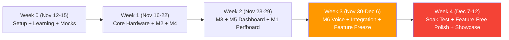

# Day-by-Day Schedule

> **Start:** Nov 12, 2026 (Thu) · **Showcase:** Dec 12, 2026 (Sat) · **Feature Freeze:** Dec 6 (Sun) · **Feature-Free Window:** Dec 9–12 (last 4 days)
>
> **Weekly Capacity per Person:** **5–6 h group work** (Fri, Sat, Sun after classes) + **2–3 h home work** (Mon–Thu evenings) = **7–9 h / week** (~34–38 h total across 4.3 weeks).
> **Rule:** Never plan more hours than the team has. M7 (Extras) uses only remaining buffer after MUST items pass Gate 2.

---

## Summary Gantt

---

## Week 0 — Kickoff, Mocks & Learning (Nov 12–15)

*Goal: Everyone unblocked on Day 1; repo, mock scripts, and basic breadboard/ESP32 blink + DHT22 working.*
*Weekly budget: 7–8 h / person (1.5 h home + 6 h Fri–Sun group).*

| Day | Person A (Cloud & Voice) | Person B (Firmware) | Person C (Hardware) | Person D (Integration) |
|-----|--------------------------|---------------------|---------------------|------------------------|
| **Thu Nov 12** *(Home, 1.5 h)* | Init `backend/` Node project + Prisma SQLite schema (**M4**, 1.5 h) | Install Arduino IDE + ESP32 board + Blink LED Ex 0–1 (**Ex**, 1.5 h) | Buy/inventory BOM parts; verify both ESP32 USB ports (**M1**, 1.5 h) | Create GitHub repo, `.gitignore`, folder tree, branch rules (**M0**, 1.5 h) |
| **Fri Nov 13** *(Free Day — Group, 2.5 h)* | Scaffold Express routes + API key auth middleware (**M4**, 2.5 h) | Ex 2–3: Serial + DHT22 read on breadboard (**M2**, 2.5 h) | Build breadboard: ESP32 + DHT22 + OLED wiring (**M1**, 2.5 h) | Write `fake-esp32.py` + `fake-backend.py` (**M0**, 2.5 h) |
| **Sat Nov 14** *(Free Day — Group, 2 h)* | Implement `POST /api/sensor-data` + validation (**M4**, 2 h) | Ex 4–5: MQ-135 ADC + OLED Hello World (**M2**, 2 h) | Build MQ-135 voltage divider (1k+1.5k); multimeter verify ≤3.0 V (**M1**, 2 h) | Test `fake-esp32.py` → `fake-backend.py`; clone repo on all 4 laptops (**M0**, 2 h) |
| **Sun Nov 15** *(After classes — Group, 1.5 h)* | Implement `GET /api/commands` + `POST /api/commands/ack` (**M4**, 1.5 h) | Ex 6–8: Button debounce + Relay toggle (**M3**, 1.5 h) | Wire relay + buttons + RGB + buzzer on breadboard (**M1**, 1.5 h) | Verify `fake-esp32.py` → A's real backend (**M8**, 1.5 h) |

**Week 0 Totals:** A = 7.5 h · B = 7.5 h · C = 7.5 h · D = 7.5 h *(5.5–6 h group + 1.5 h home)*

### 🚦 Gate 1 Check (Sun Nov 15 evening)
- Repo cloned on all 4 OSes (Mac, Ubuntu, 2× Windows); `fake-esp32.py` posts to Express backend.
- Breadboard has DHT22 + OLED + voltage divider (≤ 3.0 V verified); ESP32 reads DHT22 without `NaN`.
- **If missed:** Cut Pomodoro & Telegram immediately; use Mon–Tue home hours to catch up.

---

## Week 1 — Core Sensing, Backend & Perfboard (Nov 16–22)

*Goal: ESP32 reads all sensors onto OLED (offline), backend deployed on Railway, perfboard soldered.*
*Weekly budget: 8–8.5 h / person (2.5 h home + 5.5–6 h Fri–Sun group).*

| Day | Person A (Cloud & Voice) | Person B (Firmware) | Person C (Hardware) | Person D (Integration) |
|-----|--------------------------|---------------------|---------------------|------------------------|
| **Mon–Thu Nov 16–19** *(Home, 2.5 h total)* | Implement `GET /api/dashboard/current`, `/history`, `POST /command`; test with curl (**M4**, 2.5 h) | Write `sensors.cpp` + `display.cpp` (2 s non-blocking OLED refresh + NaN fallback) (**M2**, 2.5 h) | Draw perfboard layout; plan component spacing & cable exits (**M1**, 2.5 h) | Expand `fake-esp32.py` edge-case tests + write `test-vapi-call.sh` (**M0/M8**, 2.5 h) |
| **Fri Nov 20** *(Free Day — Group, 2.5 h)* | Deploy Express + MySQL to Railway; run `prisma migrate deploy` (**M4**, 2.5 h) | Ex 9–11: Wi-Fi connect + HTTP POST/GET against `fake-backend.py` (**M3**, 2.5 h) | Solder ESP32 headers, voltage divider & sensors onto perfboard (**M1**, 2.5 h) | Test Railway endpoints with `fake-esp32.py`; verify MySQL rows (**M8**, 2.5 h) |
| **Sat Nov 21** *(Free Day — Group, 2 h)* | Scaffold Next.js dashboard + `SensorGauge` with 3 s SWR poll (**M5**, 2 h) | Integrate `network.cpp` + `relay.cpp` + `commands.cpp` non-blocking loop (**M3**, 2 h) | Solder relay, buttons, RGB LED, buzzer onto perfboard; continuity check (**M1**, 2 h) | Assist B with first live ESP32 → Railway HTTP cycle (**M8**, 2 h) |
| **Sun Nov 22** *(After classes — Group, 1.5 h)* | Add `RelayToggle` + `StatusBar` to Next.js dashboard (**M5**, 1.5 h) | Implement auto-threshold (30°C ON / 28°C OFF) + sticky button override (**M3**, 1.5 h) | Flash M2+M3 firmware onto perfboard; test fan switching (**M1**, 1.5 h) | Run Gate 2 checklist: button, dashboard toggle, auto-threshold (**M8**, 1.5 h) |

**Week 1 Totals:** A = 8.5 h · B = 8.5 h · C = 8.5 h · D = 8.5 h *(6 h group + 2.5 h home)*

### 🚦 Gate 2 Check (Sun Nov 22 evening)
- Real ESP32 on perfboard posts sensor readings to Railway every 5 s.
- Next.js dashboard displays live readings and toggles relay within 5 s.
- Physical button and auto-threshold (> 30°C) toggle relay.
- **If missed:** Cut ALL of M7 (Extras). Week 2 focuses 100% on MUST stability.

---

## Week 2 — Dashboard Polish, Voice Integration & Offline Resilience (Nov 23–29)

*Goal: Full MUST scope working end-to-end (including Vapi voice + offline mode).*
*Weekly budget: 8–8.5 h / person (2.5 h home + 5.5–6 h Fri–Sun group).*

| Day | Person A (Cloud & Voice) | Person B (Firmware) | Person C (Hardware) | Person D (Integration) |
|-----|--------------------------|---------------------|---------------------|------------------------|
| **Mon–Thu Nov 23–26** *(Home, 2.5 h total)* | Build `HistoryChart` + deploy Next.js to Vercel + configure CORS (**M5**, 2.5 h) | Harden offline reconnect (10 s retry, built-in LED indicator, 3 s HTTP timeout) (**M3**, 2.5 h) | Start 24 h MQ-135 burn-in at home; record clean-air ADC baseline (**M1/M2**, 2.5 h) | Write integration test checklist + bug tracker doc (**M8**, 2.5 h) |
| **Fri Nov 27** *(Free Day — Group, 2 h)* | Create Vapi assistant, register tools (`get_sensor_data`, `set_relay`, `set_auto_mode`) (**M6**, 2 h) | Tune MQ-135 thresholds from C's baseline; fix OLED layout glitches (**M2/M3**, 2 h) | Wire/test RGB LED PWM (`ledcWrite`) + buzzer alert (if Gate 2 passed) (**M7**, 2 h) | Run end-to-end offline test (hotspot OFF → buttons/auto work → hotspot ON) (**M8**, 2 h) |
| **Sat Nov 28** *(Free Day — Group, 2 h)* | Implement `/api/vapi/webhook` + `VoicePanel` component (**M6**, 2 h) | Merge firmware fixes + test `ESP.getFreeHeap()` stability (**M3**, 2 h) | Build cardboard enclosure cutouts (OLED, buttons, MQ-135 airflow) (**M9**, 2 h) | Test all 9 integration paths end-to-end (**M8**, 2 h) |
| **Sun Nov 29** *(After classes — Group, 1.5 h)* | Build `TypedCommand` fallback UI + test voice → relay E2E (**M6**, 1.5 h) | Flash spare ESP32 with identical production firmware (**M3**, 1.5 h) | Cable management (zip ties, hot glue, component labels) (**M9**, 1.5 h) | Verify Gate 3; log all remaining bugs (**M8**, 1.5 h) |

**Week 2 Totals:** A = 8.0 h · B = 8.0 h · C = 8.0 h · D = 8.0 h *(5.5 h group + 2.5 h home)*

### 🚦 Gate 3 Check (Sun Nov 29 evening)
- Voice ("turn the fan on", "what's the temperature?") works end-to-end; `TypedCommand` fallback works.
- Dashboard deployed on Vercel with gauges, toggle, chart.
- All 8 MUST criteria verified on perfboard hardware.
- **If missed:** Freeze immediately on Dec 1; cut remaining M7 items (Telegram/To-Do/Pomodoro).

---

## Week 3 — Bug Fixes, Optional Extras & Feature Freeze (Nov 30–Dec 6)

*Goal: Fix all integration bugs, add optional SHOULD polish only if green, hit hard Feature Freeze on Dec 6.*
*Weekly budget: 7–8 h / person (2 h home + 5–6 h Fri–Sun group).*

| Day | Person A (Cloud & Voice) | Person B (Firmware) | Person C (Hardware) | Person D (Integration) |
|-----|--------------------------|---------------------|---------------------|------------------------|
| **Mon–Thu Nov 30–Dec 3** *(Home, 2 h total)* | Fix voice latency/prompt phrasing; optional To-Do UI (**M6/M7**, 2 h) | Fix any HTTP/JSON bugs from M8; optional Pomodoro timer (**M3/M7**, 2 h) | Finish component labels & enclosure trim (**M9**, 2 h) | Optional Telegram alert bot (only if MUST is 100% green) + draft demo script (**M7/M9**, 2 h) |
| **Fri Dec 4** *(Free Day — Group, 2 h)* | Verify Vapi credits & Railway logs under load (**M6**, 2 h) | Assist D with 2-hour soak test monitoring (**M8**, 2 h) | Final continuity & shake test on enclosure (**M1/M9**, 2 h) | Run **2-hour soak test** + **noise test** (music at 50% volume) (**M8**, 2 h) |
| **Sat Dec 5** *(Free Day — Group, 2 h)* | Record **fallback demo video** (OBS / Game Bar) with audio (**M9**, 2 h) | Patch any soak-test memory/watchdog findings (**M3**, 2 h) | Print/assemble A3 architecture poster (**M9**, 2 h) | Run **5× repeated judge simulation**; track timing (≤ 3 min) (**M8**, 2 h) |
| **Sun Dec 6** *(After classes — Group, 1.5 h)* | Final production deploy (Vercel + Railway env check) (**M4/M5**, 1.5 h) | Flash **final frozen firmware** to Primary + Spare ESP32 (**M3**, 1.5 h) | Final enclosure assembly (**M9**, 1.5 h) | Merge `dev → main`, tag `v1.0-freeze` (**M0/M9**, 1.5 h) |

### **🔒 HARD FEATURE FREEZE: Sunday Dec 6, 10:00 PM**
> Zero new features after Dec 6. All code on `main` is locked.

**Week 3 Totals:** A = 7.5 h · B = 7.5 h · C = 7.5 h · D = 7.5 h *(5.5 h group + 2 h home)*

### 🚦 Gate 4 Check (Sun Dec 6 evening)
- 2-hour soak test passed; 5× repeated runs passed; fallback video recorded and saved locally on Laptop 1.

---

## Week 4 — Feature-Free Verification & Showcase (Dec 7–12)

*Goal: Zero code changes on Dec 9–12 unless fixing a critical showstopper. Rehearse, pack, rest, execute.*
*Weekly budget: 5.5–6.5 h / person (1 h home + 4.5–5.5 h Fri–Sat).*

| Day | Person A | Person B | Person C | Person D |
|-----|----------|----------|----------|----------|
| **Mon–Tue Dec 7–8** *(Home, 1 h total)* | Verify fallback video + Chrome mic permissions (**M9**, 1 h) | Verify spare ESP32 boots & connects to demo hotspot (**M8**, 1 h) | Double-check packing list & power strip/cables (**M9**, 1 h) | Finalize `README.md` + print 2 copies of demo script (**M9**, 1 h) |
| **Wed–Thu Dec 9–10** *(FEATURE-FREE — 0.5 h)* | Hands off code! Check Railway health (`curl /api/health`) (0.5 h) | Hands off firmware! Charge hotspot phone/power bank (0.5 h) | Pack enclosure + tools into box (0.5 h) | Coordinate arrival time & transport (0.5 h) |
| **Fri Dec 11** *(Free Day — Group, 2 h — FEATURE-FREE)* | **Rehearsal #2 & #3** (all 4 members, timed ≤ 3 min) + full packing check (**M9**, 2 h) | Same (test cold start < 5 min) (2 h) | Same (pack spares & multimeter) (2 h) | Same (check off packing list) (2 h) |
| **Sat Dec 12** *(SHOWCASE DAY — 2 h setup + event)* | Arrive T-60 min; run T-30 check; operate voice & dashboard (**M9**, 2 h+) | Arrive T-60 min; hotspot & ESP32 watch; reset between judges (2 h+) | Arrive T-60 min; power on MQ-135 at T-50; press physical buttons (2 h+) | Arrive T-60 min; lead 3-min pitch for ~20 judge visits (2 h+) |

**Week 4 Totals:** A = 5.5 h · B = 5.5 h · C = 5.5 h · D = 5.5 h

---

## Total Planned Hours Per Person (Nov 12 – Dec 12)

| Person | Week 0 | Week 1 | Week 2 | Week 3 | Week 4 | **Total Planned** | **Available Capacity (~4.3 wks × 8.5 h)** | **Remaining Buffer** |
|--------|--------|--------|--------|--------|--------|-------------------|-------------------------------------------|----------------------|
| **A (Cloud & Voice)** | 7.5 h | 8.5 h | 8.0 h | 7.5 h | 5.5 h | **37.0 h** | ~37–39 h | ~1–2 h (+ M7 buffer) |
| **B (Firmware)** | 7.5 h | 8.5 h | 8.0 h | 7.5 h | 5.5 h | **37.0 h** | ~37–39 h | ~1–2 h (+ M7 buffer) |
| **C (Hardware)** | 7.5 h | 8.5 h | 8.0 h | 7.5 h | 5.5 h | **37.0 h** | ~37–39 h | ~1–2 h (+ M7 buffer) |
| **D (Integration)** | 7.5 h | 8.5 h | 8.0 h | 7.5 h | 5.5 h | **37.0 h** | ~37–39 h | ~1–2 h (+ M7 buffer) |

> [!NOTE]
> **How this stays inside your 7–9 h/week limit:**
> - **Group sessions (Fri/Sat/Sun):** 5.5–6.0 h/week (split cleanly into ~2 h Fri, ~2 h Sat, ~1.5 h Sun).
> - **Home sessions (Mon–Thu):** 1.5–2.5 h/week (~30–45 min/evening).
> - **Built-in schedule safety:** Week 3 includes ~2–4 h of optional M7 Extras; if any MUST task slips, dropping M7 immediately frees up those hours without delaying Feature Freeze (Dec 6) or the 4-day Feature-Free buffer (Dec 9–12).
