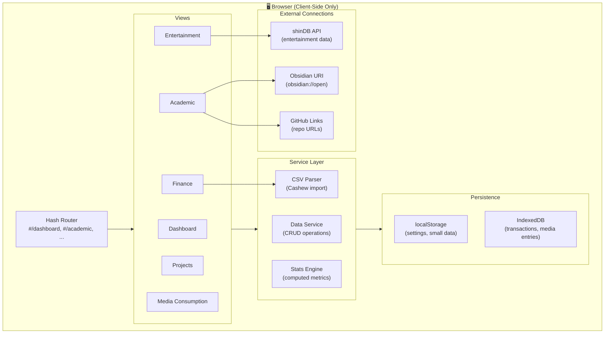

# 📋 Plan for Life OS — Product Requirements Document (PRD)

> **Version**: 1.0  
> **Author**: Tamim  
> **Date**: June 27, 2026  
> **Status**: Draft — Awaiting Review  
> **Design Reference**: [DESIGN.md](file:///d:/02_CODE/04_TEST/plan-for-life-os/DESIGN.md)

---

## Table of Contents

1. [Product Overview](#1-product-overview)
2. [Goals & Success Metrics](#2-goals--success-metrics)
3. [Target User](#3-target-user)
4. [Technical Architecture](#4-technical-architecture)
5. [Data Models](#5-data-models)
6. [Functional Requirements](#6-functional-requirements)
   - [6.0 Dashboard](#60-dashboard)
   - [6.1 Academic](#61-academic)
   - [6.2 Entertainment Tracking](#62-entertainment-tracking)
   - [6.3 Project Tracking](#63-project-tracking)
   - [6.4 Finance Tracking](#64-finance-tracking)
   - [6.5 Media Consumption](#65-media-consumption)
   - [6.6 Global Notes](#66-global-notes)
7. [Non-Functional Requirements](#7-non-functional-requirements)
8. [External Integrations](#8-external-integrations)
9. [Implementation Roadmap](#9-implementation-roadmap)
10. [Risks & Mitigations](#10-risks--mitigations)
11. [Out of Scope (v1)](#11-out-of-scope-v1)

---

## 1. Product Overview

### 1.1 What is it?
**Plan for Life OS** is a centralized personal command center — a single-page web application that consolidates academic tracking, entertainment logging, project management, financial analysis, and media consumption analytics into one premium, dark-themed dashboard.

### 1.2 Problem Statement
Life data is scattered across multiple apps and services:
- Academic schedules in notebooks/calendars
- Entertainment tracking in separate databases (shinDB)
- Project status in GitHub/Notion
- Finance data in Cashew app (CSV exports)
- Media consumption has no centralized tracking

There is no single place to see a unified view of all life operations, resulting in context switching and loss of overview.

### 1.3 Solution
A **self-hosted web application** that:
- Aggregates data from multiple sources (CSV imports, API connections, manual entry)
- Provides a unified dashboard with quick stats from every life domain
- Offers deep-dive views for each section with full CRUD operations
- Runs entirely client-side for privacy (no server, no cloud)
- Delivers a premium Notion-inspired dark UI with micro-animations

### 1.4 Core Principles

| Principle | Description |
|-----------|-------------|
| **Privacy First** | All data stays local. No external APIs for personal data. Finance data never leaves the browser. |
| **Single Source of Truth** | One dashboard to rule them all. Reduces app-switching to zero. |
| **Low Friction** | Quick actions, CSV imports, keyboard shortcuts. Data entry should feel effortless. |
| **Visual Excellence** | Premium dark theme, glassmorphism, smooth animations. It should feel like a $200/yr SaaS product. |
| **Offline Capable** | Works without internet. Data persisted in localStorage/IndexedDB. |

---

## 2. Goals & Success Metrics

### 2.1 Primary Goals

| Goal | Metric | Target |
|------|--------|--------|
| Unified life overview | Time to get full status check | < 10 seconds from opening dashboard |
| Financial awareness | Monthly spending visibility | See current month breakdown in 1 click |
| Academic organization | Assignment miss rate | Zero missed deadlines |
| Entertainment tracking | Data completeness | All ongoing media visible on dashboard |
| Project momentum | Progress visibility | All active projects with % visible at a glance |

### 2.2 Key Performance Indicators (KPIs)

- **Dashboard load time**: < 1.5 seconds on first load
- **CSV import time**: < 2 seconds for 1,500+ row Cashew export
- **Page navigation**: < 200ms between sections (client-side routing)
- **Data entry**: Any new item can be added in < 3 clicks

---

## 3. Target User

### User Persona: Tamim

| Attribute | Detail |
|-----------|--------|
| **Role** | University student |
| **Location** | Dhaka, Bangladesh |
| **Currency** | BDT (৳) |
| **Devices** | Desktop (primary), mobile (secondary) |
| **Tech Stack** | Uses Obsidian for notes, GitHub for code, Cashew for finance, shinDB for entertainment |
| **Pain Point** | Data spread across 5+ apps with no unified view |
| **Goal** | One dashboard to track academics, money, projects, entertainment, and media |

### User Behavior Patterns
- Logs expenses in Cashew daily, exports CSV periodically
- Tracks anime/series/games in shinDB
- Uses Obsidian for academic notes
- Has active projects on GitHub (shinDB, VOX Agent, e-commerce)
- Receives income from family (Mother, Father, APU, Fahima) and savings interest

---

## 4. Technical Architecture

### 4.1 Stack Decision

| Layer | Technology | Rationale |
|-------|------------|-----------|
| **Markup** | HTML5 | Semantic, accessible |
| **Styling** | Vanilla CSS | Full control, no dependencies, CSS custom properties for theming |
| **Logic** | Vanilla JavaScript (ES modules) | No framework overhead, fast load, full control |
| **Fonts** | Google Fonts (Outfit, Inter, JetBrains Mono) | Premium typography |
| **Storage** | localStorage + IndexedDB | Client-side persistence, offline capable |
| **CSV Parsing** | Custom parser (no library) | Cashew CSV has multi-line notes in quoted fields |
| **Charts** | Canvas API or lightweight library (Chart.js) | For finance charts, heatmaps |
| **Routing** | Hash-based SPA routing | No server needed, works with file:// protocol |

### 4.2 Architecture Diagram



### 4.3 File Structure

```
plan-for-life-os/
├── index.html                    # Single entry point
├── css/
│   ├── index.css                 # Design system tokens, global styles
│   ├── components.css            # Shared component styles (cards, buttons, tables)
│   ├── dashboard.css             # Dashboard-specific styles
│   ├── academic.css              # Academic section styles
│   ├── entertainment.css         # Entertainment section styles
│   ├── projects.css              # Projects section styles
│   ├── finance.css               # Finance section styles
│   └── media.css                 # Media consumption styles
├── js/
│   ├── app.js                    # Main entry, router initialization
│   ├── router.js                 # Hash-based SPA router
│   ├── store.js                  # Central data store (IndexedDB + localStorage)
│   ├── components/
│   │   ├── sidebar.js            # Navigation sidebar component
│   │   ├── topbar.js             # Top bar (search, date, profile)
│   │   ├── modal.js              # Reusable modal component
│   │   ├── toast.js              # Toast notification component
│   │   └── charts.js             # Chart rendering utilities
│   ├── views/
│   │   ├── dashboard.js          # Dashboard view
│   │   ├── academic.js           # Academic view (with sub-tabs)
│   │   ├── entertainment.js      # Entertainment view
│   │   ├── projects.js           # Projects view
│   │   ├── finance.js            # Finance view
│   │   └── media.js              # Media consumption view
│   ├── services/
│   │   ├── csv-parser.js         # Cashew CSV parser
│   │   ├── stats.js              # Stats calculation engine
│   │   ├── shindb-connector.js   # shinDB API connector
│   │   └── export.js             # Data export utilities
│   └── utils/
│       ├── date.js               # Date formatting utilities
│       ├── currency.js           # BDT currency formatting
│       └── dom.js                # DOM helper utilities
├── data/
│   └── cashew-*.csv              # Imported Cashew exports
├── assets/
│   ├── icons/                    # SVG icons (or emoji fallback)
│   └── images/                   # Any static images
└── DESIGN.md                     # Design document
```

### 4.4 Routing Map

| Route | View | Description |
|-------|------|-------------|
| `#/` or `#/dashboard` | Dashboard | Main command center |
| `#/academic` | Academic | Default to Tracker tab |
| `#/academic/tracker` | Academic > Tracker | Exams, Classes, Assignments |
| `#/academic/materials` | Academic > Materials | Material grid with filters |
| `#/academic/notes` | Academic > Notes | Scanned + Obsidian notes |
| `#/academic/codes` | Academic > Codes | GitHub integration |
| `#/entertainment` | Entertainment | Media grid with filters |
| `#/entertainment/:id` | Entertainment Detail | Modal overlay for media item |
| `#/projects` | Projects | Gallery view (default) |
| `#/projects/:id` | Project Detail | Detail page with tabs |
| `#/finance` | Finance | Monthly overview |
| `#/media` | Media Consumption | Analytics dashboard |
| `#/notes` | Global Notes | Scratch pad |
| `#/settings` | Settings | Configuration |

---

## 5. Data Models

### 5.1 Academic Data

#### Exam

```json
{
  "id": "exam_uuid",
  "subject": "Data Structures",
  "syllabus": "Ch 1-8, Trees, Graphs, Sorting",
  "date": "2026-07-15",
  "result": null,
  "maxResult": 4.0,
  "status": "pending",
  "notes": "",
  "createdAt": "2026-06-20T10:00:00Z",
  "updatedAt": "2026-06-20T10:00:00Z"
}
```

| Field | Type | Required | Constraints |
|-------|------|----------|-------------|
| `id` | string (UUID) | auto | Unique identifier |
| `subject` | string | ✅ | Max 100 chars |
| `syllabus` | string | ❌ | Free text, supports markdown |
| `date` | ISO date string | ✅ | Future or past date |
| `result` | number \| null | ❌ | Null = pending, number = grade |
| `maxResult` | number | ❌ | Default 4.0 (GPA scale) |
| `status` | enum | auto | `pending` \| `completed` (derived from result) |
| `notes` | string | ❌ | Free text |

#### Class

```json
{
  "id": "class_uuid",
  "subject": "Algorithms",
  "dayOfWeek": 1,
  "startTime": "10:00",
  "endTime": "11:30",
  "room": "Room 302",
  "color": "#60A5FA",
  "isActive": true,
  "createdAt": "2026-06-01T10:00:00Z"
}
```

| Field | Type | Required | Constraints |
|-------|------|----------|-------------|
| `id` | string (UUID) | auto | Unique identifier |
| `subject` | string | ✅ | Max 100 chars |
| `dayOfWeek` | number | ✅ | 0 (Sun) - 6 (Sat) |
| `startTime` | string (HH:mm) | ✅ | 24-hour format |
| `endTime` | string (HH:mm) | ✅ | Must be after startTime |
| `room` | string | ❌ | Max 50 chars |
| `color` | hex string | ❌ | Default assigned from palette |
| `isActive` | boolean | ❌ | Default true, false = archived |

#### Assignment

```json
{
  "id": "assign_uuid",
  "subject": "Operating Systems",
  "topic": "OS Lab Report",
  "deadline": "2026-07-01",
  "completed": false,
  "completedAt": null,
  "priority": "medium",
  "notes": "",
  "createdAt": "2026-06-20T10:00:00Z"
}
```

| Field | Type | Required | Constraints |
|-------|------|----------|-------------|
| `id` | string (UUID) | auto | Unique identifier |
| `subject` | string | ✅ | Max 100 chars |
| `topic` | string | ✅ | Max 200 chars |
| `deadline` | ISO date string | ✅ | Date only |
| `completed` | boolean | ❌ | Default false |
| `completedAt` | ISO datetime \| null | auto | Set when completed = true |
| `priority` | enum | ❌ | `low` \| `medium` \| `high` |
| `notes` | string | ❌ | Free text |

#### Material

```json
{
  "id": "mat_uuid",
  "title": "DSA Lecture 5",
  "type": "lecture_sheet",
  "subject": "Data Structures",
  "fileName": "dsa_lec5.pdf",
  "fileSize": 2048576,
  "filePath": "",
  "uploadedAt": "2026-06-20T10:00:00Z",
  "tags": ["trees", "binary-search"]
}
```

| Field | Type | Required | Constraints |
|-------|------|----------|-------------|
| `type` | enum | ✅ | `lecture_sheet` \| `book` \| `notes` \| `previous_question` \| `source_material` |
| `subject` | string | ✅ | Max 100 chars |
| `fileName` | string | ✅ | Original file name |
| `filePath` | string | ❌ | Local file path or blob URL |
| `tags` | string[] | ❌ | Searchable tags |

#### PersonalNote

```json
{
  "id": "note_uuid",
  "title": "Math Ch3 Solution",
  "source": "scanned",
  "subject": "Mathematics",
  "imageUrl": "blob:...",
  "obsidianUri": null,
  "createdAt": "2026-06-22T10:00:00Z"
}
```

| Field | Type | Required | Constraints |
|-------|------|----------|-------------|
| `source` | enum | ✅ | `scanned` \| `digital` |
| `imageUrl` | string \| null | conditional | Required if source = scanned |
| `obsidianUri` | string \| null | conditional | Obsidian URI if source = digital |

---

### 5.2 Entertainment Data

#### MediaEntry

```json
{
  "id": "media_uuid",
  "title": "Solo Leveling",
  "type": "anime",
  "status": "ongoing",
  "score": 8.5,
  "progress": {
    "current": 8,
    "total": 12,
    "unit": "episodes"
  },
  "season": "S2",
  "coverUrl": "https://...",
  "startedAt": "2026-05-12",
  "completedAt": null,
  "watchtime": 192,
  "notes": "Great animation quality. Shadow monarch arc is peak.",
  "shindbId": "ext_12345",
  "updatedAt": "2026-06-27T10:00:00Z"
}
```

| Field | Type | Required | Constraints |
|-------|------|----------|-------------|
| `type` | enum | ✅ | `anime` \| `anime_movie` \| `series` \| `movie` \| `manga` \| `pc_game` \| `mobile_game` |
| `status` | enum | ✅ | `completed` \| `ongoing` \| `plan_to_consume` \| `dropped` \| `on_hold` |
| `score` | number \| null | ❌ | 0.0 - 10.0, step 0.5 |
| `progress.current` | number | ❌ | Current episode/chapter/hours |
| `progress.total` | number \| null | ❌ | Null if unknown (e.g., ongoing games) |
| `progress.unit` | enum | ❌ | `episodes` \| `chapters` \| `hours` \| `movies` |
| `watchtime` | number | ❌ | Total minutes consumed |
| `shindbId` | string \| null | ❌ | External ID for shinDB sync |

---

### 5.3 Project Data

#### Project

```json
{
  "id": "proj_uuid",
  "name": "shinDB",
  "description": "High-performance anime/media database engine",
  "status": "in_progress",
  "priority": "P1",
  "progress": 78,
  "techStack": ["Rust", "SQLite", "React"],
  "githubUrl": "https://github.com/tamim/shindb",
  "startedAt": "2026-01-15",
  "completedAt": null,
  "prd": "## Product Requirements\n...",
  "documentation": "## Setup Guide\n...",
  "errors": [],
  "updatedAt": "2026-06-27T07:00:00Z"
}
```

| Field | Type | Required | Constraints |
|-------|------|----------|-------------|
| `status` | enum | ✅ | `planned` \| `in_progress` \| `paused` \| `completed` \| `archived` |
| `priority` | enum | ❌ | `P0` \| `P1` \| `P2` \| `P3` |
| `progress` | number | ❌ | 0 - 100 (percentage) |
| `prd` | string | ❌ | Markdown content |
| `documentation` | string | ❌ | Markdown content |

#### ProjectError

```json
{
  "id": "err_uuid",
  "projectId": "proj_uuid",
  "title": "SQLite lock contention under concurrent writes",
  "description": "When multiple write operations happen simultaneously...",
  "severity": "high",
  "status": "resolved",
  "resolution": "Implemented WAL mode",
  "createdAt": "2026-06-25T10:00:00Z",
  "resolvedAt": "2026-06-26T14:00:00Z"
}
```

| Field | Type | Required | Constraints |
|-------|------|----------|-------------|
| `severity` | enum | ✅ | `low` \| `medium` \| `high` \| `critical` |
| `status` | enum | ✅ | `open` \| `investigating` \| `resolved` |
| `resolution` | string \| null | ❌ | Required when status = resolved |

---

### 5.4 Finance Data (from Cashew CSV)

#### Transaction (parsed from CSV)

```json
{
  "id": "txn_uuid",
  "account": "CASH",
  "amount": -480.0,
  "currency": "BDT",
  "title": "",
  "note": "Egg - 18 - 200\nBiscuits - 2x\nToothpaste",
  "date": "2026-06-19T09:14:57.000Z",
  "isIncome": false,
  "type": "default",
  "category": "Groceries",
  "subcategory": "Food",
  "isBalanceCorrection": false,
  "color": "0XFFAB47BC",
  "icon": "groceries"
}
```

#### CSV Column Mapping

| CSV Column | Model Field | Transform |
|------------|-------------|-----------|
| `account` | `account` | Direct: `CASH` \| `BKASH` \| `SAVINGS` |
| `amount` | `amount` | Parse as float. Negative = expense, positive = income |
| `currency` | `currency` | Always `BDT` |
| `title` | `title` | Direct string |
| `note` | `note` | Multi-line string (CSV quoted field) |
| `date` | `date` | Parse `YYYY-MM-DD HH:mm:ss.SSS` → Date object |
| `income` | `isIncome` | `"true"` → true, `"false"` → false |
| `category name` | `category` | Direct string |
| `subcategory name` | `subcategory` | Direct string (may be empty) |
| `color` | `color` | Hex color string with `0XFF` prefix → `#RRGGBB` |
| `icon` | `icon` | Direct string |

#### Known Categories (from actual CSV data)

**Expense Categories:**

| Category | Subcategories |
|----------|--------------|
| `Core expenses` | `Rent`, `Chef`, `Electricity`, `Water`, `Wifi`, _(none)_ |
| `Groceries` | `Food`, `Snacks`, `Chef`, _(none)_ |
| `Travel` | `In Dhaka`, `Out Dhaka` |
| `Education` | `Stationary`, `Books`, `Application`, `Courses`, _(none)_ |
| `Shopping` | _(none)_ |
| `Other` | `Recharge`, `Bkashout`, _(none)_ |

**Income Sources (subcategory of `Income`):**

| Subcategory | Description |
|-------------|-------------|
| `Mother` | Regular family support |
| `Father` | Regular family support |
| `APU` | Family member |
| `Savings` | Interest / returns |
| _(empty)_ | Misc income (Fahima, unlabeled) |

**Special Category:**

| Category | Behavior |
|----------|----------|
| `Balance Correction` | **Internal transfers between accounts.** Must be excluded from income/expense calculations. Hidden from normal views by default. |

#### CSV Data Profile

| Metric | Value |
|--------|-------|
| Total rows | ~1,424 transactions |
| Date range | May 2024 → June 2026 (25 months) |
| Accounts | CASH, BKASH, SAVINGS |
| Currency | BDT only |
| Has multi-line notes | Yes (quoted CSV fields with `\n`) |
| Has floating point precision issues | Yes (e.g., `999.9999999999999` instead of `1000`) |

---

### 5.5 Activity Feed (derived/composite)

```json
{
  "id": "activity_uuid",
  "section": "finance",
  "type": "expense",
  "title": "Expense: ৳480 — Groceries/Food (CASH)",
  "timestamp": "2026-06-19T09:14:57Z",
  "icon": "🔴",
  "linkTo": "#/finance"
}
```

---

## 6. Functional Requirements

### 6.0 Dashboard

The dashboard is the main command center — a single-screen overview of all life domains.

#### FR-D01: Hero Banner
- **Display**: Greeting based on time of day (`Good Morning/Afternoon/Evening, Tamim`)
- **Display**: Current date in format `Friday, June 27, 2026`
- **Display**: Random motivational quote from a curated list
- **Behavior**: Greeting updates dynamically without page reload

#### FR-D02: Quick Stats Row
- **Display**: 5 stat cards in a horizontal row, one per section:

| Card | Primary Stat | Secondary Stat | Accent Color |
|------|-------------|----------------|--------------|
| 📚 Academic | Pending exams count | Next exam date | `--accent-blue` |
| 🎮 Entertainment | Ongoing count | Total entries | `--accent-purple` |
| 🚀 Projects | Active projects count | Average progress % | `--accent-cyan` |
| 💰 Finance | Net worth (৳) | Monthly savings delta | `--accent-amber` |
| 📺 Media | Weekly watch hours | vs. last week trend | `--accent-pink` |

- **Interaction**: Click navigates to the respective section
- **Animation**: Count-up animation on load (800ms)
- **Hover**: Section-specific accent color glow

#### FR-D03: Section Spotlights (2×2 Grid)

**Academic Snapshot:**
- Next upcoming exam (subject + date + days remaining)
- Count of pending assignments with top 2 shown (topic + deadline)
- Next class (subject + time + "Tomorrow"/"Today")

**Currently Consuming:**
- Top 3 media items with status = `ongoing`
- Each shows: cover thumbnail, title, progress (Ep X/Y), type badge
- Sourced from Entertainment data

**Project Status:**
- All active projects (status = `in_progress`)
- Each shows: name, progress bar with %, status badge
- Max 3 visible, "+N more" if exceeded

**Finance Snapshot:**
- Net worth sum across all accounts
- Per-account balance (CASH, BKASH, SAVINGS)
- Current month's total spending
- Top 5 expense categories with horizontal bar visualization

#### FR-D04: Quick Actions
- 4 action buttons: `+ Add Exam`, `+ Log Expense`, `+ New Project`, `+ Import Media`
- **Behavior**: Each opens the respective add/import modal/form
- **Style**: Ghost pill buttons → solid on hover

#### FR-D05: Recent Activity Feed
- **Display**: Chronological feed of the 20 most recent activities across all sections
- **Sources**: New transactions (finance), completed assignments, media progress updates, project updates
- **Each item**: Color-coded dot (section color) + timestamp + description
- **Interaction**: Click navigates to the source item
- **Scroll**: Vertical scroll within a fixed-height container
- **Empty state**: "No recent activity. Start by adding some data!"

---

### 6.1 Academic

#### 6.1.1 Tracker Tab

##### FR-A01: Exams Table
- **Display**: Table with columns: Subject, Syllabus, Date, Result
- **Sorting**: Default sort by date (ascending, nearest first)
- **Result display**:
  - `null` → ⏳ pending (amber text)
  - `number` → 🟢 X.XX / maxResult (green text)
- **Add**: `+ Add Exam` button opens a modal form
- **Edit**: Click any row to edit inline or via modal
- **Delete**: Swipe or context menu to delete with confirmation
- **Countdown**: Show "X days remaining" badge for pending exams

##### FR-A02: Class Schedule (Weekly Calendar)
- **Display**: Weekly calendar view inspired by the Obsidian calendar reference
- **Layout**: 7 columns (Sun-Sat) × time slots (8AM - 8PM, 30-min increments)
- **Blocks**: Color-coded blocks per subject, positioned by day + time
- **Add**: Click empty slot to add a new class
- **Edit**: Click existing block to edit
- **Recurring**: Classes repeat weekly by default (no per-instance editing in v1)

##### FR-A03: Assignments List
- **Display**: Grouped into 4 sections:
  1. 🔴 **Overdue** — deadline < today, not completed
  2. 🟡 **Due This Week** — deadline within 7 days
  3. 🟢 **Upcoming** — deadline > 7 days
  4. ✅ **Completed** — collapsed by default, expandable
- **Each item**: Checkbox + topic + subject + deadline + "X days" badge
- **Complete**: Click checkbox → moves to Completed with animation
- **Add**: `+ Add Assignment` button opens form
- **Sort**: Within each group, sorted by deadline (ascending)

#### 6.1.2 Materials Tab

##### FR-A04: Material Library
- **Display**: Grid of material cards (4 columns on desktop)
- **Each card**: Type icon + title + subject + date + file type badge
- **Filter**: Horizontal pill filters by type: All, Lecture Sheets, Books, Notes, Previous Questions, Source Material
- **Search**: Full-text search across title, subject, tags
- **Add**: `+ Add` button → file upload modal with metadata form
- **Upload**: Drag & drop or click to select files (PDF, JPG, PNG, DOCX)
- **Storage**: Files stored as blob URLs in IndexedDB
- **Download**: Click card to view/download the file

#### 6.1.3 Personal Notes Tab

##### FR-A05: Scanned Notes
- **Upload**: Drag & drop zone accepting JPG, PNG, PDF
- **Display**: Grid of scanned note thumbnails with title + subject + date
- **View**: Click thumbnail to view full-size in a lightbox modal
- **Metadata**: Each scan can have a title, subject, and tags

##### FR-A06: Digital Notes (Obsidian Integration)
- **Configuration**: User sets their Obsidian vault path in settings
- **Display**: Connection status card showing vault path + last sync time
- **Action**: `[Open in Obsidian]` button triggers `obsidian://` URI protocol
- **Note**: This is a one-way link — no actual sync, just a launcher

#### 6.1.4 Codes Tab

##### FR-A07: GitHub Repositories
- **Display**: List of manually added repository links
- **Each item**: Repo name + star count + open PRs + last updated time
- **Action**: Click opens GitHub URL in new tab
- **Add**: Manual URL entry (no GitHub API in v1, just links)
- **Configure**: Settings for GitHub username

---

### 6.2 Entertainment Tracking

#### FR-E01: shinDB Connection Status
- **Display**: Connection indicator in the section header
- **States**: 🟢 Connected, 🔴 Disconnected, 🟡 Connecting
- **Disconnected**: Show "Connect to shinDB" prompt with configuration options
- **Fallback**: If disconnected, allow manual media entry

#### FR-E02: Stats Bar
- **Display**: 4 stat cards in a horizontal row:

| Stat | Source | Format |
|------|--------|--------|
| Total Entries | Count of all media items | Number |
| Total Hours | Sum of all `watchtime` values | Number (formatted: 1,240) |
| Average Score | Mean of all non-null `score` values | Number (1 decimal) |
| Ongoing | Count where status = `ongoing` | Number |

- **Animation**: Count-up on load

#### FR-E03: Status Filter (Tabs)
- **Options**: All, ▶️ Ongoing, ✅ Completed, 📋 Plan to Consume, ⏸ On Hold, ❌ Dropped
- **Behavior**: Single-select, filters the media grid below
- **Count badge**: Each tab shows count of items in that status
- **Default**: "All" selected on page load

#### FR-E04: Media Type Filter (Pills)
- **Options**: All, 🎬 Anime, 🎬 Anime Movies, 📺 Series, 🎥 Movies, 📖 Manga, 🎮 PC Games, 📱 Mobile Games
- **Behavior**: Single-select, combinable with status filter (AND logic)
- **Persistence**: Filter state persists during session

#### FR-E05: Media Grid
- **Layout**: Responsive card grid (4 cols desktop, 3 tablet, 2 mobile)
- **Each card**:
  - Cover art image (2:3 aspect ratio, placeholder if none)
  - Title (truncated to 2 lines)
  - Status badge (color-coded)
  - Progress text (e.g., "Ep 8/12" or "45 hrs")
  - Score (⭐ X.X)
  - Type badge
- **Interaction**: Click opens detail modal (FR-E07)
- **Empty state**: "No media found. Try adjusting your filters or add something new!"
- **Pagination**: Load 20 at a time, "Load more" button at bottom

#### FR-E06: Stats Breakdown (Bottom Section)
- **Left panel**: Bar chart "By Type" — horizontal bars showing count per media type
- **Right panel**: Bar chart "By Status" — horizontal bars showing count per status
- **Hover**: Tooltip showing exact count + percentage

#### FR-E07: Media Detail Modal
- **Trigger**: Click any media card
- **Content**:
  - Large cover art (left side)
  - Title, type badge, status badge, score
  - Progress bar with percentage
  - Start date + watchtime
  - Notes (editable text area)
- **Actions**: `[Update Progress]`, `[Change Status]`, `[Edit]`, `[Delete]`
- **Animation**: Scale 0.95 → 1.0 + fade (250ms)
- **Close**: Click X, click overlay, or press Escape

---

### 6.3 Project Tracking

#### FR-P01: View Toggle
- **Options**: Gallery (default), Table, Board (Kanban)
- **Persistence**: Last selected view saved in localStorage
- **Transition**: Smooth CSS transition between views (200ms)

#### FR-P02: Gallery View
- **Layout**: 2-column card grid
- **Each card**:
  - Project name with folder icon
  - Status badge (color-coded): 🟡 In Progress, 🔵 Planned, ⏸ Paused, ✅ Completed
  - Priority badge (P0-P3)
  - Short description (truncated to 2 lines)
  - Progress bar with percentage
  - Last updated timestamp
- **Interaction**: Click navigates to project detail page

#### FR-P03: Table View
- **Columns**: Name, Status, Priority, Progress, Tech Stack, Last Updated
- **Sorting**: Click column headers to sort
- **Inline editing**: Double-click status/priority cells to change

#### FR-P04: Board View (Kanban)
- **Columns**: 📋 Planned, 🔵 Active, ⏸ Paused, ✅ Done
- **Cards**: Simplified project cards in each column
- **Drag & Drop**: Move cards between columns to change status
- **Count**: Column header shows item count

#### FR-P05: Project Detail Page
- **Navigation**: `← Back to Projects` breadcrumb
- **Header**: Project name, status badge, priority, start date, progress bar
- **Tabs**: Overview, PRD, Documentation, Errors

**Overview Tab:**
- Description (editable)
- Tech stack tags
- GitHub link (clickable)
- Start date, completion date (if completed)

**PRD Tab:**
- Markdown editor/viewer for Product Requirements Document
- Supports headings, lists, code blocks, tables
- Auto-save on edit (debounced 1s)

**Documentation Tab:**
- Markdown editor/viewer for project documentation
- Only necessary parts, manually curated
- Auto-save on edit

**Errors Tab:**
- Chronological list of manually logged errors
- Each error: Date, severity badge, title, description, status, resolution
- `+ Log Error` button opens form
- Filter by status: All, Open, Investigating, Resolved

#### FR-P06: Add New Project
- **Trigger**: `+ New Project` button
- **Form fields**: Name (required), Description, Status (default: planned), Priority, Tech Stack (tag input), GitHub URL
- **Validation**: Name is required, must be unique

---

### 6.4 Finance Tracking

> [!IMPORTANT]
> This is the most data-heavy section. All computations are derived from the imported Cashew CSV.

#### FR-F01: CSV Import
- **Trigger**: `[Import CSV]` button in section header
- **Input**: File picker accepting `.csv` files
- **Parser requirements**:
  - Handle multi-line quoted fields (Cashew notes contain newlines)
  - Handle floating-point precision issues (e.g., `999.9999999999999` → round to `1000`)
  - Parse date format: `YYYY-MM-DD HH:mm:ss.SSS`
  - Convert `income: "true"/"false"` to boolean
  - Convert color format: `0XFFRRGGBB` → `#RRGGBB`
  - Identify `Balance Correction` category for special handling
- **Validation**: Check CSV headers match expected Cashew format
- **Feedback**: Progress indicator during import, success toast with row count
- **Storage**: Parsed transactions stored in IndexedDB
- **Re-import**: Overwrite existing data (with confirmation dialog)

#### FR-F02: Month Navigator
- **Display**: `📅 June 2026 ◀ ▶` in section header
- **Behavior**: `◀ ▶` arrows switch between months
- **Range**: Only months present in imported data
- **All views below recalculate when month changes**

#### FR-F03: Account Balance Cards
- **Display**: 4 cards: CASH, BKASH, SAVINGS, Net Worth
- **Calculation**: Running balance from all transactions (sum of amounts per account)

> [!WARNING]
> Balance is calculated as a running sum from the CSV. There is no "opening balance" in the data. The sum of all amounts per account gives the current balance. Balance Correction entries ARE included in balance calculation (they represent real money movement between accounts).

- **Trend**: Show % change vs. previous month
- **Accent colors**: CASH = green, BKASH = pink, SAVINGS = amber, Net Worth = white
- **Net Worth**: Sum of all account balances

#### FR-F04: Monthly Summary
- **Display**: Income vs. Expense comparison for selected month
- **Calculation**:
  - **Total Income**: Sum of amounts where `isIncome = true` AND category ≠ `Balance Correction`
  - **Total Expense**: Sum of absolute amounts where `isIncome = false` AND category ≠ `Balance Correction`
  - **Savings Delta**: Total Income - Total Expense
- **Visual**: Horizontal bars comparing income (green) vs expense (red)
- **Savings Delta**: Green if positive, red if negative

#### FR-F05: Income Breakdown
- **Display**: Table/list of income by subcategory (source)
- **Sources**: Mother, Father, APU, Fahima, Savings, misc (empty subcategory)
- **Each row**: Source name + amount + percentage of total income
- **Chart**: Donut chart showing income split by source
- **Month-scoped**: Filters by selected month

#### FR-F06: Expense Category Breakdown
- **Display**: Nested accordion-style list grouped by category → subcategory
- **Categories** (from actual CSV data):
  ```
  ├── Core expenses
  │   ├── Rent
  │   ├── Chef
  │   ├── Electricity
  │   ├── Water
  │   └── Wifi
  ├── Groceries
  │   ├── Food
  │   ├── Snacks
  │   └── Chef
  ├── Travel
  │   ├── In Dhaka
  │   └── Out Dhaka
  ├── Education
  │   ├── Stationary
  │   ├── Books
  │   ├── Application
  │   └── Courses
  ├── Shopping
  └── Other
      ├── Recharge
      └── Bkashout
  ```
- **Each row**: Category/subcategory name + total amount + percentage
- **Visual**: Horizontal bar proportional to amount
- **Expandable**: Click category to expand/collapse subcategories
- **Month-scoped**: Filters by selected month
- **Excludes**: Balance Correction entries

#### FR-F07: Per-Account Spending
- **Display**: Horizontal stacked bar chart showing spending by account
- **Per account**: Show total expense amount + percentage of total expenses
- **Month-scoped**: Filters by selected month
- **Excludes**: Balance Correction entries

#### FR-F08: Recent Transactions Feed
- **Display**: Table with columns: Date, Account, Category/Subcategory, Amount, Note
- **Default count**: 30 most recent transactions for selected month
- **Filtering**:
  - By category (dropdown)
  - By account (dropdown)
  - By type: Income only / Expense only / All
- **Amount styling**:
  - Income: Green text with `+` prefix
  - Expense: Red text with `-` prefix
- **Notes**: Expand icon (📝) on rows with notes. Click to expand the note below the row.
- **Pagination**: "Load more" button to show next 30
- **Balance Correction**: Hidden by default. Toggle "Show transfers" to reveal them.
  - When visible: 🔒 icon, greyed out styling, italic text
  - Never included in running totals displayed in the feed

#### FR-F09: Transaction Notes
- **Display**: Transaction notes from Cashew CSV `note` field
- **Behavior**: Multi-line notes displayed in an expandable section below the transaction row
- **Editing**: Notes are read-only in v1 (sourced from CSV import)
- **Future**: Allow adding custom notes per transaction

#### FR-F10: Balance Correction Rules
- **Definition**: Any transaction where `category = "Balance Correction"`
- **Behavior**:
  1. ❌ Excluded from Total Income calculation
  2. ❌ Excluded from Total Expense calculation
  3. ❌ Excluded from Category Breakdown charts
  4. ✅ Included in account balance calculation (real money moved)
  5. ❌ Hidden from transaction feed by default
  6. ✅ Toggleable via "Show transfers" switch
  7. When visible: Distinguished with 🔒 icon + muted gray styling

---

### 6.5 Media Consumption

> Derived analytics layer on top of Entertainment data.

#### FR-M01: Time Spent Overview
- **Display**: 4 stat cards showing total hours by media type
  - 🎬 Anime, 📺 Series, 🎮 Gaming, 📖 Manga
- **Source**: Sum of `watchtime` per media type
- **Trend**: `+Xh ▲` or `-Xh ▼` vs. previous period

#### FR-M02: Weekly Activity Heatmap
- **Display**: 4-week × 7-day grid (GitHub contribution graph style)
- **Cell color intensity**: Based on hours consumed that day
  - `░░` = 0-1hr, `▓▓` = 1-3hr, `██` = 3hr+
- **Hover**: Tooltip showing exact hours + what was consumed
- **Data source**: Derived from media entries' timestamps

#### FR-M03: Currently Consuming (Featured)
- **Display**: List of all media with status = `ongoing`
- **Each item**: Cover art + title + progress + score + last consumed date
- **Sorted by**: Last consumed date (most recent first)
- **Clickable**: Opens Entertainment detail modal

#### FR-M04: Consumption History Chart
- **Display**: Line/area chart showing hours consumed per week
- **Series**: Separate colored lines for Anime, Series, Gaming, Manga
- **Time range**: Last 6 weeks (default), expandable
- **Hover**: Tooltip with breakdown per type for that week

---

### 6.6 Global Notes

#### FR-N01: Scratch Pad
- **Display**: Full-page markdown editor
- **Features**: Rich text editing with markdown support
- **Auto-save**: Saves to localStorage every 2 seconds (debounced)
- **Persistence**: Survives browser refresh
- **Use case**: Quick thoughts, ideas, miscellaneous notes

---

## 7. Non-Functional Requirements

### 7.1 Performance

| Metric | Target |
|--------|--------|
| First Contentful Paint | < 1.0s |
| Time to Interactive | < 1.5s |
| CSV parsing (1,500 rows) | < 2.0s |
| View transitions | < 200ms |
| Stat calculations | < 100ms |
| IndexedDB read | < 50ms |
| Total bundle size (JS + CSS) | < 200KB (uncompressed) |

### 7.2 Accessibility

| Requirement | Standard |
|-------------|----------|
| Color contrast | WCAG 2.1 AA (4.5:1 for body text, 3:1 for large text) |
| Keyboard navigation | All interactive elements focusable via Tab |
| Screen reader | Semantic HTML, ARIA labels for icons and badges |
| Focus indicators | Visible focus ring on all interactive elements |
| Reduced motion | Respect `prefers-reduced-motion` media query |

### 7.3 Browser Support

| Browser | Version |
|---------|---------|
| Chrome | 90+ |
| Firefox | 90+ |
| Edge | 90+ |
| Safari | 15+ |

### 7.4 Security

| Constraint | Detail |
|------------|--------|
| No external API calls for finance data | All processing client-side |
| No telemetry | Zero analytics, zero tracking |
| No cloud storage | All data in browser localStorage/IndexedDB |
| CSV data never transmitted | Parsed and stored locally only |
| Optional: Password protection | Simple PIN lock for the app (nice-to-have) |

### 7.5 Data Limits

| Store | Max Size | Fallback |
|-------|----------|----------|
| localStorage | 5-10MB | Warn user when >80% full |
| IndexedDB | 50MB+ | Sufficient for ~50K transactions + media entries |
| File blobs (materials, scans) | 50MB per file | Warn on large files, suggest external storage |

---

## 8. External Integrations

### 8.1 shinDB (Entertainment Data)

> [!NOTE]
> shinDB is Tamim's personal project — a media database. The integration API will be defined when shinDB's API is ready.

**Integration Type**: REST API or local database connection (TBD)

**Expected API Contract (draft):**

```
GET  /api/media              → List all media entries
GET  /api/media/:id          → Single media entry
GET  /api/media?status=ongoing → Filtered list
GET  /api/stats              → Aggregate stats (total, avg score, etc.)
POST /api/media              → Create entry
PUT  /api/media/:id          → Update entry
DELETE /api/media/:id        → Delete entry
```

**Sync Strategy:**
1. Pull full data on first connect
2. Periodic sync (every 5 minutes while tab is active)
3. Push local changes to shinDB
4. Conflict resolution: shinDB is source of truth

**Fallback (shinDB unavailable):**
- Manual entry mode with local storage
- Sync button to push/pull when connection is restored
- Clear visual indication of disconnected state

### 8.2 Obsidian (Academic Notes)

**Integration Type**: URI protocol (`obsidian://`)

**Capabilities:**
- Open specific vault: `obsidian://open?vault=Academic`
- Open specific note: `obsidian://open?vault=Academic&file=DSA/lecture5`
- No data read (Obsidian doesn't expose vault data to browsers)

**Configuration:**
- User enters vault name in Settings
- Optional: vault file path for reference display

### 8.3 GitHub (Code Repositories)

**Integration Type**: Static links (v1) → GitHub API (future)

**v1 Behavior:**
- Manual list of repository URLs
- Display as clickable links with manually entered metadata
- No live data fetch

**Future (v2+):**
- GitHub Personal Access Token for read-only API access
- Fetch: star count, open PRs, last push date, languages
- Respect rate limits (60 req/hr unauthenticated, 5000/hr authenticated)

### 8.4 Cashew (Finance)

**Integration Type**: CSV file import (manual)

**Flow:**
1. User exports CSV from Cashew mobile app
2. User clicks `[Import CSV]` in Finance section
3. App parses CSV client-side
4. Parsed transactions stored in IndexedDB
5. All analytics derived from stored transactions

**CSV Parsing Edge Cases:**

| Edge Case | Handling |
|-----------|----------|
| Multi-line `note` field | CSV parser must handle quoted fields containing newlines |
| Floating-point amounts | Round to nearest integer for display, keep precision for calculations |
| Empty subcategory | Display category only (e.g., "Shopping" instead of "Shopping/") |
| `Balance Correction` | Flag and filter per FR-F10 rules |
| Negative income entries | Some entries have `income=false` under `Income` category (line 236-237 in CSV) — treat as corrections/adjustments, flag for review |
| Duplicate timestamps | Multiple transactions at same second — preserve all, sort by CSV row order |
| `amount unpaid` column | Ignore in v1 (always empty in sample data) |
| `extra` column | Contains "repeat every 1 month" — informational only, ignore in v1 |

---

## 9. Implementation Roadmap

### Phase 1: Foundation + Finance (Week 1-2)

**Goal**: Core infrastructure + most data-heavy section working

| Task | Priority | Effort |
|------|----------|--------|
| Set up project structure (HTML, CSS, JS modules) | P0 | Low |
| Implement design system (CSS custom properties, typography, card components) | P0 | Medium |
| Build sidebar + topbar + hash router | P0 | Medium |
| Build Cashew CSV parser with edge case handling | P0 | High |
| Implement IndexedDB store for transactions | P0 | Medium |
| Finance view: Account balances, Monthly summary | P0 | Medium |
| Finance view: Income/Expense breakdown | P0 | Medium |
| Finance view: Transaction feed with filters | P0 | Medium |
| Balance Correction toggle + filtering logic | P0 | Low |
| Dashboard: Basic layout + Finance snapshot | P1 | Low |

**Exit Criteria**: Can import Cashew CSV and see full monthly financial breakdown

---

### Phase 2: Academic (Week 3-4)

**Goal**: Academic tracking fully operational

| Task | Priority | Effort |
|------|----------|--------|
| Exam tracker (CRUD + table view) | P0 | Medium |
| Class schedule (weekly calendar) | P0 | High |
| Assignment tracker (grouped list + completion) | P0 | Medium |
| Materials library (grid + upload + filter) | P1 | Medium |
| Personal notes (scan upload + Obsidian link) | P1 | Low |
| Codes tab (GitHub links) | P2 | Low |
| Dashboard: Academic snapshot card | P1 | Low |

**Exit Criteria**: Can manage exams, classes, assignments, and browse uploaded materials

---

### Phase 3: Projects (Week 5)

**Goal**: Project tracking with gallery, board, and detail views

| Task | Priority | Effort |
|------|----------|--------|
| Project gallery view (cards + progress bars) | P0 | Medium |
| Project table view | P1 | Low |
| Project board view (Kanban with drag-drop) | P1 | Medium |
| Project detail page (Overview, PRD, Docs, Errors) | P0 | Medium |
| Markdown editor integration | P1 | Medium |
| Dashboard: Project status card | P1 | Low |

**Exit Criteria**: Can create projects, track progress, write PRDs, and log errors

---

### Phase 4: Entertainment + shinDB (Week 6-7)

**Goal**: Entertainment tracking with shinDB integration

| Task | Priority | Effort |
|------|----------|--------|
| shinDB connector (API client) | P0 | High |
| Manual entry fallback mode | P0 | Medium |
| Media grid with dual filters | P0 | Medium |
| Media detail modal (CRUD) | P0 | Medium |
| Stats bar + stats breakdown charts | P1 | Medium |
| Dashboard: Currently consuming card | P1 | Low |

**Exit Criteria**: Can view, filter, and manage entertainment entries with or without shinDB

---

### Phase 5: Media Consumption + Polish (Week 8)

**Goal**: Analytics layer + final polish

| Task | Priority | Effort |
|------|----------|--------|
| Media consumption stats cards | P1 | Low |
| Weekly activity heatmap | P1 | Medium |
| Consumption history chart | P1 | Medium |
| Dashboard: Activity feed (cross-section) | P1 | Medium |
| Global notes scratch pad | P2 | Low |
| Settings page | P2 | Low |
| Responsive design fixes | P1 | Medium |
| Performance optimization | P1 | Low |
| Micro-animations polish | P2 | Medium |

**Exit Criteria**: Full application functional with all sections, responsive layout, and smooth animations

---

## 10. Risks & Mitigations

| Risk | Impact | Likelihood | Mitigation |
|------|--------|------------|------------|
| **shinDB API not ready** | Entertainment section limited to manual entry | High | Build manual entry first, shinDB as an enhancement layer |
| **Cashew CSV format changes** | Finance import breaks | Low | Validate CSV headers before parsing, show clear error messages |
| **IndexedDB storage limits** | Data loss for large datasets | Low | Monitor usage, warn at 80%, implement data export |
| **Browser compatibility** | Layout breaks on Safari | Medium | Test early, use CSS fallbacks for glassmorphism |
| **Multi-line CSV parsing** | Incorrect transaction data | Medium | Robust parser with RFC 4180 compliance for quoted fields |
| **Floating-point precision** | Incorrect balance calculations | Medium | Round display values, use integer cents internally |
| **Large file uploads (Materials)** | Browser memory issues | Low | Limit to 50MB per file, compress images client-side |
| **Data loss on browser clear** | All data wiped | High | Implement JSON export/import for full backup |

---

## 11. Out of Scope (v1)

The following features are **explicitly not included** in v1 and deferred to future versions:

| Feature | Reason |
|---------|--------|
| Server backend / cloud sync | Privacy-first, client-side only |
| Mobile native app | Web-first, responsive PWA later |
| Multi-user support | Personal tool, single user |
| Real-time shinDB sync | API not yet available |
| GitHub API integration | Manual links sufficient for v1 |
| Cashew real-time sync | Manual CSV import is sufficient |
| AI-powered insights | Future enhancement |
| Calendar integration (Google/Outlook) | Manual class schedule sufficient |
| Push notifications | Browser notifications in v2 |
| Data encryption at rest | Browser handles this via sandboxing |
| Expense prediction / budgeting | Future enhancement after baseline data collection |
| Dark/light theme toggle | Dark only in v1 (by design) |
| Internationalization (i18n) | English + BDT only |
| Transaction editing (Finance) | Read-only from CSV in v1, edit in Cashew |
| Automatic backup | Manual export/import in v1 |
