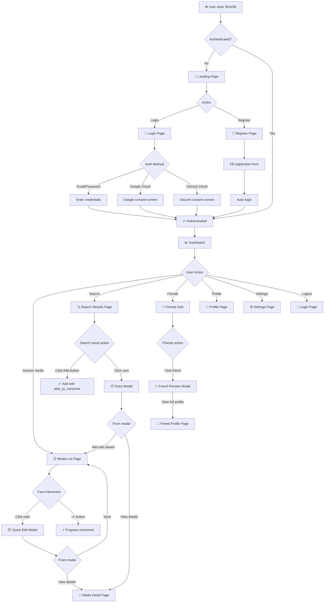
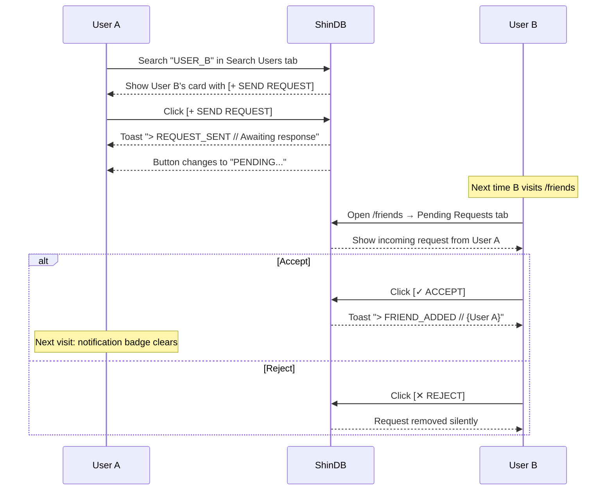

# ShinDB — Application Flow

> **Version**: 1.0.0  
> **Last Updated**: 2026-10-16  
> **Status**: Complete (v1.0.0 User Flows Implemented & Tested)  
> **Companion Docs**: [PRD.md](./PRD.md) · [DESIGN.md](./DESIGN.md) · [TechSpec.md](./TechSpec.md)

---

## Table of Contents

1. [Sitemap & Navigation Structure](#1-sitemap--navigation-structure)
2. [Master User Journey](#2-master-user-journey)
3. [Authentication Flows](#3-authentication-flows)
4. [Dashboard Flow](#4-dashboard-flow)
5. [Search & Add Media Flow](#5-search--add-media-flow)
6. [Media List Page Flow](#6-media-list-page-flow)
7. [Media Entry Interactions](#7-media-entry-interactions)
8. [Friends & Social Flow](#8-friends--social-flow)
9. [Profile & Settings Flow](#9-profile--settings-flow)
10. [Feedback & Notification System](#10-feedback--notification-system)
11. [Loading & Transition States](#11-loading--transition-states)
12. [Empty States](#12-empty-states)
13. [Error States](#13-error-states)
14. [Screen Inventory](#14-screen-inventory)

---

## 1. Sitemap & Navigation Structure

### 1.1 Complete Sitemap

```
ShinDB
│
├── / .......................... Landing Page (public)
│
├── /login .................... Login Page (public)
├── /register ................. Register Page (public)
│
├── /dashboard ................ Dashboard / Command Console (protected)
│
├── /anime .................... Anime List (protected)
├── /manga .................... Manga List (protected)
├── /movies ................... Movies List (protected)
├── /series ................... Series List (protected)
├── /games .................... Games List (protected)
│
├── /search?q=...&type=....... Search Results (protected)
│
├── /media/[type]/[id] ........ Media Detail Page (protected)
│
├── /friends .................. Friends Hub (protected)
│   ├── Tab: Friends List
│   ├── Tab: Pending Requests
│   └── Tab: Search Users
│
├── /friends/[username] ....... Friend's Profile (protected)
│
├── /profile .................. Own Profile (protected, view-only)
│
├── /settings ................. Account Settings (protected)
│   ├── Section: Profile
│   ├── Section: Account
│   └── Section: Data
│
└── /404 ...................... Not Found
```

### 1.2 Top Navigation Bar (Always Visible When Authenticated)

```
┌──────────────────────────────────────────────────────────────────────────────────┐
│  [>_] ShinDB    ✧ DASHBOARD  ◎ ANIME  □ MANGA  ⊞ GAMES  ◫ MOVIES  ◫ SERIES   │
│                                                        🔔(badge)  👤 SENPAI_09  │
└──────────────────────────────────────────────────────────────────────────────────┘
```

| Element | Behavior |
|---------|----------|
| **Logo (`[>_] ShinDB`)** | Clickable → navigates to `/dashboard` |
| **Dashboard** | Active state when on `/dashboard` |
| **Anime / Manga / Games / Movies / Series** | Each links to its list page. Active state shows bordered pill highlight |
| **Friends icon (🔔)** | Links to `/friends`. Red notification badge when pending requests exist |
| **User avatar + name** | Dropdown menu: Profile, Settings, Logout |

**Responsive behavior**:
- **Desktop**: All items visible with icons + labels
- **Tablet**: Icons only (labels hidden)
- **Mobile**: Hamburger menu → slide-out drawer with all items

### 1.3 Protected Route Behavior

When an **unauthenticated user** tries to access any protected route:

```
User visits /anime
       │
       ▼
  Is authenticated?
       │
  NO ──┤
       ▼
  Redirect to /login
  Show message: "> ACCESS_DENIED // AUTHENTICATION REQUIRED"
  Store original URL in query param: /login?redirect=/anime
       │
  After successful login ──► Redirect to /anime (original destination)
```

---

## 2. Master User Journey

### 2.1 High-Level Flow Diagram



### 2.2 Journey: New User (First-Time Experience)

```
1. Visit shindb.com (or self-hosted URL)
                │
2. See Landing Page — branded terminal aesthetic, login/register CTAs
                │
3. Click "Register" → /register
                │
4. Fill form: username, email, password, display name
   (or click Google/Discord OAuth)
                │
5. Account created → auto-login → redirect to /dashboard
                │
6. See EMPTY DASHBOARD
   ┌──────────────────────────────────────────────┐
   │  > NO RECORDS FOUND                          │
   │  > INITIATE TRACKING SEQUENCE                │
   │                                              │
   │  Stats: 0 across all categories              │
   │  [🔍 SEARCH & ADD YOUR FIRST ENTRY]          │
   └──────────────────────────────────────────────┘
                │
7. Click search CTA or use Ctrl+K → search bar focuses
                │
8. Type "Steins;Gate" → navigates to /search?q=steins+gate
                │
9. See search results grid from AniList
                │
10. Click [+ Add] button on a result → instantly added as "plan_to_consume"
    Toast: "> ENTRY_ADDED // Steins;Gate → PLAN_TO_CONSUME"
                │
    OR: Click on the card itself → Entry Modal opens with pre-filled data
    → Set status to "Watching", rate it, set progress → click "Add to List"
                │
11. Navigate to /anime → see the entry in the grid
                │
12. Return to /dashboard → see updated stats (1 entry!)
```

### 2.3 Journey: Returning User (Daily Use)

```
1. Visit shindb.com → already authenticated → /dashboard
                │
2. Glance at stats — "211 anime, 10 manga, 26 games, 116 movies+series"
                │
3. See "Currently Watching" section — Oshi No Ko at EP 8/11
                │
4. Click [+1] on Oshi No Ko card → progress updates to 9/11
   Toast: "> PROGRESS_UPDATED // Oshi No Ko → EP 9/11"
                │
5. Navigate to /anime → see full grid of anime entries
                │
6. Filter by "WATCHING" → see only currently watching entries
                │
7. Click on an entry → Quick Edit Modal opens
   → Update rating to 8, add note "great arc", save
   Toast: "> ENTRY_UPDATED // OK"
                │
8. Ctrl+K → search "Dandadan" → /search?q=dandadan
   → Click [+ Add] → added as plan_to_consume
                │
9. Check Friends icon (has red badge) → /friends
   → Pending Requests tab → accept friend request
                │
10. Click on a friend → preview modal → see their stats & currently watching
                │
11. User menu → Logout
```

---

## 3. Authentication Flows

### 3.1 Landing Page (`/`)

The entry point for unauthenticated users. Serves as a branded introduction to ShinDB.

```
┌──────────────────────────────────────────────────────────────────┐
│                                                                  │
│                         [>_]                                     │
│                                                                  │
│               S H I N D B                                        │
│                                                                  │
│     CENTRALIZED MEDIA TRACKING COMMAND CONSOLE                   │
│     TRACK. ARCHIVE. CONQUER.                                     │
│                                                                  │
│  ┌──────────────────┐   ┌──────────────────────┐                │
│  │   ▶ LOGIN        │   │   ◆ REGISTER         │                │
│  └──────────────────┘   └──────────────────────┘                │
│                                                                  │
│  ─── or continue with ───                                        │
│                                                                  │
│  ┌──────────┐  ┌──────────────┐                                 │
│  │ Google   │  │ Discord      │                                 │
│  └──────────┘  └──────────────┘                                 │
│                                                                  │
│  > ANIME • MANGA • MOVIES • SERIES • GAMES                      │
│  > ONE CONSOLE. ZERO FRAGMENTATION.                              │
│                                                                  │
│  > V1.0.0 STABLE // NODE_STATE: ONLINE                           │
│                                                                  │
└──────────────────────────────────────────────────────────────────┘
```

**Behavior**:
- If the user is **already authenticated**, redirect immediately to `/dashboard`
- Login button → `/login`
- Register button → `/register`
- Google/Discord buttons → start OAuth flow directly

### 3.2 Login Page (`/login`)

```
┌──────────────────────────────────────────────────────────────────┐
│                                                                  │
│  [>_] ShinDB                                                     │
│                                                                  │
│  > AUTHENTICATION REQUIRED                                       │
│  > ENTER CREDENTIALS TO ACCESS SYSTEM                            │
│                                                                  │
│  ┌──────────────────────────────────────────┐                   │
│  │  EMAIL                                    │                   │
│  │  ┌────────────────────────────────────┐   │                   │
│  │  │  operator@shindb.com               │   │                   │
│  │  └────────────────────────────────────┘   │                   │
│  │                                           │                   │
│  │  PASSWORD                                 │                   │
│  │  ┌────────────────────────────────────┐   │                   │
│  │  │  ••••••••••••                      │   │                   │
│  │  └────────────────────────────────────┘   │                   │
│  │                                           │                   │
│  │  ┌────────────────────────────────────┐   │                   │
│  │  │        ▶ AUTHENTICATE              │   │                   │
│  │  └────────────────────────────────────┘   │                   │
│  │                                           │                   │
│  │  ─── or continue with ───                 │                   │
│  │                                           │                   │
│  │  ┌──────────┐  ┌──────────────┐          │                   │
│  │  │ Google   │  │ Discord      │          │                   │
│  │  └──────────┘  └──────────────┘          │                   │
│  │                                           │                   │
│  │  Don't have an account? [REGISTER]        │                   │
│  └──────────────────────────────────────────┘                   │
│                                                                  │
└──────────────────────────────────────────────────────────────────┘
```

**Flow**:
```
Enter email + password → Click "AUTHENTICATE"
  │
  ├── ✅ Success → Redirect to /dashboard (or stored redirect URL)
  │
  └── ❌ Failure → Show inline error:
       ├── "INVALID_CREDENTIALS // Email or password incorrect"
       └── "REGISTRATION_DISABLED // Contact system operator"
```

### 3.3 Register Page (`/register`)

```
┌──────────────────────────────────────────────────────────────────┐
│                                                                  │
│  [>_] ShinDB                                                     │
│                                                                  │
│  > NEW OPERATOR REGISTRATION                                     │
│  > INITIALIZE SYSTEM ACCESS                                      │
│                                                                  │
│  ┌──────────────────────────────────────────┐                   │
│  │  USERNAME                                 │                   │
│  │  ┌────────────────────────────────────┐   │                   │
│  │  │  SENPAI_09                         │   │                   │
│  │  └────────────────────────────────────┘   │                   │
│  │  3-30 chars, alphanumeric + underscores   │                   │
│  │                                           │                   │
│  │  DISPLAY NAME                             │                   │
│  │  ┌────────────────────────────────────┐   │                   │
│  │  │  Senpai                            │   │                   │
│  │  └────────────────────────────────────┘   │                   │
│  │                                           │                   │
│  │  EMAIL                                    │                   │
│  │  ┌────────────────────────────────────┐   │                   │
│  │  │  senpai@example.com                │   │                   │
│  │  └────────────────────────────────────┘   │                   │
│  │                                           │                   │
│  │  PASSWORD                                 │                   │
│  │  ┌────────────────────────────────────┐   │                   │
│  │  │  ••••••••••••                      │   │                   │
│  │  └────────────────────────────────────┘   │                   │
│  │  Min 8 chars, 1 uppercase, 1 number       │                   │
│  │                                           │                   │
│  │  ┌────────────────────────────────────┐   │                   │
│  │  │      ◆ INITIALIZE ACCOUNT          │   │                   │
│  │  └────────────────────────────────────┘   │                   │
│  │                                           │                   │
│  │  ─── or continue with ───                 │                   │
│  │  ┌──────────┐  ┌──────────────┐          │                   │
│  │  │ Google   │  │ Discord      │          │                   │
│  │  └──────────┘  └──────────────┘          │                   │
│  │                                           │                   │
│  │  Already have an account? [LOGIN]         │                   │
│  └──────────────────────────────────────────┘                   │
│                                                                  │
└──────────────────────────────────────────────────────────────────┘
```

**Validation** (inline, real-time):
- Username: check availability on blur (debounced API call)
- Email: format validation + check availability
- Password: strength indicator (weak/medium/strong)

**Flow**:
```
Fill form → Click "INITIALIZE ACCOUNT"
  │
  ├── ✅ Success → Auto-login → Redirect to /dashboard
  │                Toast: "> OPERATOR_REGISTERED // WELCOME, {USERNAME}"
  │
  └── ❌ Failure → Inline field errors:
       ├── "USERNAME_TAKEN // Choose another callsign"
       ├── "EMAIL_EXISTS // This email is already registered"
       └── "REGISTRATION_DISABLED // System is not accepting new operators"
```

### 3.4 OAuth Flow

```
User clicks [Google] or [Discord] button
       │
       ▼
  Redirect to provider's auth page
  (Google consent screen / Discord authorize)
       │
       ▼
  User grants permission
       │
       ▼
  Provider redirects to /auth/callback/{provider}?code=...
       │
       ▼
  Frontend sends code to POST /auth/login/{provider}
       │
       ▼
  Auth service exchanges code → fetches profile → find-or-create user
       │
       ├── New user → Create account, auto-generate username → dashboard
       └── Existing user → Login → dashboard
```

### 3.5 Logout Flow

```
User clicks "Logout" from user dropdown menu
       │
       ▼
  POST /auth/logout (blacklists refresh token)
       │
       ▼
  Clear tokens from memory + cookies
       │
       ▼
  Redirect to /login
  Toast: "> SESSION_TERMINATED // LOGGED OUT"
```

---

## 4. Dashboard Flow

### 4.1 Dashboard Layout (`/dashboard`)

The dashboard is the central command console. All sections render simultaneously with their own loading states.

```
┌─ NAVBAR ─────────────────────────────────────────────────────────────────────┐

┌─ SYSTEM BANNER ──────────────────────────────────────────────────────────────┐
│  ⊙ SYS_OPERATOR::CENTRAL_CONSOLE                    NODE_STATE: SECURE     │
│    OBSIDIAN CORE TRACKING ENVIRONMENT // V1.0.0      >_ SESSION: ACTIVE_DEV │
└──────────────────────────────────────────────────────────────────────────────┘

                    ┌─ SEARCH BAR ─────────────────┐
                    │ 🔍 SEARCH DATABASES... [⌘K]   │
                    └──────────────────────────────┘

┌─ PROFILE CARD ────┐  ┌─ STAT ──┐ ┌─ STAT ──┐ ┌─ STAT ──┐ ┌─ STAT ──┐
│  [avatar]          │  │ ANIME   │ │ MANGA   │ │ GAMES   │ │ MOVIES+ │
│  [SYS_OP::ELITE]  │  │         │ │         │ │         │ │ SERIES  │
│  SENPAI_09         │  │  211    │ │  10     │ │  26     │ │  116    │
│  >_ STATUS: OK     │  │[LOGGED] │ │[LOGGED] │ │[LOGGED] │ │[LOGGED] │
└────────────────────┘  └─────────┘ └─────────┘ └─────────┘ └─────────┘

┌─ SUMMARY ────────────────────┐  ┌─ BREAKDOWN ────────────────────────┐
│  TOTAL TRACKED: 363           │  │  135 ACTIVE  |  189 DONE  |  22 BACKLOG │
│  COMPILATION RATE: 100% OK    │  └───────────────────────────────────┘
└───────────────────────────────┘

┌─ 📁 ANIME STATISTICS ──────────────────────────── ALL ANIME STATS → ─┐
│  DAYS: 8.0    MEAN: 7.86    ● Watch 66  ● Done 115  ...  | UPDATES  │
└──────────────────────────────────────────────────────────────────────┘

┌─ 📖 MANGA STATISTICS ──────────────────────────── ALL MANGA STATS → ─┐
│  ...                                                                  │
└──────────────────────────────────────────────────────────────────────┘

┌─ 🎮 GAME STATISTICS ───────────────────────────── ALL GAME STATS →  ─┐
│  ...                                                                  │
└──────────────────────────────────────────────────────────────────────┘

┌─ 🎬 MOVIES + SERIES STATISTICS ────────────────── ALL STATS →       ─┐
│  ...                                                                  │
└──────────────────────────────────────────────────────────────────────┘

┌─ ▶ CURRENTLY CONSUMING ─────────────────────────────────────────────┐
│  [poster] [poster] [poster] [poster] [poster] ...  (scroll →)       │
└──────────────────────────────────────────────────────────────────────┘

┌─ ■ RECENTLY COMPLETED ──────────────────── >_ 189 ARCHIVES SEALED ──┐
│  [poster] [poster] [poster] [poster] [poster] [poster] [poster]     │
└──────────────────────────────────────────────────────────────────────┘
```

### 4.2 Dashboard Interactions

| Element | Click Action |
|---------|-------------|
| **Search bar** | Focus search input. Also triggered by `Ctrl+K` |
| **Search submit** | Navigate to `/search?q={query}` |
| **Stat card (e.g., "211" anime)** | Navigate to `/anime` |
| **"ALL ANIME STATS →"** | Navigate to `/anime` |
| **Currently Consuming poster** | Open Quick Edit Modal for that entry |
| **Recently Completed poster** | Open Quick Edit Modal for that entry |
| **Currently Consuming [+1]** | Increment progress by 1 (toast confirmation) |
| **Per-type statistics section** | Expand/collapse (optional) |
| **"Last Updates" entry** | Open Quick Edit Modal for that entry |

---

## 5. Search & Add Media Flow

### 5.1 Search Entry Points

Users can initiate a search from multiple places:

| Entry Point | Behavior |
|-------------|----------|
| **Dashboard search bar** | Type query → press Enter → navigate to `/search?q={query}` |
| **`Ctrl+K` keyboard shortcut** | Focus dashboard search bar (or trigger search bar from any page) |
| **Media list page "Search" toolbar button** | Opens the search bar on the list page header → navigate to `/search?q={query}&type={currentType}` |
| **Media list page "+ New" button** | Navigate to `/search?type={currentType}` with empty query (focus on search input) |

### 5.2 Search Results Page (`/search`)

```
┌─ NAVBAR ─────────────────────────────────────────────────────────────────────┐

┌─ SEARCH HEADER ──────────────────────────────────────────────────────────────┐
│  🔍 EXTERNAL DATABASE SEARCH                                                │
│                                                                              │
│  ┌───────────────────────────────────────────────────┐                       │
│  │  steins;gate                                    ✕ │                       │
│  └───────────────────────────────────────────────────┘                       │
│                                                                              │
│  TYPE: [ ALL ] [ ANIME ] [ MANGA ] [ MOVIES ] [ SERIES ] [ GAMES ]          │
│                                                                              │
│  Source: AniList  •  15 results  •  Cached ✓                                │
└──────────────────────────────────────────────────────────────────────────────┘

┌─ RESULTS GRID (7 columns) ──────────────────────────────────────────────────┐
│                                                                              │
│  ┌─────────────┐  ┌─────────────┐  ┌─────────────┐  ┌─────────────┐       │
│  │             │  │             │  │             │  │             │        │
│  │  [poster]   │  │  [poster]   │  │  [poster]   │  │  [poster]   │        │
│  │             │  │             │  │             │  │             │        │
│  │             │  │             │  │             │  │             │        │
│  ├─────────────┤  ├─────────────┤  ├─────────────┤  ├─────────────┤       │
│  │ Steins;Gate │  │ S;G Movie   │  │ S;G 0       │  │ S;G Load... │       │
│  │ 2011        │  │ 2013        │  │ 2018        │  │ 2011        │       │
│  │   [+ ADD]   │  │   [+ ADD]   │  │   [+ ADD]   │  │   [+ ADD]   │       │
│  └─────────────┘  └─────────────┘  └─────────────┘  └─────────────┘       │
│                                                                              │
└──────────────────────────────────────────────────────────────────────────────┘
```

### 5.3 Search Interaction Flow

```mermaid
flowchart TD
    A["User on Search Results Page"] --> B{Interaction}
    
    B -->|Click [+ ADD] button| C["✅ Instant add as plan_to_consume"]
    C --> D["Toast: '> ENTRY_ADDED // {Title} → PLAN_TO_CONSUME'"]
    D --> E["Button changes to '✓ ADDED' (disabled)"]
    
    B -->|Click on card/poster area| F["📦 Entry Modal opens"]
    F --> G["Shows pre-filled data from API:\n- Cover image, title, year, genres\n- Editable: status, rating, progress, notes, tags"]
    
    G --> H{Modal action}
    H -->|Click 'ADD TO LIST'| I["✅ Entry created with user's settings"]
    I --> J["Toast + Modal closes"]
    
    H -->|Click 'VIEW DETAILS'| K["Navigate to external detail\n(or internal /media/[type]/[id] if already added)"]
    
    H -->|Click '✕' or outside| L["Modal closes, no action"]
    
    B -->|Change type filter| M["Re-search with new type\n(different API source)"]
    
    B -->|Type new query| N["Re-search after debounce (300ms)"]
```

### 5.4 Entry Modal (From Search)

```
┌─ MODAL OVERLAY ──────────────────────────────────────────────────────────────┐
│                                                                              │
│  ┌─ ENTRY DETAILS ────────────────────────────────────────────────────────┐  │
│  │                                                                        │  │
│  │  ┌──────────┐  STEINS;GATE                                            │  │
│  │  │          │  2011 • Anime • 24 Episodes                             │  │
│  │  │ [poster] │  Sci-Fi, Thriller, Drama                                │  │
│  │  │          │                                                          │  │
│  │  │          │  AniList Score: 9.08                                     │  │
│  │  └──────────┘                                                          │  │
│  │                                                                        │  │
│  │  ─── TRACKING DETAILS ───                                              │  │
│  │                                                                        │  │
│  │  STATUS       ┌─────────────────────────────┐                         │  │
│  │               │  Plan to Watch          ▼   │                         │  │
│  │               └─────────────────────────────┘                         │  │
│  │                                                                        │  │
│  │  RATING       ┌─ 0 ──────────────────── 10 ─┐   — (not rated)        │  │
│  │               └──────────────────────────────┘                         │  │
│  │                                                                        │  │
│  │  PROGRESS     ┌────┐ / ┌────┐  Episodes                              │  │
│  │               │ 0  │   │ 24 │                                         │  │
│  │               └────┘   └────┘                                         │  │
│  │                                                                        │  │
│  │  NOTES        ┌──────────────────────────────┐                        │  │
│  │               │                              │                        │  │
│  │               └──────────────────────────────┘                        │  │
│  │                                                                        │  │
│  │  TAGS         ┌──────────────────────────────┐                        │  │
│  │               │  + Add tags...               │                        │  │
│  │               └──────────────────────────────┘                        │  │
│  │                                                                        │  │
│  │  ┌──────────────────────┐  ┌────────────────────┐                    │  │
│  │  │    ADD TO LIST       │  │   VIEW DETAILS  →  │                    │  │
│  │  └──────────────────────┘  └────────────────────┘                    │  │
│  │                                                                        │  │
│  └────────────────────────────────────────────────────────────────────────┘  │
│                                                                              │
└──────────────────────────────────────────────────────────────────────────────┘
```

---

## 6. Media List Page Flow

### 6.1 Page Layout (`/anime`, `/manga`, `/movies`, `/series`, `/games`)

All 5 media list pages share identical layout, with type-specific accent colors and filter options.

```
┌─ NAVBAR ─────────────────────────────────────────────────────────────────────┐

┌─ PAGE HEADER ────────────────────────────────────────────────────────────────┐
│  📁 ALL ANIME SERIES  ◇ 211 results      ↕ Sort  ▼ Filter  🔍 Search  + New│
└──────────────────────────────────────────────────────────────────────────────┘

┌─ FILTER PILLS ───────────────────────────────────────────────────────────────┐
│  [■ ALL]  [ WATCHING ]  [ COMPLETED ]  [ PLAN TO WATCH ]  [ DROPPED ]       │
└──────────────────────────────────────────────────────────────────────────────┘

┌─ MEDIA GRID (7 columns) ────────────────────────────────────────────────────┐
│                                                                              │
│  ┌─────────┐  ┌─────────┐  ┌─────────┐  ┌─────────┐  ┌─────────┐  ...    │
│  │         │  │         │  │         │  │         │  │         │          │
│  │ [poster]│  │ [poster]│  │ [poster]│  │ [poster]│  │ [poster]│          │
│  │         │  │         │  │         │  │         │  │         │          │
│  │   [+1]  │  │   [+1]  │  │   [+1]  │  │   [+1]  │  │   [+1]  │          │
│  ├─────────┤  ├─────────┤  ├─────────┤  ├─────────┤  ├─────────┤          │
│  │Title '11│  │Title '18│  │Title '20│  │Title '22│  │Title '23│          │
│  └─────────┘  └─────────┘  └─────────┘  └─────────┘  └─────────┘          │
│                                                                              │
│  ... (scroll for more, lazy-loaded in batches of 50) ...                    │
│                                                                              │
└──────────────────────────────────────────────────────────────────────────────┘
```

### 6.2 Filter/Sort Interaction Flow

```
User on /anime (showing ALL entries, sorted by Date Added desc)
       │
       ├── Click "WATCHING" pill
       │     → Filter instantly applied (client-side if all data loaded)
       │     → URL updates: /anime?status=watching
       │     → Result count updates: "66 results"
       │     → "WATCHING" pill shows active state (purple bg for anime)
       │
       ├── Click "Sort" button
       │     → Dropdown appears: Title, Rating, Date Added, Progress, Year
       │     → Click "Rating" → grid re-sorts by rating (high to low)
       │     → Click again → toggles to low-to-high
       │
       ├── Click "Search" button (or type in inline search)
       │     → Text input appears in toolbar
       │     → Type "steins" → client-side filter on titles
       │     → Results narrow to matching entries
       │
       └── Click "+ New"
             → Navigate to /search?type=anime
```

### 6.3 Media Card Interaction

```
┌─────────────┐
│             │
│   [poster]  │  ← Click anywhere on poster → Opens Quick Edit Modal
│             │
│   📌 [+1]  │  ← Click [+1] → Increment progress (no modal)
├─────────────┤
│ Title (Year)│  ← Truncated with ellipsis
└─────────────┘
```

| Interaction | Result |
|-------------|--------|
| **Click poster** | Opens Quick Edit Modal (see §7.1) |
| **Click [+1]** | Progress increments by 1, toast shows updated progress |
| **Hover poster** | Subtle `scale(1.02)` + brightness boost |
| **[+1] on completed entry** | Button hidden or disabled |
| **[+1] reaches total** | Auto-change status to "completed", toast: `"> ARCHIVES_SEALED // {Title} COMPLETED"` |

---

## 7. Media Entry Interactions

### 7.1 Quick Edit Modal (From Existing Entry)

Opened when clicking on any media card in the grid or dashboard.

```
┌─ QUICK EDIT MODAL ───────────────────────────────────────────────────────────┐
│                                                                              │
│  ┌──────────┐  STEINS;GATE                              [VIEW DETAILS →]   │
│  │          │  2011 • Anime • 24 Episodes                                   │
│  │ [poster] │  Sci-Fi, Thriller, Drama                                      │
│  │          │  ★ Favorite                                                    │
│  └──────────┘                                                                │
│                                                                              │
│  STATUS       ┌─────────────────────────────┐                               │
│               │  Watching                ▼  │                               │
│               └─────────────────────────────┘                               │
│                                                                              │
│  RATING       [ 1 ] [ 2 ] [ 3 ] [ 4 ] [ 5 ] [ 6 ] [ 7 ] [■8 ] [ 9 ] [10] │
│                                                                              │
│  PROGRESS     ┌────┐ / ┌────┐  Episodes     [−] [+]                        │
│               │ 18 │   │ 24 │                                               │
│               └────┘   └────┘                                               │
│               ████████████████████░░░░░░  75%                               │
│                                                                              │
│  DATES        Start: 2024-01-15    End: —                                   │
│  REWATCH      0 times                                                        │
│                                                                              │
│  NOTES        ┌──────────────────────────────┐                              │
│               │ Masterpiece sci-fi thriller   │                              │
│               └──────────────────────────────┘                              │
│                                                                              │
│  TAGS         [masterpiece] [sci-fi] [time-travel] [+ add]                  │
│                                                                              │
│  ┌──────────────────┐  ┌────────────┐  ┌─────────────────┐                 │
│  │    SAVE CHANGES   │  │  CANCEL    │  │   🗑 DELETE      │                 │
│  └──────────────────┘  └────────────┘  └─────────────────┘                 │
│                                                                              │
└──────────────────────────────────────────────────────────────────────────────┘
```

**Actions**:

| Button | Behavior |
|--------|----------|
| **VIEW DETAILS →** | Navigate to `/media/anime/[id]` (full detail page) |
| **SAVE CHANGES** | Update entry via API, close modal, toast: `"> ENTRY_UPDATED // OK"` |
| **CANCEL** | Close modal, no changes |
| **🗑 DELETE** | Soft delete (entry removed immediately), undo toast for 5 seconds |
| **★ Favorite** | Toggle favorite status (instant, no save needed) |

### 7.2 Media Detail Page (`/media/[type]/[id]`)

A full-page view for deep entry inspection. Accessed via "VIEW DETAILS" from any modal.

```
┌─ NAVBAR ─────────────────────────────────────────────────────────────────────┐

┌─ BREADCRUMB ─────────────────────────────────────────────────────────────────┐
│  Dashboard  >  Anime  >  Steins;Gate                                        │
└──────────────────────────────────────────────────────────────────────────────┘

┌─ HERO SECTION ───────────────────────────────────────────────────────────────┐
│                                                                              │
│  ┌───────────────┐   STEINS;GATE                                            │
│  │               │   シュタインズ・ゲート (Shutainzu Gēto)                     │
│  │               │                                                           │
│  │   [large      │   2011 • Anime • 24 Episodes • Completed                 │
│  │    poster]    │   Sci-Fi, Thriller, Drama                                │
│  │               │                                                           │
│  │               │   Rating: ★ 8 / 10                                       │
│  │               │   Progress: 24 / 24 EP (100%)                            │
│  │               │   Started: 2024-01-15  Completed: 2024-02-01             │
│  │               │   Rewatched: 1 time                                      │
│  │               │                                                           │
│  │               │   ┌──────────┐  ┌──────────┐  ┌──────────┐              │
│  │               │   │  ✏ EDIT  │  │ ★ UNFAV  │  │ 🗑 DELETE │              │
│  └───────────────┘   └──────────┘  └──────────┘  └──────────┘              │
│                                                                              │
└──────────────────────────────────────────────────────────────────────────────┘

┌─ NOTES ──────────────────────────────────────────────────────────────────────┐
│  Masterpiece sci-fi thriller. The first half is slow but the payoff is       │
│  absolutely incredible. Okabe is one of the best protagonists ever written.  │
└──────────────────────────────────────────────────────────────────────────────┘

┌─ TAGS ───────────────────────────────────────────────────────────────────────┐
│  [masterpiece] [sci-fi] [time-travel] [comfort-rewatch]                     │
└──────────────────────────────────────────────────────────────────────────────┘

┌─ ACTIVITY LOG ───────────────────────────────────────────────────────────────┐
│  2024-02-01  ● Completed (24/24 EP)                                         │
│  2024-01-28  ● Progress updated (20/24 → 24/24)                            │
│  2024-01-20  ● Rated 8/10                                                   │
│  2024-01-15  ● Started watching                                              │
│  2024-01-15  ● Added to list                                                 │
└──────────────────────────────────────────────────────────────────────────────┘
```

**Actions**:
| Button | Behavior |
|--------|----------|
| **✏ EDIT** | Opens Quick Edit Modal (same as §7.1) pre-filled with current data |
| **★ UNFAV / FAV** | Toggle favorite |
| **🗑 DELETE** | Delete with undo toast |
| **← Back** | Browser back (or breadcrumb navigation) |

### 7.3 Delete Flow

```
User clicks 🗑 DELETE (from modal or detail page)
       │
       ▼
  Entry removed immediately from UI (optimistic update)
       │
       ▼
  Toast appears (bottom-right):
  ┌─────────────────────────────────────────────────┐
  │  > ENTRY_DELETED // "Steins;Gate"     [UNDO]    │
  │  ░░░░░░░░░░░░░░░░░░░░░░░░░░░░░  (5s countdown) │
  └─────────────────────────────────────────────────┘
       │
       ├── User clicks [UNDO] within 5s
       │     → Entry restored, toast: "> ENTRY_RESTORED // OK"
       │
       └── 5 seconds pass (no undo)
             → DELETE API call fires
             → Entry permanently removed
             → Stats cache invalidated
```

### 7.4 Progress Increment Flow

```
User clicks [+1] on a media card
       │
       ▼
  PATCH /media/entries/:id/progress { action: "increment" }
       │
       ▼
  Optimistic UI update: progress number increases immediately
       │
       ▼
  Toast: "> PROGRESS_UPDATED // {Title} → EP {new}/{total}"
       │
       ├── If new progress === total
       │     → Auto-set status to "completed"
       │     → Toast changes to: "> ARCHIVES_SEALED // {Title} COMPLETED"
       │     → Entry moves to "Recently Completed" on dashboard
       │
       └── If new progress < total
             → No status change, just progress update
```

---

## 8. Friends & Social Flow

### 8.1 Friends Hub (`/friends`)

```
┌─ NAVBAR ─────────────────────────────────────────────────────────────────────┐

┌─ FRIENDS HEADER ─────────────────────────────────────────────────────────────┐
│  👥 FRIENDS NETWORK                                                          │
│                                                                              │
│  ┌──────────────────┐ ┌────────────────────────┐ ┌──────────────────────┐   │
│  │  FRIENDS LIST (8) │ │  PENDING REQUESTS (2)  │ │  SEARCH USERS       │   │
│  └──────────────────┘ └────────────────────────┘ └──────────────────────┘   │
└──────────────────────────────────────────────────────────────────────────────┘
```

#### Tab 1: Friends List

```
┌─ FRIENDS LIST ───────────────────────────────────────────────────────────────┐
│                                                                              │
│  ┌──────────────────────────────────────────────────────────┐               │
│  │  [avatar]  SAKURA_CHAN                                    │               │
│  │            Display: Sakura  •  127 entries tracked        │               │
│  │            Currently watching: Dandadan                   │               │
│  └──────────────────────────────────────────────────────────┘               │
│                                                                              │
│  ┌──────────────────────────────────────────────────────────┐               │
│  │  [avatar]  NARUTO_FAN_99                                  │               │
│  │            Display: Naruto  •  89 entries tracked         │               │
│  │            Last active: 2 hours ago                       │               │
│  └──────────────────────────────────────────────────────────┘               │
│                                                                              │
│  ... more friends ...                                                        │
│                                                                              │
└──────────────────────────────────────────────────────────────────────────────┘
```

**Click on friend card** → Opens Friend Preview Modal (see §8.3)

#### Tab 2: Pending Requests

```
┌─ PENDING REQUESTS ───────────────────────────────────────────────────────────┐
│                                                                              │
│  INCOMING                                                                    │
│  ┌──────────────────────────────────────────────────────────┐               │
│  │  [avatar]  NEW_FRIEND_01                                  │               │
│  │            Wants to connect     [✓ ACCEPT] [✕ REJECT]    │               │
│  └──────────────────────────────────────────────────────────┘               │
│                                                                              │
│  OUTGOING                                                                    │
│  ┌──────────────────────────────────────────────────────────┐               │
│  │  [avatar]  SOMEONE_COOL                                   │               │
│  │            Request sent 2 days ago        [CANCEL]        │               │
│  └──────────────────────────────────────────────────────────┘               │
│                                                                              │
└──────────────────────────────────────────────────────────────────────────────┘
```

#### Tab 3: Search Users

```
┌─ SEARCH USERS ───────────────────────────────────────────────────────────────┐
│                                                                              │
│  ┌────────────────────────────────────────────┐                             │
│  │  🔍 Search by username...                   │                             │
│  └────────────────────────────────────────────┘                             │
│                                                                              │
│  ┌──────────────────────────────────────────────────────────┐               │
│  │  [avatar]  SENPAI_09                                      │               │
│  │            Display: Senpai  •  363 entries                │               │
│  │                                     [+ SEND REQUEST]      │               │
│  └──────────────────────────────────────────────────────────┘               │
│                                                                              │
└──────────────────────────────────────────────────────────────────────────────┘
```

### 8.2 Friend Request Flow



### 8.3 Friend Preview Modal

Opened when clicking on a friend in the Friends List tab.

```
┌─ FRIEND PREVIEW MODAL ──────────────────────────────────────────────────────┐
│                                                                              │
│  ┌──────────────────────────────────────────────────────────────────────┐   │
│  │                                                                      │   │
│  │  [avatar]  SAKURA_CHAN                                               │   │
│  │            [SYS_OPERATOR::MEMBER]                                    │   │
│  │            "Just vibing with anime and manga ~"                      │   │
│  │                                                                      │   │
│  │  ┌─────────┐ ┌─────────┐ ┌─────────┐ ┌─────────┐                  │   │
│  │  │ Anime   │ │ Manga   │ │ Games   │ │ Movies  │                  │   │
│  │  │  89     │ │  12     │ │  5      │ │  21     │                  │   │
│  │  └─────────┘ └─────────┘ └─────────┘ └─────────┘                  │   │
│  │                                                                      │   │
│  │  CURRENTLY WATCHING                                                  │   │
│  │  • Dandadan (EP 5/12)                                               │   │
│  │  • One Piece (EP 1102/???)                                          │   │
│  │  • Oshi No Ko S2 (EP 3/13)                                         │   │
│  │                                                                      │   │
│  │  ┌──────────────────────────┐                                       │   │
│  │  │   VIEW FULL PROFILE →    │                                       │   │
│  │  └──────────────────────────┘                                       │   │
│  │                                                                      │   │
│  └──────────────────────────────────────────────────────────────────────┘   │
│                                                                              │
└──────────────────────────────────────────────────────────────────────────────┘
```

**"VIEW FULL PROFILE →"** → Navigate to `/friends/[username]`

### 8.4 Friend Profile Page (`/friends/[username]`)

Full read-only view of a friend's profile, similar to your own dashboard but without editing capabilities.

```
┌─ NAVBAR ─────────────────────────────────────────────────────────────────────┐

┌─ BREADCRUMB ─────────────────────────────────────────────────────────────────┐
│  Dashboard  >  Friends  >  SAKURA_CHAN                                       │
└──────────────────────────────────────────────────────────────────────────────┘

┌─ PROFILE HEADER ─────────────────────────────────────────────────────────────┐
│                                                                              │
│  [large avatar]   SAKURA_CHAN                                                │
│                   [SYS_OPERATOR::MEMBER]                                     │
│                   "Just vibing with anime and manga ~"                       │
│                   127 total entries  •  Mean Score: 7.4                      │
│                                                            [REMOVE FRIEND]  │
└──────────────────────────────────────────────────────────────────────────────┘

┌─ STAT CARDS ──── (same layout as dashboard but read-only) ──────────────────┐
│  Anime: 89  |  Manga: 12  |  Games: 5  |  Movies+Series: 21                │
└──────────────────────────────────────────────────────────────────────────────┘

┌─ CURRENTLY WATCHING ─────────────────────────────────────────────────────────┐
│  [poster] [poster] [poster] ... (horizontal scroll, read-only)              │
└──────────────────────────────────────────────────────────────────────────────┘

┌─ FAVORITES ──────────────────────────────────────────────────────────────────┐
│  [poster] [poster] [poster] [poster] ... (read-only)                        │
└──────────────────────────────────────────────────────────────────────────────┘

┌─ MEDIA LISTS (tabbed) ───────────────────────────────────────────────────────┐
│  [ANIME] [MANGA] [GAMES] [MOVIES] [SERIES]                                 │
│                                                                              │
│  (Read-only grid of their entries, same layout as media list pages)          │
└──────────────────────────────────────────────────────────────────────────────┘
```

### 8.5 Notification Badge

```
Friends nav icon behavior:
  │
  ├── No pending requests → Normal icon, no badge
  │
  └── Pending requests exist → Red dot badge with count
       │
       └── Badge auto-updates when:
            ├── Friend requests tab is opened (marks as seen)
            └── TanStack Query refetches friends data (on window focus)
```

---

## 9. Profile & Settings Flow

### 9.1 Profile Page (`/profile`) — View Only

Displays the current user's profile in a read-only format, similar to how others would see it.

```
┌─ NAVBAR ─────────────────────────────────────────────────────────────────────┐

┌─ MY PROFILE ─────────────────────────────────────────────────────────────────┐
│                                                                              │
│  [large avatar]   SENPAI_09                                                  │
│                   [SYS_OPERATOR::ELITE]                                      │
│                   "Archiving the multiverse, one entry at a time."           │
│                   363 total entries  •  Mean Score: 7.86                     │
│                   Joined: January 2024                                       │
│                                                            [EDIT PROFILE →] │
└──────────────────────────────────────────────────────────────────────────────┘

┌─ STAT OVERVIEW ──────────────────────────────────────────────────────────────┐
│  (Same stat cards as dashboard: anime 211, manga 10, games 26, m+s 116)     │
└──────────────────────────────────────────────────────────────────────────────┘

┌─ FAVORITES ──────────────────────────────────────────────────────────────────┐
│  [poster] [poster] [poster] [poster] [poster] ...                           │
└──────────────────────────────────────────────────────────────────────────────┘

┌─ CURRENTLY CONSUMING ────────────────────────────────────────────────────────┐
│  [poster] [poster] [poster] ...                                              │
└──────────────────────────────────────────────────────────────────────────────┘
```

**"EDIT PROFILE →"** → Navigate to `/settings`

### 9.2 Settings Page (`/settings`)

```
┌─ NAVBAR ─────────────────────────────────────────────────────────────────────┐

┌─ SETTINGS ───────────────────────────────────────────────────────────────────┐
│                                                                              │
│  ┌─ SIDEBAR ──────┐  ┌─ CONTENT ──────────────────────────────────────────┐ │
│  │                 │  │                                                    │ │
│  │  ▶ Profile      │  │  (Active section content here)                    │ │
│  │    Account      │  │                                                    │ │
│  │    Data         │  │                                                    │ │
│  │                 │  │                                                    │ │
│  └─────────────────┘  └────────────────────────────────────────────────────┘ │
│                                                                              │
└──────────────────────────────────────────────────────────────────────────────┘
```

#### Section: Profile

| Field | Input Type | Behavior |
|-------|-----------|----------|
| Avatar | Click to upload (Cloudinary) | Preview before saving |
| Display Name | Text input (max 50 chars) | |
| Bio | Textarea (max 200 chars) | Character counter |
| **Save button** | | Toast: `"> PROFILE_UPDATED // OK"` |

#### Section: Account

| Field | Input Type | Behavior |
|-------|-----------|----------|
| Email | Read-only display | |
| Username | Read-only display | |
| Auth Provider | Badge showing email/google/discord | |
| Change Password | Current + New + Confirm fields | Only for email auth users |
| **Save button** | | Toast: `"> ACCOUNT_UPDATED // OK"` |

#### Section: Data

| Action | Button | Behavior |
|--------|--------|----------|
| Export Data | [📥 EXPORT ALL DATA (JSON)] | Downloads `.json` file with all entries, profile, tags |
| Delete Account | [🗑 DELETE ACCOUNT] | Confirmation modal → requires typing username to confirm → permanent |

---

## 10. Feedback & Notification System

### 10.1 Toast Notifications

All user action feedback is delivered via **toast notifications** in the bottom-right corner.

```
                                          ┌───────────────────────────────────┐
                                          │  > ENTRY_ADDED // Steins;Gate     │
                                          │    → PLAN_TO_CONSUME              │
                                          │                        ░░░░ (3s)  │
                                          └───────────────────────────────────┘
```

#### Toast Types

| Type | Color | Icon | Auto-Dismiss | Example |
|------|-------|------|-------------|---------|
| **Success** | Green accent (`#22c55e`) | `>_` | 3 seconds | `> ENTRY_ADDED // OK` |
| **Info** | Blue accent (`#3b82f6`) | `>_` | 3 seconds | `> REQUEST_SENT // Awaiting response` |
| **Warning** | Yellow accent (`#eab308`) | `⚠` | 5 seconds | `> RATE_LIMITED // Slow down` |
| **Error** | Red accent (`#ef4444`) | `✕` | 5 seconds | `> AUTHENTICATION_FAILED // Invalid credentials` |
| **Undo** | Muted (`#8888a0`) | `↶` | 5 seconds | `> ENTRY_DELETED // "Steins;Gate" [UNDO]` |

#### Toast Behavior

- Stack up to 3 visible toasts (older ones pushed up)
- Progress bar at the bottom showing remaining time
- Hovering pauses the auto-dismiss timer
- Click `✕` to manually dismiss
- Undo toasts have a clickable [UNDO] button

### 10.2 Toast Message Catalog

| Action | Toast Message |
|--------|---------------|
| Entry added (quick) | `> ENTRY_ADDED // {Title} → PLAN_TO_CONSUME` |
| Entry added (from modal) | `> ENTRY_ADDED // {Title} → {STATUS}` |
| Entry updated | `> ENTRY_UPDATED // OK` |
| Entry deleted | `> ENTRY_DELETED // "{Title}" [UNDO]` |
| Entry restored (undo) | `> ENTRY_RESTORED // OK` |
| Progress incremented | `> PROGRESS_UPDATED // {Title} → EP {new}/{total}` |
| Entry completed | `> ARCHIVES_SEALED // {Title} COMPLETED` |
| Favorite toggled on | `> FAVORITE_ADDED // {Title}` |
| Favorite toggled off | `> FAVORITE_REMOVED // {Title}` |
| Login success | `> SESSION_INITIALIZED // Welcome, {USERNAME}` |
| Registration success | `> OPERATOR_REGISTERED // Welcome, {USERNAME}` |
| Logout | `> SESSION_TERMINATED // LOGGED OUT` |
| Friend request sent | `> REQUEST_SENT // Awaiting response from {username}` |
| Friend request accepted | `> FRIEND_ADDED // {username}` |
| Friend removed | `> FRIEND_REMOVED // {username}` |
| Profile updated | `> PROFILE_UPDATED // OK` |
| Password changed | `> PASSWORD_UPDATED // OK` |
| Data exported | `> DATA_EXPORTED // Download started` |
| API error | `> EXTERNAL_API_ERROR // Search temporarily unavailable` |
| Network error | `> CONNECTION_LOST // Check your network` |

---

## 11. Loading & Transition States

### 11.1 Loading Philosophy

> **Principle**: Loading indicators should only appear when the user would otherwise wonder if something is broken. Fast transitions (< 200ms) should show **no loading state at all**.

### 11.2 Loading State Matrix

| Scenario | Duration | Loading Treatment |
|----------|----------|-------------------|
| Page navigation (cached data) | < 200ms | **None** — instant transition |
| Page navigation (uncached) | 200ms-1s | **Skeleton screens** — dark shimmer placeholders |
| Page navigation (slow network) | > 1s | **Skeleton + terminal text** — `"> LOADING RECORDS..."` with blinking cursor |
| Search request | 200ms-2s | **Skeleton cards** in results grid |
| Search request (slow) | > 2s | **Skeleton + terminal text** — `"> QUERYING EXTERNAL DATABASES..."` |
| Entry mutation (add/edit/delete) | < 500ms | **Optimistic update** — UI updates immediately, no spinner |
| Progress increment | < 200ms | **Instant** — number updates immediately |
| Image loading | Varies | **next/image blur placeholder** — dark shimmer base64 |
| Dashboard stats | < 1s | **Stat cards show skeleton** — shimmer in number area |

### 11.3 Skeleton Screen Design

```
Skeleton shimmer: animated gradient pulse
  Background: #111118 → #1a1a24 → #111118
  Animation: 1.5s ease-in-out infinite
  No spinners anywhere in the app
```

**Media Grid Skeleton**:
```
┌─────────┐  ┌─────────┐  ┌─────────┐  ┌─────────┐
│ ░░░░░░░ │  │ ░░░░░░░ │  │ ░░░░░░░ │  │ ░░░░░░░ │
│ ░░░░░░░ │  │ ░░░░░░░ │  │ ░░░░░░░ │  │ ░░░░░░░ │
│ ░░░░░░░ │  │ ░░░░░░░ │  │ ░░░░░░░ │  │ ░░░░░░░ │
├─────────┤  ├─────────┤  ├─────────┤  ├─────────┤
│ ░░░░░   │  │ ░░░░░   │  │ ░░░░░   │  │ ░░░░░   │
└─────────┘  └─────────┘  └─────────┘  └─────────┘
```

**Stat Card Skeleton**:
```
┌──────────────────────┐
│  ░░░░░░░░░░         │
│                      │
│     ░░░░░            │
│                      │
│  ░░░░░░░░            │
└──────────────────────┘
```

### 11.4 Terminal Loading Text

Only appears on slow loads (> 1 second):

```
> LOADING RECORDS...█  (blinking cursor)
```

Variants:
- `> LOADING RECORDS...` (media list pages)
- `> QUERYING EXTERNAL DATABASES...` (search)
- `> INITIALIZING DASHBOARD...` (dashboard first load)
- `> FETCHING OPERATOR PROFILE...` (profile page)
- `> SYNCING FRIENDS NETWORK...` (friends page)

### 11.5 Page Transitions

```
Route change → Content area fades:
  opacity: 0 → 1
  duration: 200ms
  easing: ease

No page-level sliding — keep it clean and terminal-like
```

---

## 12. Empty States

### 12.1 Empty Dashboard (New User)

```
┌──────────────────────────────────────────────────────────────────────────────┐
│                                                                              │
│  SYSTEM BANNER (normal)                                                      │
│                                                                              │
│  ┌───── PROFILE CARD ─────┐   ┌──── STAT CARDS (all showing 0) ────────┐   │
│  │  [default avatar]       │   │  ANIME: 0  MANGA: 0  GAMES: 0  M+S: 0 │   │
│  │  {username}             │   └────────────────────────────────────────┘   │
│  └─────────────────────────┘                                                │
│                                                                              │
│  ┌─ EMPTY STATE ────────────────────────────────────────────────────────┐   │
│  │                                                                      │   │
│  │              >_                                                      │   │
│  │                                                                      │   │
│  │    > NO RECORDS FOUND IN DATABASE                                    │   │
│  │    > INITIATE TRACKING SEQUENCE                                      │   │
│  │                                                                      │   │
│  │    Your console is empty. Start by searching for media               │   │
│  │    to add to your tracking database.                                 │   │
│  │                                                                      │   │
│  │    ┌──────────────────────────────────────┐                         │   │
│  │    │  🔍  SEARCH & ADD YOUR FIRST ENTRY    │                         │   │
│  │    └──────────────────────────────────────┘                         │   │
│  │                                                                      │   │
│  │    Tip: Use Ctrl+K to search from anywhere                          │   │
│  │                                                                      │   │
│  └──────────────────────────────────────────────────────────────────────┘   │
│                                                                              │
└──────────────────────────────────────────────────────────────────────────────┘
```

### 12.2 Empty Media List Page

```
┌─ PAGE HEADER (normal) ───────────────────────────────────────────────────────┐
│  📁 ALL ANIME SERIES  ◇ 0 results              🔍 Search  + New             │
└──────────────────────────────────────────────────────────────────────────────┘

┌─ EMPTY STATE ────────────────────────────────────────────────────────────────┐
│                                                                              │
│    > NO ANIME ENTRIES FOUND                                                  │
│    > DATABASE SECTOR: EMPTY                                                  │
│                                                                              │
│    ┌───────────────────────────────┐                                        │
│    │  + ADD YOUR FIRST ANIME       │                                        │
│    └───────────────────────────────┘                                        │
│                                                                              │
└──────────────────────────────────────────────────────────────────────────────┘
```

### 12.3 Empty Search Results

```
┌─ SEARCH RESULTS ─────────────────────────────────────────────────────────────┐
│                                                                              │
│    > QUERY: "{search term}"                                                  │
│    > NO MATCHES FOUND IN EXTERNAL DATABASES                                  │
│                                                                              │
│    Try a different search term or check your spelling.                       │
│                                                                              │
└──────────────────────────────────────────────────────────────────────────────┘
```

### 12.4 Empty Friends List

```
│    > NO FRIENDS CONNECTED                                                    │
│    > NETWORK: ISOLATED                                                       │
│                                                                              │
│    Search for users to connect with.                                         │
│                                                                              │
│    ┌───────────────────────────────┐                                        │
│    │  🔍 FIND OPERATORS             │                                        │
│    └───────────────────────────────┘                                        │
```

### 12.5 Empty Filtered Results

When filters return zero results but the list has entries:

```
│    > NO ENTRIES MATCH CURRENT FILTERS                                        │
│    > ACTIVE FILTER: WATCHING                                                 │
│                                                                              │
│    ┌───────────────────────────────┐                                        │
│    │  CLEAR FILTERS                 │                                        │
│    └───────────────────────────────┘                                        │
```

---

## 13. Error States

### 13.1 Network Error (Offline)

```
┌─ ERROR BANNER (top of content area) ────────────────────────────────────────┐
│  ⚠ CONNECTION_LOST // Unable to reach server. Check your network.  [RETRY] │
└──────────────────────────────────────────────────────────────────────────────┘
```
- Stale cached data remains visible (TanStack Query serves from cache)
- Mutations are queued and retried when connection restores

### 13.2 External API Error

```
Toast: "> EXTERNAL_API_ERROR // AniList temporarily unavailable. Try again later."
```
- Search results show a retry button
- Cached results still shown if available

### 13.3 404 Page (`/404`)

```
┌──────────────────────────────────────────────────────────────────────────────┐
│                                                                              │
│                >_                                                            │
│                                                                              │
│    > ERROR 404                                                               │
│    > SECTOR NOT FOUND IN DATABASE                                            │
│    > REQUESTED PATH: /invalid-page                                           │
│                                                                              │
│    The page you're looking for doesn't exist or has been                     │
│    moved to a different sector.                                              │
│                                                                              │
│    ┌───────────────────────────────┐                                        │
│    │  ← RETURN TO DASHBOARD        │                                        │
│    └───────────────────────────────┘                                        │
│                                                                              │
└──────────────────────────────────────────────────────────────────────────────┘
```

### 13.4 Unauthorized Access

```
Redirect to /login with query param:
  /login?redirect=/anime&error=unauthorized

Login page shows:
  > ACCESS_DENIED // AUTHENTICATION REQUIRED
  > Login to access the requested sector
```

---

## 14. Screen Inventory

### Complete Screen List

| # | Screen | Route | Auth | Type | Description |
|---|--------|-------|------|------|-------------|
| 1 | Landing Page | `/` | ❌ | Page | Branded intro, login/register CTAs |
| 2 | Login | `/login` | ❌ | Page | Email/password + OAuth login |
| 3 | Register | `/register` | ❌ | Page | New account creation |
| 4 | Dashboard | `/dashboard` | ✅ | Page | Central command console with stats |
| 5 | Anime List | `/anime` | ✅ | Page | Anime entries grid with filters |
| 6 | Manga List | `/manga` | ✅ | Page | Manga entries grid with filters |
| 7 | Movies List | `/movies` | ✅ | Page | Movies entries grid with filters |
| 8 | Series List | `/series` | ✅ | Page | Series entries grid with filters |
| 9 | Games List | `/games` | ✅ | Page | Games entries grid with filters |
| 10 | Search Results | `/search` | ✅ | Page | External API search results |
| 11 | Media Detail | `/media/[type]/[id]` | ✅ | Page | Full entry detail with activity log |
| 12 | Friends Hub | `/friends` | ✅ | Page | 3-tab friends management |
| 13 | Friend Profile | `/friends/[username]` | ✅ | Page | Read-only friend profile + lists |
| 14 | My Profile | `/profile` | ✅ | Page | Read-only own profile |
| 15 | Settings | `/settings` | ✅ | Page | Profile, account, data management |
| 16 | 404 | `/404` | ❌ | Page | Not found |

### Modal Inventory

| # | Modal | Trigger | Purpose |
|---|-------|---------|---------|
| M1 | Entry Modal (Search) | Click search result card | Pre-filled entry with add options |
| M2 | Quick Edit Modal | Click existing entry card | Edit status, rating, progress, notes, tags |
| M3 | Friend Preview Modal | Click friend in friends list | Quick summary + link to full profile |
| M4 | Delete Account Modal | Settings → Delete Account | Confirmation with username typing |
| M5 | User Dropdown Menu | Click avatar in navbar | Profile, Settings, Logout |

### Keyboard Shortcuts

| Shortcut | Action | Context |
|----------|--------|---------|
| `Ctrl+K` | Focus search bar | Global (any page) |
| `Escape` | Close modal / clear search | When modal is open |
| `Enter` | Submit search query | When search bar is focused |

---

> **This AppFlow document maps every user journey, screen, and interaction in ShinDB v1.0. It should be used alongside [DESIGN.md](file:///d:/02_CODE/04_WORKING/ShinDB/src/notes/DESIGN.md) for visual specifications and [TechSpec.md](file:///d:/02_CODE/04_WORKING/ShinDB/src/notes/TechSpec.md) for implementation details.**
