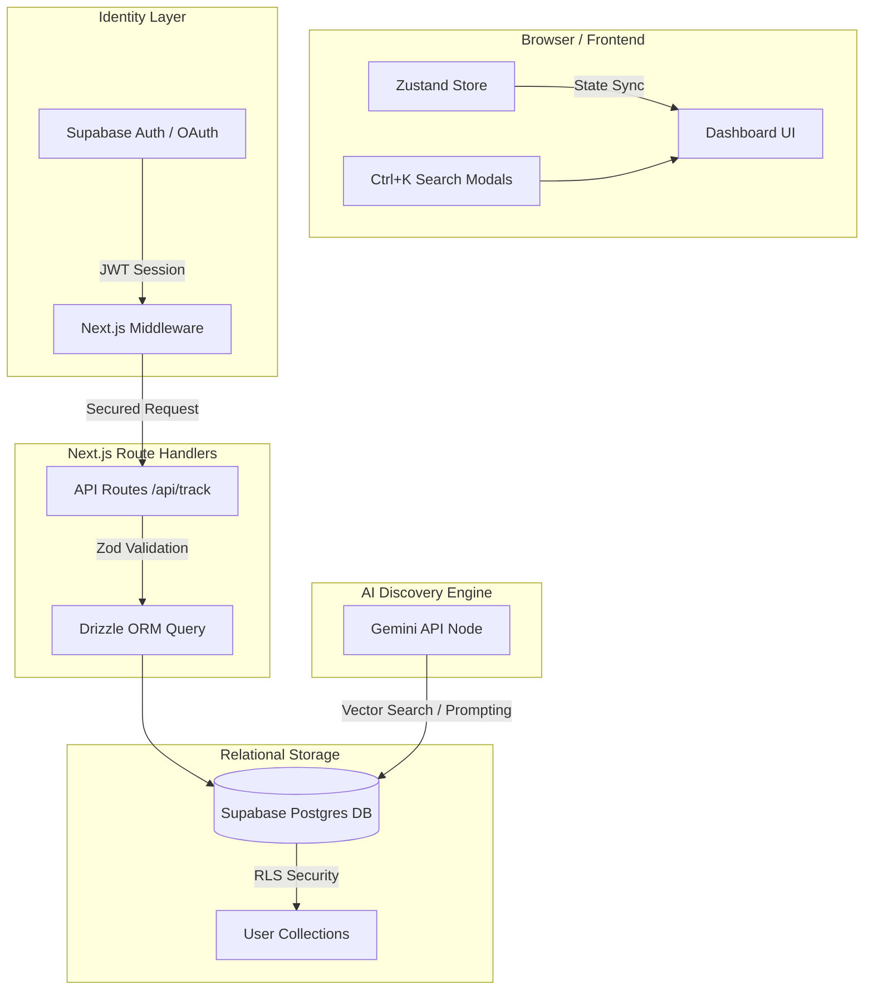

# SYS_TRACKER — Dashboard Overhaul & Architecture Blueprint

An exhaustive, high-fidelity engineering guide and constructive critique for transforming the **SYS_TRACKER** dashboard from a single-user static snapshot into a premium, interactive, multi-user media-tracking ecosystem. This blueprint draws direct architectural inspiration from **MyAnimeList**, **AniList**, **IMDb**, and **Letterboxd**, while exploiting the project's unique cross-media identity and Gemini integrations.

---

## Table of Contents

1. [Constructive Criticism: The Mirror of Reality](#1-constructive-criticism-the-mirror-of-reality)
2. [Architectural Redesign: Flat Files to Relational Auth](#2-architectural-redesign-flat-files-to-relational-auth)
3. [The Ultimate Dashboard Layout: MAL & AniList Reimagined](#3-the-ultimate-dashboard-layout-mal--anilist-reimagined)
4. [Designing a High-Fidelity Suggestion & Discovery Engine](#4-designing-a-high-fidelity-suggestion--discovery-engine)
5. [Refactoring Plan: Eliminating Code Duplication & Bloat](#5-refactoring-plan-eliminating-code-duplication--bloat)
6. [Implementation Checklist: Step-by-Step Guide](#6-implementation-checklist-step-by-step-guide)

---

## 1. Constructive Criticism: The Mirror of Reality

While the cyber-neobrutalist visual aesthetic of **SYS_TRACKER** is outstanding, the technical architecture behind it is highly fragile and acts as a severe bottleneck. Below is a detailed, honest critique of what is currently built.

### 🔴 The JSON Database (Concurrent Write Risks & Stale Data)
The app currently relies on reading and writing flat JSON files (`anime.json`, `manga.json`, etc.) in `src/database/` via Node's `fs/promises`.
*   **The Problem:** Next.js is a serverless-first framework. When deployed to Vercel or similar cloud environments, the filesystem is **read-only and ephemeral**. Writes will fail silently or succeed momentarily only to be wiped out when the serverless container spins down.
*   **Build-time Stagnation:** Because these JSON files are located inside the `src/` directory, they get compiled into the static bundle during `next build`. At runtime in production, you are serving a stale snapshot of whenever the project was built, completely defeating dynamic tracking.
*   **Race Conditions:** If you click `+1 episode` on an anime while simultaneously changing the score of a manga, the backend will perform concurrent `fs.readFile` and `fs.writeFile` operations on different files, but concurrent updates on the *same* file will corrupt the database.

### 🟡 The "Empty Shell" Dashboard (Static & Cluttered)
Your dashboard is currently a dashboard in name only. It does not feel alive:
*   **Terminal Welcomer is Dead Space:** While the neobrutalist terminal banner (`SESSION: ACTIVE_DEV`) looks fantastic, it takes up prime screen real-estate with static strings. It offers no interactive functionality (e.g., quick command line searching or status switching).
*   **Currently Consuming Overflow:** If you have 30 active items, the dashboard dumps all 30 onto the homepage grid. This causes long load times and visual clutter.
*   **The Regex Progress Nightmare:** Your `CategoryStats.tsx` component manually parses complex, custom strings like `"18/28 EP"` or `"S3E06"` or `"120 hrs"` with regex on every single render to calculate percentage widths and watch time. If a user inputs progress slightly differently (e.g., `"Ep 18"`, `"Season 3, Ep 6"`), the layout collapses.
*   **No Time Consciousness:** The system has no timestamps. You cannot filter by "recently updated" or view your watch history over the last week because the system does not record *when* updates happen.

### 🔴 Maintenance Nightmare (700+ Lines of Copy-Paste)
*   The `CategoryStats.tsx` component is currently **773 lines of highly redundant code**. The exact same JSX grid structure, status breakdown lists, and "Recent Updates" card mappings are duplicated **five times**—once for each media type.
*   If you decide to change how a status badge is rendered or adjust a text color, you have to modify it in five separate locations. This is an anti-pattern that slows down development and guarantees styling discrepancies.

---

## 2. Architectural Redesign: Flat Files to Relational Auth

To build a professional dashboard that supports real-time updates, secure authentication, and complex queries, the underlying storage and data flow must be modernized.



### The Data Layer Stack
We recommend migrating to **Supabase (PostgreSQL) + Drizzle ORM**:
1.  **Drizzle ORM** provides type-safe SQL queries, simple migrations, and zero-overhead performance.
2.  **Supabase** offers a free PostgreSQL database, instant authentication integrations, and Row Level Security (RLS) out of the box.

### The New Relational Schema
By breaking down the flat JSON file structure, we can establish relations between **Users**, **Media Items** (global entries), and **User Tracks** (user-specific list status, progress, and personal scores).

```typescript
// src/db/schema.ts
import { pgTable, text, integer, doublePrecision, timestamp, boolean, pgEnum } from "drizzle-orm/pg-core";

export const mediaTypeEnum = pgEnum("media_type", ["anime", "manga", "game", "movie", "series"]);
export const trackingStatusEnum = pgEnum("tracking_status", [
  "watching",      // Watching / Reading / Playing
  "completed",     // Completed
  "on_hold",       // Paused
  "dropped",       // Abandoned
  "plan_to_track"  // Backlog
]);

// 1. Global Media Library (acts as a cache of TMDB, AniList, RAWG data)
export const mediaLibrary = pgTable("media_library", {
  id: text("id").primaryKey(), // e.g., 'anilist-1535' or 'tmdb-m-27205'
  title: text("title").notNull(),
  type: mediaTypeEnum("type").notNull(),
  coverImage: text("cover_image").notNull(),
  releaseYear: integer("release_year"),
  genres: text("genres").array().notNull().default([]),
  externalRating: doublePrecision("external_rating"), // Global average rating
  synopsis: text("synopsis"),
  studio: text("studio"), // Studio/Director/Developer
  totalProgress: integer("total_progress"), // Total episodes/chapters/hours (nullable)
  unit: text("unit").notNull().default("ep"), // "ep", "ch", "hrs", "min"
  createdAt: timestamp("created_at").defaultNow().notNull(),
});

// 2. User Tracking Collection (User-specific data)
export const userTracks = pgTable("user_tracks", {
  id: text("id").primaryKey(), // UUID / CUID
  userId: text("user_id").notNull(), // Linked to Auth User
  mediaId: text("media_id").references(() => mediaLibrary.id, { onDelete: "cascade" }).notNull(),
  status: trackingStatusEnum("status").notNull().default("plan_to_track"),
  userRating: doublePrecision("user_rating"), // Personal score 0.0 - 10.0
  currentProgress: integer("current_progress").notNull().default(0),
  notes: text("notes"),
  isFavorite: boolean("is_favorite").notNull().default(false),
  rewatchCount: integer("rewatch_count").notNull().default(0),
  startDate: timestamp("start_date"),
  endDate: timestamp("end_date"),
  createdAt: timestamp("created_at").defaultNow().notNull(),
  updatedAt: timestamp("updated_at").defaultNow().notNull(),
});
```

> [!IMPORTANT]
> By separating the data into `media_library` (static movie/anime descriptions) and `user_tracks` (your personal progress), you completely eliminate duplicate downloads. If multiple users add *Attack on Titan*, the static text is stored once, and each user gets a small, indexable row in the `user_tracks` table.

---

## 3. The Ultimate Dashboard Layout: MAL & AniList Reimagined

A premium dashboard should feel alive, reflecting recent interactions instantly. It needs to organize information hierarchically so you are never overwhelmed.

### High-Fidelity UI Layout
We propose replacing the static layout with an interactive grid split into **Action Command Center (Left)**, **Interactive Timelines & Feeds (Center)**, and **Aggregated Visual Analytics (Right)**.

```
+---------------------------------------------------------------------------------------+
|  [SYS_TRACKER]     [Dashboard]   [Anime]   [Manga]   [Games]      [ Search Ctrl+K ]   |
+---------------------------------------------------------------------------------------+
|                                                                                       |
|  +---------------------------+  +--------------------------------------------------+  |
|  | OPERATOR CONSOLE          |  | CURRENT PROCESSES (ACTIVE TRACKS)                |  |
|  | [Avatar: SENPAI_09]       |  | +----------------------------------------------+ |  |
|  | Rank: SYS_OPERATOR::ELITE |  | | WATCHING (3)                                 | |  |
|  |                           |  | | [Card] [Card] [Card]                         | |  |
|  | Quick Stats:              |  | +----------------------------------------------+ |  |
|  | * Active: 6 Processes     |  | | PLAYING (1)                                  | |  |
|  | * Completed: 142 items    |  | | [Card]                                       | |  |
|  | * Dev Node Status: OK     |  | +----------------------------------------------+ |  |
|  |                           |  +--------------------------------------------------+  |
|  | [ Quick Add Input (/) ]   |                                                        |
|  +---------------------------+  +--------------------------------------------------+  |
|                                 | DISCOVERY / SUGGESTED PATHWAYS                   |  |
|  +---------------------------+  | > Based on your history, Gemini suggests:        |  |
|  | PINNED FAVORITES (★)       |  | +----------------------------------------------+ |  |
|  | [Card] [Card]             |  | | [Rec Card]   [Rec Card]   [Rec Card]           | |  |
|  | [Card] [Card]             |  | +----------------------------------------------+ |  |
|  +---------------------------+  +--------------------------------------------------+  |
|                                                                                       |
|  +---------------------------------------------------------------------------------+  |
|  | ACTIVITY CHRONOLOGY (RECENT SEALS)                                              |  |
|  | * [02h ago] - Completed "Interstellar" (Rated 9.5/10)                           |  |
|  | * [1d ago]  - Incremented progress on "Steins;Gate" to Ep 12/24                 |  |
|  | * [3d ago]  - Added "Hollow Knight" to Plan to Play                             |  |
|  +---------------------------------------------------------------------------------+  |
+---------------------------------------------------------------------------------------+
```

### Key Elements of the Rebuilt Dashboard:
1.  **Operator Command Console:** Replace the decorative Terminal banner with an interactive profile panel containing a dynamic "Quick Command Input" (`/`). Type `/status online` or `/add Steins Gate` to execute keyboard-driven dashboard adjustments.
2.  **Stateful Active Filters:** Instead of showing all active items on one infinite screen, implement smooth CSS-transition accordion drawers. Group your tracks by status:
    *   **Watching** (shows progress increments `+1 Ep`)
    *   **Reading** (shows `+1 Ch`)
    *   **Playing** (shows custom playtime input dial)
3.  **Activity Chronology Feed:** Draw inspiration from AniList. Create a micro-timeline using your record `updatedAt` timestamps. It renders elegant neobrutalist log streams:
    ```
    [LOG_SYNC] 2026-05-30 20:30: // Incremented "Jujutsu Kaisen" Chapter 142 -> 143.
    [LOG_SEAL] 2026-05-29 18:15: // Completed "Inception". Score submitted: 9.0/10.
    ```
4.  **Pinned Favorites Panel:** A dedicated grid block where you can pin up to 4 items per media category, showing your personal elite-tier ratings (a feature popular on Letterboxd and AniList).

---

## 4. Designing a High-Fidelity Suggestion & Discovery Engine

Currently, your "suggestions" are just external search results fetched from APIs. A true **Suggestion Engine** makes proactive, personalized recommendations based on what you have already completed and rated highly.

```
+----------------------------------------------------------------------------+
| COGNITIVE SUGGESTION ENGINE // POWERED BY GEMINI-1.5-FLASH                 |
+----------------------------------------------------------------------------+
| Analyzing user metadata for operator SENPAI_09...                          |
| Detected Preferences: High-Sci-Fi Anime (9.0+), Metroidvania Games (9.5+). |
|                                                                            |
| Recommended Pathways:                                                      |
|                                                                            |
| 1. [ANIME] ERGO PROXY (2006)                                               |
|    "Because you completed Steins;Gate and rated Death Note 9.0. Ergo Proxy |
|     shares the deep psychological thriller aspects and dystopian tech."    |
|    [ Quick Add to Plan to Watch ]                                          |
|                                                                            |
| 2. [GAME] ORI AND THE WILL OF THE WISPS (2020)                             |
|    "Because you rated Hollow Knight 9.5/10. This platformer offers a       |
|     similar masterfully atmospheric, interconnected exploration style."    |
|    [ Quick Add to Plan to Play ]                                           |
+----------------------------------------------------------------------------+
```

### Implementing Content-Based Suggestions (Local API Call)
To make your recommendations intelligent, we can use the **Gemini API** to evaluate user profiles.

1.  **Step 1: Gather Profile Vector Data**
    On the server, query the database for the user's highly-rated completed tracks (ratings $\ge$ 8.0). Compile their titles, genres, and media types into a structured JSON payload:
    ```json
    {
      "highly_rated": [
        { "title": "Hollow Knight", "type": "game", "genres": ["Metroidvania", "Indie"], "rating": "9.5" },
        { "title": "Steins;Gate", "type": "anime", "genres": ["Sci-Fi", "Thriller"], "rating": "9.8" }
      ],
      "active_genres": ["Sci-Fi", "Thriller", "Metroidvania", "Adventure"]
    }
    ```

2.  **Step 2: Submit to Gemini for Inference**
    Send this user profile directly to the Gemini API with a system prompt that mandates returning rich recommendation objects containing reasons and external identifiers.

    ```typescript
    // src/app/api/suggestions/route.ts
    import { NextRequest, NextResponse } from "next/server";
    import { GoogleGenAI } from "@google/genai";
    import { getHighlyRatedMedia } from "@/lib/db";

    const ai = new GoogleGenAI({ apiKey: process.env.GEMINI_API_KEY });

    export async function GET(request: NextRequest) {
      try {
        const userId = "SENPAI_09"; // Mock or retrieve from session
        const history = await getHighlyRatedMedia(userId);

        const prompt = `
          You are the AI Core Recommendation engine of SYS_TRACKER, an elite media collection dashboard.
          Analyze this user's profile database: ${JSON.stringify(history)}.
          
          Suggest exactly 3 highly relevant media items that the user HAS NOT tracked yet.
          The recommendations can traverse anime, manga, games, movies, or series.
          
          Respond ONLY with a JSON array matching this format:
          [
            {
              "title": "Item Name",
              "type": "anime" | "manga" | "game" | "movie" | "series",
              "reason": "A 2-sentence explanation of why they will love this, referencing their watch list.",
              "estimatedMatchPercentage": 94,
              "searchQuery": "Fuzzy query to find this item"
            }
          ]
        `;

        const response = await ai.models.generateContent({
          model: "gemini-1.5-flash",
          contents: prompt,
        });

        const text = response.text || "[]";
        const cleanJson = text.substring(text.indexOf("["), text.lastIndexOf("]") + 1);
        const recommendations = JSON.parse(cleanJson);

        return NextResponse.json({ success: true, recommendations });
      } catch (err: any) {
        console.error("Gemini suggestion failed:", err);
        return NextResponse.json({ success: false, error: err.message }, { status: 500 });
      }
    }
    ```

3.  **Step 3: Render Interactive Recommendation Cards**
    Map this JSON output into cyber-neobrutalist recommendation cards. When you hover over a suggestion card, it shows the AI's explanation (`reason`). Clicking the **"ADD TRACK"** button immediately initiates a background query against search APIs (using `searchQuery`), retrieves the cover image, and saves it into the database.

---

## 5. Refactoring Plan: Eliminating Code Duplication & Bloat

The component structure is begging for code-dryness. By extracting shared utilities and creating generic UI templates, we can reduce our total codebase lines by **nearly 50%**, accelerating build times and preventing rendering bugs.

### Overhauling `CategoryStats.tsx`
We can replace the copy-pasted blocks inside `CategoryStats.tsx` with a single, highly flexible `CategoryStatRow` subcomponent.

```typescript
// src/components/sections/CategoryStats/CategoryStatRow.tsx
"use client";

import React from "react";
import { LucideIcon, ArrowUpRight } from "lucide-react";
import { MediaItem } from "@/components/common/MediaCard";

interface CategoryStatRowProps {
  title: string;
  list: MediaItem[];
  icon: LucideIcon;
  colorClass: "purple" | "orange" | "green" | "cyan" | "yellow";
  linkPath: string;
  unit: string;
  calculateSpecificStat: (list: MediaItem[]) => { label: string; value: string | number };
}

export default function CategoryStatRow({
  title,
  list,
  icon: Icon,
  colorClass,
  linkPath,
  unit,
  calculateSpecificStat
}: CategoryStatRowProps) {
  // Shared calculations (Mean, Counts, Recents)
  const meanScore = calculateMeanScore(list);
  const activeCount = list.filter(item => ["watching", "reading", "playing"].includes(item.status.toLowerCase())).length;
  const completedCount = list.filter(item => item.status.toLowerCase() === "completed").length;
  const planCount = list.filter(item => item.status.toLowerCase().startsWith("plan")).length;
  const specificStat = calculateSpecificStat(list);

  // Color mapping config
  const colorMap = {
    purple: "border-cyber-purple shadow-[2px_2px_0px_0px_var(--cyber-purple)]",
    orange: "border-cyber-orange shadow-[2px_2px_0px_0px_var(--cyber-orange)]",
    green: "border-cyber-green shadow-[2px_2px_0px_0px_var(--cyber-green)]",
    cyan: "border-cyber-cyan shadow-[2px_2px_0px_0px_var(--cyber-cyan)]",
    yellow: "border-cyber-yellow shadow-[2px_2px_0px_0px_var(--cyber-yellow)]",
  };

  return (
    <div className="flex flex-col gap-3">
      {/* Dynamic Header */}
      <div className="flex items-center justify-between">
        <div className={`flex items-center gap-2 border bg-black/60 px-3.5 py-1.5 rounded-md text-xs font-bold text-white ${colorMap[colorClass]}`}>
          <Icon className="w-4 h-4" />
          <span className="tracking-widest uppercase">{title} Statistics</span>
        </div>
        <a href={linkPath} className="hover:opacity-80 text-[10px] text-gray-500 font-semibold uppercase flex items-center gap-0.5 transition-opacity">
          Full Collections <ArrowUpRight className="w-3 h-3" />
        </a>
      </div>

      {/* Grid Metrics Block */}
      <div className="bg-[#0b0b0e] border-2 border-white/5 p-6 rounded-lg grid grid-cols-1 lg:grid-cols-12 gap-8">
        {/* Statistics Cards */}
        <div className="lg:col-span-3 flex gap-12 items-center">
          <div className="flex flex-col">
            <span className="text-[10px] text-gray-500 tracking-wider uppercase font-bold mb-1">{specificStat.label}</span>
            <span className="text-3xl font-black text-white leading-none">{specificStat.value}</span>
          </div>
          <div className="flex flex-col">
            <span className="text-[10px] text-gray-500 tracking-wider uppercase font-bold mb-1">Mean Score</span>
            <span className="text-3xl font-black text-white leading-none">{meanScore}</span>
          </div>
        </div>

        {/* Status Breakdown Lists */}
        <div className="lg:col-span-3 grid grid-cols-2 gap-x-6 gap-y-1.5 text-xs border-y lg:border-y-0 lg:border-x border-white/5 py-4 lg:py-0 lg:px-6">
          <div className="flex items-center justify-between text-gray-400">
            <span className="flex items-center gap-1.5"><span className="w-2 h-2 rounded-full bg-[#2ecc71] inline-block" />Active</span>
            <span className="font-bold text-white">{activeCount}</span>
          </div>
          <div className="flex items-center justify-between text-gray-400">
            <span className="flex items-center gap-1.5"><span className="w-2 h-2 rounded-full bg-[#3498db] inline-block" />Completed</span>
            <span className="font-bold text-white">{completedCount}</span>
          </div>
          <div className="flex items-center justify-between text-gray-400">
            <span className="flex items-center gap-1.5"><span className="w-2 h-2 rounded-full bg-[#f1c40f] inline-block" />Backlog</span>
            <span className="font-bold text-white">{planCount}</span>
          </div>
        </div>

        {/* Totals */}
        <div className="lg:col-span-2 flex flex-col justify-center gap-2 text-xs text-gray-400">
          <div className="flex justify-between items-center">
            <span>Entries</span>
            <span className="font-bold text-white">{list.length}</span>
          </div>
        </div>

        {/* Dynamic Activity List */}
        <div className="lg:col-span-4 flex flex-col gap-2.5">
          <span className="text-[10px] text-gray-500 tracking-wider uppercase font-bold">Recent Injections</span>
          {list.slice(-2).reverse().map(item => (
            <div key={item.id} className="flex gap-2 items-center text-xs">
              <span className="text-white truncate font-bold flex-1">{item.title}</span>
              <span className="text-gray-500 font-mono text-[10px]">{item.status} ({item.progress})</span>
            </div>
          ))}
        </div>
      </div>
    </div>
  );
}
```

---

## 6. Implementation Checklist: Step-by-Step Guide

To bring these suggestions to life without breaking your working production branch, we advise executing in the following strictly ordered checklist.

### Phase 1: Database and Authentication Core (4 Days)
- [ ] **Provision Database:** Set up a free Supabase instance and note down public access URLs.
- [ ] **Install ORM Package:** Run `npm i drizzle-orm @neondatabase/serverless` and configure local configuration files.
- [ ] **Configure Supabase Auth:** Setup OAuth handlers inside the Supabase console (Google, Discord, or GitHub accounts are highly recommended for gamer/tracker systems).
- [ ] **Setup Middleware Routing:** Implement a Next.js `middleware.ts` structure to intercept routes and block unauthorized writes:
  ```typescript
  import { createMiddlewareClient } from '@supabase/auth-helpers-nextjs';
  import { NextResponse } from 'next/server';
  import type { NextRequest } from 'next/server';

  export async function middleware(req: NextRequest) {
    const res = NextResponse.next();
    const supabase = createMiddlewareClient({ req, res });
    const { data: { session } } = await supabase.auth.getSession();

    if (!session && req.nextUrl.pathname.startsWith('/api/track')) {
      return NextResponse.json({ error: 'Auth session required' }, { status: 401 });
    }
    return res;
  }
  ```

### Phase 2: Core UX Rebuild (3 Days)
- [ ] **Refactor Component Code:** Replace the 773 lines of raw statistics code in `CategoryStats.tsx` using our dynamic component extraction strategy.
- [ ] **Move Search to Navbar:** Place the search input component securely into a floating desktop navbar header, mapping the standard `Ctrl + K` hotkey event to trigger focus.
- [ ] **Implement Client State Store (Zustand):** Add global media state management, removing the slow and awkward `router.refresh()` cycles:
  ```typescript
  import { create } from 'zustand';
  import { MediaItem } from '@/components/common/MediaCard';

  interface MediaState {
    collection: MediaItem[];
    setCollection: (items: MediaItem[]) => void;
    updateItem: (id: string, progress: number, rating?: string) => void;
  }

  export const useMediaStore = create<MediaState>((set) => ({
    collection: [],
    setCollection: (collection) => set({ collection }),
    updateItem: (id, progress, rating) => set((state) => ({
      collection: state.collection.map(item => 
        item.id === id ? { ...item, progress: `${progress} EP`, rating: rating || item.rating } : item
      )
    })),
  }));
  ```
- [ ] **Design Individual Detail Pages:** Add dynamic folders `/app/media/[type]/[id]/page.tsx` that retrieve and render deep metadata from API endpoints.

### Phase 3: Suggestion & Custom Polish (2 Days)
- [ ] **Connect Gemini Recommendation API:** Build the `/api/suggestions` server handler matching the prompt configuration above.
- [ ] **Add AI Carousel Interface:** Render recommendation modules inside the dashboard homepage with custom neobrutalist designs, hover-state details, and quick-add execution logic.
- [ ] **Implement Optimistic Mutation Updates:** Program visual updates on incremental buttons (`+1 Ep`) to happen instantly on-click before the HTTP POST/PUT database transaction completes, falling back dynamically on errors.
- [ ] **Image Optimization Transition:** Replace primitive `` attributes across components with optimized `next/image` layouts using remote patterns to support fast, compressed WebP generation.

---

> [!TIP]
> **Conclusion:** By modernizing the database model and creating an intelligent, Gemini-driven suggestion engine, **SYS_TRACKER** will transcend a simple visual catalog to become a cutting-edge, state-of-the-art media logging console. Maintain your beautiful cyber-neobrutalist identity, clean up the codebase duplication, and transition onto a proper database framework—your users will be absolutely wowed.
