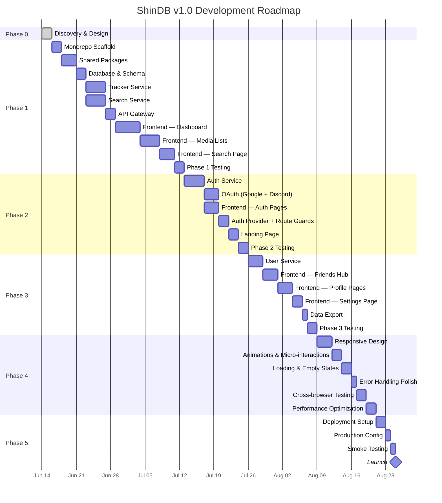
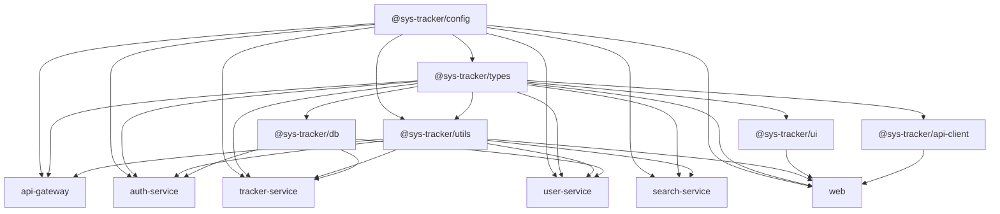

# ShinDB — Implementation Plan

> **Version**: 1.1.0-harmonized  
> **Last Updated**: 2026-10-14  
> **Status**: Active (Phase 0 Complete, Phase 1 Foundation Underway)  
> **Target Release**: v1.0.0  
> **Companion Docs**: [PRD.md](file:///d:/02_CODE/04_WORKING/ShinDB/src/notes/PRD.md) · [TechSpec.md](file:///d:/02_CODE/04_WORKING/ShinDB/src/notes/TechSpec.md) · [AppFlow.md](file:///d:/02_CODE/04_WORKING/ShinDB/src/notes/AppFlow.md) · [Schema.md](file:///d:/02_CODE/04_WORKING/ShinDB/src/notes/Schema.md) · [DESIGN.md](file:///d:/02_CODE/04_WORKING/ShinDB/src/notes/DESIGN.md) · [SYS_Tracker.md](file:///d:/02_CODE/04_WORKING/ShinDB/src/notes/SYS_Tracker.md) · [Tracker.md](file:///d:/02_CODE/04_WORKING/ShinDB/src/notes/Tracker.md) · [Rules.md](file:///d:/02_CODE/04_WORKING/ShinDB/src/notes/Rules.md)

---

## Table of Contents

1. [Development Lifecycle Overview](#1-development-lifecycle-overview)
2. [Phase 0 — Discovery & Design](#2-phase-0--discovery--design)
3. [Phase 1 — Foundation (Core Tracking)](#3-phase-1--foundation-core-tracking)
4. [Phase 2 — Authentication & User Identity](#4-phase-2--authentication--user-identity)
5. [Phase 3 — Social Features](#5-phase-3--social-features)
6. [Phase 4 — Polish & Production Readiness](#6-phase-4--polish--production-readiness)
7. [Phase 5 — Deployment & Launch](#7-phase-5--deployment--launch)
8. [Testing Strategy per Phase](#8-testing-strategy-per-phase)
9. [Risk Assessment & Mitigation](#9-risk-assessment--mitigation)
10. [Dependency Map](#10-dependency-map)
11. [Definition of Done](#11-definition-of-done)
12. [Architecture Harmonization & Revision History](#12-architecture-harmonization--revision-history)

---

## 1. Development Lifecycle Overview

### Phase Summary



### Phase Summary Table

| Phase | Focus | Key Deliverables | Est. Duration |
|-------|-------|-----------------|---------------|
| **Phase 0** | Discovery & Design | All spec docs completed | 2 days |
| **Phase 1** | Foundation | Working media tracker (no auth) — CRUD, search, dashboard, lists | ~25 days |
| **Phase 2** | Authentication | Multi-user support — email/password, OAuth, protected routes, landing page | ~16 days |
| **Phase 3** | Social Features | Friends, profiles, settings, data export | ~14 days |
| **Phase 4** | Polish | Responsive, animations, loading states, performance, cross-browser | ~12 days |
| **Phase 5** | Deployment | Production infrastructure, smoke testing, launch | ~4 days |
| | | **Total estimated** | **~73 days** |

> **Note**: Estimates assume a single developer working part-time (~4-6 hours/day). Full-time development could compress the timeline by 30-40%.

---

## 2. Phase 0 — Discovery & Design

> **Status**: ✅ COMPLETE  
> **Goal**: Establish all specification documents before writing any code.

### Deliverables

| Document | Status | Description |
|----------|--------|-------------|
| [PRD.md](file:///d:/02_CODE/04_WORKING/ShinDB/src/notes/PRD.md) | ✅ Complete | Product requirements, feature scope, success criteria |
| [TechSpec.md](file:///d:/02_CODE/04_WORKING/ShinDB/src/notes/TechSpec.md) | ✅ Complete | Tech stack, API design, architecture decisions |
| [AppFlow.md](file:///d:/02_CODE/04_WORKING/ShinDB/src/notes/AppFlow.md) | ✅ Complete | User journeys, screen flows, interaction patterns |
| [DESIGN.md](file:///d:/02_CODE/04_WORKING/ShinDB/src/notes/DESIGN.md) | ✅ Complete | Visual design system, tokens, components |
| [Schema.md](file:///d:/02_CODE/04_WORKING/ShinDB/src/notes/Schema.md) | ✅ Complete | Database schema, relationships, indexes (single source of truth) |
| [SYS_Tracker.md](file:///d:/02_CODE/04_WORKING/ShinDB/src/notes/SYS_Tracker.md) | ✅ Complete | Monorepo architecture, folder structure, fresh-build framing |
| [ImplementationPlan.md](file:///d:/02_CODE/04_WORKING/ShinDB/src/notes/ImplementationPlan.md) | ✅ Complete | Master execution roadmap & architecture changelog (this document) |
| [Tracker.md](file:///d:/02_CODE/04_WORKING/ShinDB/src/notes/Tracker.md) | ✅ Complete | Task tracking board |
| [Rules.md](file:///d:/02_CODE/04_WORKING/ShinDB/src/notes/Rules.md) | ✅ Complete | User AI coding guardrails |

### Architecture Harmonization (Post-Draft Consistency Pass)

During pre-development review, all specification documents were audited and unified to eliminate inconsistencies that accumulated across iterative planning stages:

1. **Brand & Naming Alignment**:
   - Standardized application name to **ShinDB** across all specs (with internal codename `[ShinDB::MVP]`).
   - Deprecated legacy working titles (`SYS_TRACKER`, `imdb-gemini`).
2. **Backend Framework Decision**:
   - Standardized on **Hono** for all 4 microservices (`auth`, `tracker`, `user`, `search`) and the API Gateway.
   - Removed Express ambiguity from architecture diagrams and service descriptions.
3. **Database & ORM Decision**:
   - Standardized on **PostgreSQL 16+** and **Prisma 6.x** as the sole ORM across all specifications and packages (`@sys-tracker/db`).
   - Cleaned up legacy Drizzle ORM artifacts, keeping Drizzle documented strictly in TechSpec ADR §1.3 as a considered alternative.
4. **Authoritative 6-Model Schema**:
   - Established [Schema.md](file:///d:/02_CODE/04_WORKING/ShinDB/src/notes/Schema.md) as the single source of truth for the database schema.
   - Replaced fragmented 4-table schemas with the full 6-model relational structure: `User`, `MediaEntry`, `MediaExternalId`, `ActivityLog`, `Friendship`, and `ProgressHistory`.
5. **Path & Link Resolution**:
   - Corrected all stale documentation links from previous scratch directories (`d:/02_CODE/04_TEST/VSHIN/imdb-gemini/`) to current project structure (`d:/02_CODE/04_WORKING/ShinDB/`).
6. **Project Framing**:
   - Realigned SYS_Tracker from "migration from monolith" to clean "fresh build" Turborepo architecture.
7. **Consolidated UI Architecture**:
   - Standardized media list views across all 5 formats onto a unified `MediaCollectionView` component.

### Exit Criteria
- [x] All 8 spec documents created and reviewed
- [x] Cross-document consistency audit complete (naming, tech stack, schema, links, framing)
- [x] Tech stack finalized (Hono, Prisma, TanStack Query, Tailwind v3, Vitest)
- [x] Database schema finalized (6 tables, Prisma schema ready in Schema.md)
- [x] API endpoints defined (4 services + Gateway, all routes mapped)
- [x] Design system documented (tokens, components, layout)
- [x] Tracker.md and Rules.md initialized

---

## 3. Phase 1 — Foundation (Core Tracking)

> **Goal**: A fully functional media tracker for a single user (no auth). CRUD operations, external search, dashboard, and media list pages.

---

### Step 1.1 — Monorepo Scaffold

> **Duration**: ~2 days  
> **Dependencies**: None  
> **Reference**: [SYS_Tracker.md §4](file:///d:/02_CODE/04_WORKING/ShinDB/src/notes/SYS_Tracker.md)

| Task | Details |
|------|---------|
| Initialize Turborepo | `npx create-turbo@latest` in project root |
| Set up `pnpm-workspace.yaml` | Define `apps/*` and `packages/*` workspaces |
| Configure `turbo.json` | Pipeline: `dev`, `build`, `lint`, `type-check`, `test` |
| Create app directories | `apps/web`, `apps/api-gateway`, `apps/auth-service`, `apps/tracker-service`, `apps/user-service`, `apps/search-service` |
| Create package directories | `packages/types`, `packages/ui`, `packages/utils`, `packages/db`, `packages/config`, `packages/api-client` |
| Root configs | `.gitignore`, `.env.example`, root `tsconfig.json`, root `package.json` |
| Docker Compose | `docker-compose.yml` with PostgreSQL 16 + Redis 7 |
| Verify | `pnpm install` succeeds, `docker compose up -d` starts infrastructure |

**Exit Criteria**: `pnpm dev` runs without errors (even if services are empty stubs).

---

### Step 1.2 — Shared Packages

> **Duration**: ~3 days  
> **Dependencies**: Step 1.1  
> **Reference**: [TechSpec.md §1](file:///d:/02_CODE/04_WORKING/ShinDB/src/notes/TechSpec.md), [Schema.md §3](file:///d:/02_CODE/04_WORKING/ShinDB/src/notes/Schema.md)

#### `@sys-tracker/config`
| Task | Details |
|------|---------|
| Base TypeScript config | `typescript/base.json` — relaxed strict mode as defined in TechSpec |
| Next.js TypeScript config | `typescript/nextjs.json` extends base |
| Node TypeScript config | `typescript/node.json` extends base |
| ESLint configs | `eslint/base.js`, `eslint/next.js`, `eslint/node.js` |
| Tailwind preset | `tailwind/preset.js` — all DESIGN.md tokens mapped (see TechSpec §3.2) |

#### `@sys-tracker/types`
| Task | Details |
|------|---------|
| Media types | `MediaType`, `MediaStatus`, `ProgressUnit` enums |
| Entry interfaces | `MediaEntry`, `SearchResult` |
| User interfaces | `User`, `UserProfile` |
| Friend interfaces | `Friendship`, `FriendWithProfile` |
| API interfaces | `ApiResponse<T>`, `PaginatedResponse<T>`, `ErrorResponse` |
| Auth interfaces | `JwtPayload`, `AuthTokens` |

#### `@sys-tracker/utils`
| Task | Details |
|------|---------|
| Formatters | `formatRating()`, `formatProgress()`, `formatDate()`, `formatRelativeTime()` |
| Validators | `isValidRating()`, `isValidProgress()`, `isValidUsername()` |
| Constants | `MEDIA_TYPES`, `STATUS_OPTIONS`, `PROGRESS_UNITS`, `DEFAULT_COVER_IMAGE` |
| Helpers | `getTypeMeta()`, `getStatusColor()`, `getProgressPercent()`, `getAccentColor()` |
| Errors | `AppError`, `NotFoundError`, `ValidationError` classes |

#### `@sys-tracker/ui` (Skeleton)
| Task | Details |
|------|---------|
| Package setup | React component library with Tailwind |
| Stub exports | Empty component files (Button, Badge, Card, Modal, Input, etc.) |
| Design tokens CSS | Import Tailwind preset, base styles |

**Exit Criteria**: All packages build successfully. Types can be imported across apps.

---

### Step 1.3 — Database & Schema

> **Duration**: ~2 days  
> **Dependencies**: Step 1.2  
> **Reference**: [Schema.md](file:///d:/02_CODE/04_WORKING/ShinDB/src/notes/Schema.md)

#### `@sys-tracker/db`
| Task | Details |
|------|---------|
| Prisma setup | Install Prisma, configure `datasource` with PostgreSQL |
| Schema definition | Full Prisma schema from Schema.md §10 (all 6 models, enums, indexes) |
| Enable `pg_trgm` | SQL migration for trigram text search extension |
| Initial migration | `prisma migrate dev --name init` |
| Prisma client generation | `prisma generate` |
| Soft delete middleware | Prisma middleware to auto-filter `deletedAt IS NULL` |
| Seed script | `prisma/seed.ts` with test users and sample entries (Schema.md §11) |
| Verify | `prisma studio` opens, seed data visible |

**Exit Criteria**: Database has all 6 tables with seed data. Prisma client is generated and importable.

---

### Step 1.4 — Tracker Service

> **Duration**: ~4 days  
> **Dependencies**: Step 1.3  
> **Reference**: [TechSpec.md §4, §6.2](file:///d:/02_CODE/04_WORKING/ShinDB/src/notes/TechSpec.md)

| Task | Details |
|------|---------|
| Hono app setup | Base Hono app with CORS, logger, health check |
| Zod schemas | `createEntrySchema`, `updateEntrySchema`, `filterParamsSchema`, `progressSchema` |
| Validation middleware | Reusable Zod validation middleware for Hono |
| **CRUD Routes** | |
| `GET /entries` | List entries with filters, sort, pagination |
| `GET /entries/:id` | Single entry by ID |
| `POST /entries` | Create entry (with external ID linking) |
| `PUT /entries/:id` | Update entry (partial) |
| `PATCH /entries/:id/progress` | Increment or set progress |
| `PATCH /entries/:id/favorite` | Toggle favorite |
| `PATCH /entries/:id/soft-delete` | Soft delete |
| `PATCH /entries/:id/restore` | Restore soft-deleted entry |
| `DELETE /entries/:id` | Permanent delete (admin only) |
| **Stats Routes** | |
| `GET /stats` | Aggregated dashboard stats (all types) |
| `GET /stats/:type` | Per-type stats |
| **Other Routes** | |
| `GET /entries/favorites` | Favorites list |
| `GET /recent` | Currently active + recently completed |
| `GET /export` | JSON export of all entries |
| **Supporting** | |
| Activity log | Automatic logging on create, update, delete, restore, progress, favorite |
| Progress history | Automatic logging on progress changes |
| Error handler | Global error handler returning `ErrorResponse` format |
| **Tests** | |
| Unit tests | Zod schema validation (valid + invalid inputs) |
| Integration tests | CRUD operations against test database |

**Exit Criteria**: All tracker endpoints work via REST client (Postman/Thunder Client). CRUD, progress, favorites, stats, and export verified.

---

### Step 1.5 — Search Service

> **Duration**: ~4 days (parallel with Step 1.4)  
> **Dependencies**: Step 1.2  
> **Reference**: [TechSpec.md §9](file:///d:/02_CODE/04_WORKING/ShinDB/src/notes/TechSpec.md)

| Task | Details |
|------|---------|
| Hono app setup | Base Hono app with CORS, logger, health check |
| Provider interface | `SearchProvider` interface (strategy pattern) |
| **AniList provider** | |
| GraphQL query | Search anime/manga with title, cover, year, genres, episodes/chapters, score |
| Response normalization | Map AniList response → `SearchResult` interface |
| **TMDB provider** | |
| Movie search | `GET /search/movie` with API key |
| Series search | `GET /search/tv` with API key |
| Response normalization | Map TMDB response → `SearchResult` (including poster URL construction) |
| **RAWG provider** | |
| Game search | `GET /games?search=...` with API key |
| Response normalization | Map RAWG response → `SearchResult` |
| **Search aggregator** | |
| Route: `GET /search` | Query params: `q`, `type`, `page` |
| Type-to-provider mapping | `anime/manga → AniList`, `movie/series → TMDB`, `game → RAWG` |
| Redis caching | Cache results with key `search:{type}:{query}:{page}`, TTL 1 hour |
| Cache hit flag | Response includes `cached: boolean` |
| **Tests** | |
| Unit tests | Response normalization for each provider |
| Integration tests | Live API calls (with mocking for CI) |

**Exit Criteria**: Search returns normalized results from all 3 APIs. Redis caching works (verify cache hit on repeated queries).

---

### Step 1.6 — API Gateway

> **Duration**: ~2 days  
> **Dependencies**: Steps 1.4, 1.5  
> **Reference**: [TechSpec.md §5](file:///d:/02_CODE/04_WORKING/ShinDB/src/notes/TechSpec.md)

| Task | Details |
|------|---------|
| Hono app setup | Base Hono app with CORS, logger |
| Service config | Service URLs and health check paths from env vars |
| Route proxying | `/media/*` → tracker-service, `/search/*` → search-service |
| Request forwarding | Strip prefix, forward headers (including future auth headers) |
| Health check | `GET /health` — aggregated health of all downstream services |
| Version endpoint | `GET /version` — returns app version |
| Error normalization | Catch downstream errors, normalize to `ErrorResponse` |
| CORS config | Configurable allowed origins |
| **Note** | Auth middleware is added in Phase 2. For now, gateway passes all requests through |

**Exit Criteria**: Frontend can call `http://localhost:4000/media/entries` and `http://localhost:4000/search?q=steins` and get correct responses from downstream services.

---

### Step 1.7 — Frontend: Dashboard

> **Duration**: ~5 days  
> **Dependencies**: Step 1.6  
> **Reference**: [AppFlow.md §4](file:///d:/02_CODE/04_WORKING/ShinDB/src/notes/AppFlow.md), [DESIGN.md §6.1](file:///d:/02_CODE/04_WORKING/ShinDB/src/notes/DESIGN.md)

| Task | Details |
|------|---------|
| Next.js setup | Initialize `apps/web` with App Router, configure `next.config.ts` (image domains, transpilePackages) |
| Tailwind setup | Install Tailwind v3, import shared preset from `@sys-tracker/config` |
| Google Fonts | Load JetBrains Mono + Inter via `next/font` |
| `@sys-tracker/api-client` | Type-safe fetch wrapper with base URL config, response parsing |
| TanStack Query setup | `QueryProvider` with default options from TechSpec §3.5 |
| Query keys | Implement query key factory (TechSpec §3.6) |
| **Layout** | |
| Root layout | `app/layout.tsx` — providers, fonts, global styles |
| Dashboard layout | `app/(dashboard)/layout.tsx` — navbar + content area |
| Navbar | Top navigation bar per DESIGN.md §5.1 — logo, nav items, user area |
| **Dashboard Page** | |
| System banner | Branded header with system status text |
| Search bar | Centered, monospace, `Ctrl+K` shortcut |
| Profile card | Avatar, role badge, username, bio, status |
| Stat cards (4) | Color-coded per media type, count-up animation |
| Summary stats | Total tracked, compilation rate, active/done/backlog |
| Per-type statistics | 4 sections (anime, manga, games, movies+series) with status breakdowns |
| Currently consuming | Horizontal scroll row of active entry poster cards |
| Recently completed | Grid of recently completed poster cards |
| **Components** | |
| `StatCard` | Reusable stat card with accent color, icon, number, label |
| `MediaPosterCard` | Poster image, title, year, [+1] button |
| `SectionHeader` | Badge-style section label with accent color border |

**Exit Criteria**: Dashboard renders with real data from API. Stat cards show correct numbers. Currently consuming and recently completed sections populated.

---

### Step 1.8 — Frontend: Media List Pages

> **Duration**: ~4 days  
> **Dependencies**: Step 1.7  
> **Reference**: [AppFlow.md §6](file:///d:/02_CODE/04_WORKING/ShinDB/src/notes/AppFlow.md), [DESIGN.md §6.2](file:///d:/02_CODE/04_WORKING/ShinDB/src/notes/DESIGN.md)

| Task | Details |
|------|---------|
| **Shared media list page** | Unified `MediaCollectionView` component used by all 5 routes (`/anime`, `/manga`, `/movies`, `/series`, `/games`) |
| Page header | Category icon, title, result count, toolbar |
| Filter pills | Status-based filters, accent-colored active state |
| Sort dropdown | Title, rating, date added, progress, year — with direction toggle |
| Search input | Inline text search (client-side filter on title) |
| Media grid | 7-column poster grid (responsive via Tailwind) |
| Lazy loading | IntersectionObserver for loading entries in batches of 50 |
| Virtual scrolling | `react-window` for large collections (200+ entries) |
| **Card interactions** | |
| Click poster | Open Quick Edit Modal |
| [+1] button | Increment progress (optimistic update + toast) |
| Auto-complete | When progress reaches total, auto-set status to "completed" |
| **Quick Edit Modal** | |
| Modal component | Overlay with entry details, editable fields |
| Status dropdown | Type-appropriate status options |
| Rating selector | 0-10 integer buttons |
| Progress input | Current/total with +/- buttons, progress bar |
| Dates | Start/end date pickers |
| Notes textarea | With character counter (max 2000) |
| Tags input | Autocomplete from existing tags, max 10 |
| Save/Cancel/Delete | Save = API update + toast. Delete = soft delete + undo toast |
| "VIEW DETAILS →" | Link to `/media/[type]/[id]` |
| **Media Detail Page** | |
| Route: `/media/[type]/[id]` | Full-page entry view |
| Hero section | Large poster, title (English + native), metadata, actions |
| Notes section | Read-only display |
| Tags section | Tag pills |
| Activity log | Chronological list from `activity_log` table |
| Edit button | Opens Quick Edit Modal |
| Delete button | Soft delete + undo toast |

**Exit Criteria**: All 5 media list pages render with filters, sorting, grid view. Quick Edit Modal works for editing entries. Media detail page shows full entry info with activity log.

---

### Step 1.9 — Frontend: Search Page

> **Duration**: ~3 days  
> **Dependencies**: Step 1.8  
> **Reference**: [AppFlow.md §5](file:///d:/02_CODE/04_WORKING/ShinDB/src/notes/AppFlow.md)

| Task | Details |
|------|---------|
| Route: `/search` | Search results page with query params |
| Search header | Search input, type filter pills (ALL, ANIME, MANGA, MOVIES, SERIES, GAMES) |
| Source indicator | Shows which API was queried + cached status |
| Results grid | Same 7-column poster layout as media lists |
| **Result card** | |
| [+ ADD] button | Quick-add as `plan_to_consume` → toast → button changes to "✓ ADDED" |
| Click card | Opens Entry Modal (pre-filled from search result) |
| **Entry Modal (from search)** | |
| Pre-filled fields | Cover, title, year, genres, episodes/chapters from API |
| Editable fields | Status, rating, progress, notes, tags |
| "ADD TO LIST" | Creates entry with user settings → toast → modal closes |
| "VIEW DETAILS" | Link/button for external detail (or internal if already added) |
| Duplicate check | If entry already in user's list, show "ALREADY TRACKED" badge instead of add button |
| **Ctrl+K behavior** | |
| Global shortcut | Focus search bar on dashboard; on other pages, redirect to `/search` |

**Exit Criteria**: Can search for media across all 3 APIs. Can quick-add or add-with-details. Duplicate entries are flagged.

---

### Phase 1 Testing Checkpoint

> **Duration**: ~2 days

| Test | Scope |
|------|-------|
| **Tracker service unit tests** | Zod schemas, utility functions |
| **Tracker service integration** | CRUD endpoints against test DB |
| **Search service unit tests** | Provider normalization |
| **Search service integration** | API calls (mocked for CI) |
| **Frontend smoke test** | Manual walkthrough: dashboard → search → add → media list → edit → delete → undo |
| **API gateway** | Route proxying, error forwarding |
| **Cross-reference** | Stats on dashboard match actual entry counts |

---

## 4. Phase 2 — Authentication & User Identity

> **Goal**: Multi-user support with JWT auth, OAuth, protected routes, and a landing page.

---

### Step 2.1 — Auth Service

> **Duration**: ~4 days  
> **Dependencies**: Phase 1 complete  
> **Reference**: [TechSpec.md §7](file:///d:/02_CODE/04_WORKING/ShinDB/src/notes/TechSpec.md)

| Task | Details |
|------|---------|
| Hono app setup | Base Hono app with CORS, logger, health check |
| Zod schemas | `registerSchema`, `loginSchema`, `changePasswordSchema` |
| **Routes** | |
| `POST /register` | Create user (bcrypt hash, registration gating via `ALLOW_REGISTRATION`) |
| `POST /login` | Verify credentials → issue JWT access + refresh tokens |
| `POST /logout` | Blacklist refresh token in Redis |
| `POST /refresh` | Verify refresh token → issue new token pair (rotation) |
| `GET /me` | Return current user from JWT payload |
| `PUT /password` | Change password (verify current, hash new) |
| **JWT implementation** | |
| Access token | 24h expiry, payload: `{ sub, username, email, type: "access" }` |
| Refresh token | 30d expiry, httpOnly cookie, `jti` for blacklisting |
| Token rotation | New refresh token on every refresh call |
| Blacklisting | Store blacklisted `jti` in Redis with TTL = remaining expiry |
| **Tests** | |
| Registration | Valid input, duplicate username, duplicate email, disabled registration |
| Login | Valid credentials, wrong password, non-existent user |
| JWT | Token creation, verification, expiry, refresh, blacklisting |
| Password | Change with valid current, wrong current password |

**Exit Criteria**: Auth endpoints work via REST client. JWT lifecycle verified (create, verify, refresh, blacklist).

---

### Step 2.2 — OAuth Integration

> **Duration**: ~3 days  
> **Dependencies**: Step 2.1  
> **Reference**: [TechSpec.md §7.5](file:///d:/02_CODE/04_WORKING/ShinDB/src/notes/TechSpec.md)

| Task | Details |
|------|---------|
| **Google OAuth** | |
| `POST /login/google` | Exchange auth code for Google tokens → fetch profile → find-or-create user → issue JWT |
| User linking | If email exists, link Google account to existing user |
| Username generation | Auto-generate from Google display name (with uniqueness check) |
| **Discord OAuth** | |
| `POST /login/discord` | Exchange auth code for Discord tokens → fetch profile → find-or-create user → issue JWT |
| User linking | Same as Google |
| **Env setup** | |
| Google Cloud Console | Create OAuth client, configure redirect URIs |
| Discord Developer Portal | Create application, configure redirect URIs |

**Exit Criteria**: Can register/login via Google and Discord. Account linking works for existing email users.

---

### Step 2.3 — Frontend: Auth Pages

> **Duration**: ~3 days (parallel with Step 2.2)  
> **Dependencies**: Step 2.1  
> **Reference**: [AppFlow.md §3](file:///d:/02_CODE/04_WORKING/ShinDB/src/notes/AppFlow.md)

| Task | Details |
|------|---------|
| Auth layout | `app/(auth)/layout.tsx` — no navbar, centered form, terminal aesthetic |
| **Login page** | |
| `/login` | Email + password form, terminal-themed |
| OAuth buttons | Google + Discord sign-in buttons |
| Error display | Inline error messages in terminal style |
| Redirect handling | Read `?redirect=` param, redirect after success |
| **Register page** | |
| `/register` | Username, display name, email, password form |
| Real-time validation | Username availability check (debounced), password strength indicator |
| OAuth option | Google + Discord registration |
| **Auth state** | |
| `AuthProvider` | React Context for current user, tokens, login/logout functions |
| Token storage | Access token in memory (React state), refresh token in httpOnly cookie |
| Auto-refresh | Interceptor in `api-client` — on 401, attempt refresh, retry original request |
| Auto-logout | On refresh failure, clear state, redirect to `/login` |

**Exit Criteria**: Can register and login via form and OAuth. Auth state persists across page navigations. Token refresh works.

---

### Step 2.4 — Auth Middleware & Route Guards

> **Duration**: ~2 days  
> **Dependencies**: Steps 2.1, 2.3  
> **Reference**: [TechSpec.md §5.3](file:///d:/02_CODE/04_WORKING/ShinDB/src/notes/TechSpec.md), [AppFlow.md §1.3](file:///d:/02_CODE/04_WORKING/ShinDB/src/notes/AppFlow.md)

| Task | Details |
|------|---------|
| **Gateway JWT middleware** | Verify JWT on all protected routes, set `X-User-Id` + `X-Username` headers |
| Public routes | `/auth/register`, `/auth/login`, `/auth/login/*`, `/health`, `/version` |
| Protected routes | Everything else |
| **Frontend route guard** | |
| `(dashboard)` layout | Check auth state, redirect to `/login?redirect={path}` if unauthenticated |
| `(auth)` layout | Redirect to `/dashboard` if already authenticated |
| **Tracker service update** | Read `X-User-Id` header, scope all queries to that user |
| **User-scoped data** | All CRUD operations filtered by `userId` from JWT |

**Exit Criteria**: Unauthenticated users are redirected to login. Authenticated users only see their own data. Gateway correctly forwards user identity to services.

---

### Step 2.5 — Landing Page

> **Duration**: ~2 days  
> **Dependencies**: Step 2.4  
> **Reference**: [AppFlow.md §3.1](file:///d:/02_CODE/04_WORKING/ShinDB/src/notes/AppFlow.md)

| Task | Details |
|------|---------|
| Route: `/` | Landing page with terminal branding |
| Content | App name, tagline, feature highlights, login/register CTAs, OAuth buttons |
| Auth redirect | If authenticated, redirect to `/dashboard` immediately |
| Design | Full Obsidian Terminal aesthetic — dark background, monospace text, neon accents |
| Version display | `V1.0.0 STABLE // NODE_STATE: ONLINE` |

**Exit Criteria**: Landing page matches the design spec. Authenticated users bypass it.

---

### Phase 2 Testing Checkpoint

> **Duration**: ~2 days

| Test | Scope |
|------|-------|
| **Auth service unit tests** | Registration, login, JWT, password change |
| **Auth service integration** | Full auth lifecycle against test DB |
| **OAuth flow** | Google and Discord login/register (manual) |
| **Route guard** | Verify protected routes redirect, public routes accessible |
| **Multi-user isolation** | Two users can't see each other's data |
| **Token refresh** | Access token expires → auto-refresh → retry works |
| **Frontend E2E** | Register → login → dashboard → add media → logout → login again → data persists |

---

## 5. Phase 3 — Social Features

> **Goal**: Friends system, user profiles, settings, and data export.

---

### Step 3.1 — User Service

> **Duration**: ~3 days  
> **Dependencies**: Phase 2 complete  
> **Reference**: [TechSpec.md §6.3](file:///d:/02_CODE/04_WORKING/ShinDB/src/notes/TechSpec.md), [Schema.md §4.5](file:///d:/02_CODE/04_WORKING/ShinDB/src/notes/Schema.md)

| Task | Details |
|------|---------|
| Hono app setup | Base Hono app with CORS, logger, health check |
| **Profile routes** | |
| `GET /profile` | Own profile (from `X-User-Id` header) |
| `GET /profile/:username` | Another user's profile (friendship check) |
| `PUT /profile` | Update displayName, bio |
| `POST /profile/avatar` | Upload to Cloudinary → update avatarUrl |
| **Friends routes** | |
| `GET /friends` | List accepted friends (with profile snippets) |
| `GET /friends/requests` | Pending requests (incoming + outgoing) |
| `POST /friends/request` | Send friend request (by username) |
| `PUT /friends/:id/accept` | Accept request |
| `PUT /friends/:id/reject` | Reject request |
| `DELETE /friends/:id` | Remove friend |
| **User search** | |
| `GET /search?q=...` | Search users by username (ILIKE) |
| **Gateway update** | Add `/users/*` route proxying to user-service |
| **Tests** | |
| Profile | Get, update, avatar upload |
| Friends | Full lifecycle: send → accept → view → remove |
| Edge cases | Duplicate request, self-friend, non-existent user |

**Exit Criteria**: All user/friends endpoints work. Friendship lifecycle verified.

---

### Step 3.2 — Frontend: Friends Hub

> **Duration**: ~3 days  
> **Dependencies**: Step 3.1  
> **Reference**: [AppFlow.md §8](file:///d:/02_CODE/04_WORKING/ShinDB/src/notes/AppFlow.md)

| Task | Details |
|------|---------|
| Route: `/friends` | 3-tab page: Friends List, Pending Requests, Search Users |
| **Friends List tab** | Friend cards with avatar, username, display name, entry count, currently watching |
| **Pending Requests tab** | Incoming (accept/reject buttons) + Outgoing (cancel button) |
| **Search Users tab** | Search input + result cards with [+ SEND REQUEST] button |
| **Friend Preview Modal** | Click friend → modal with stats summary, currently watching, "VIEW FULL PROFILE" button |
| **Navbar badge** | Red notification dot on Friends icon when pending requests > 0 |
| **TanStack Query** | `friends` and `friends/requests` query keys with invalidation on mutations |

**Exit Criteria**: Can search users, send requests, accept/reject, view friend preview modal.

---

### Step 3.3 — Frontend: Profile Pages

> **Duration**: ~3 days  
> **Dependencies**: Step 3.2  
> **Reference**: [AppFlow.md §8.4, §9.1](file:///d:/02_CODE/04_WORKING/ShinDB/src/notes/AppFlow.md)

| Task | Details |
|------|---------|
| **Own Profile** `/profile` | Read-only: avatar, username, display name, role badge, bio, stats, favorites, currently consuming. "EDIT PROFILE →" link to settings |
| **Friend Profile** `/friends/[username]` | Same layout as own profile but read-only. Breadcrumb navigation. REMOVE FRIEND button. Tabbed media lists (anime, manga, games, movies, series) — read-only grid |
| **Friendship gate** | If not friends, show "ACCESS DENIED" or redirect |
| **API client** | Profile and friend-profile fetch hooks |
| **Cross-service data** | Gateway orchestrates: profile from user-service + entries from tracker-service |

**Exit Criteria**: Own profile shows correct stats. Friend profile shows their data (read-only). Non-friends can't access profiles.

---

### Step 3.4 — Frontend: Settings Page

> **Duration**: ~2 days  
> **Dependencies**: Step 3.3  
> **Reference**: [AppFlow.md §9.2](file:///d:/02_CODE/04_WORKING/ShinDB/src/notes/AppFlow.md)

| Task | Details |
|------|---------|
| Route: `/settings` | Sectioned page with sidebar: Profile, Account, Data |
| **Profile section** | Avatar upload (Cloudinary), display name input, bio textarea with char counter |
| **Account section** | Email (read-only), username (read-only), auth provider badge, change password form (email users only) |
| **Data section** | Export button, (placeholder for future: delete account) |
| **Forms** | React Hook Form + Zod validation |
| **Save behavior** | Per-section save button → API call → toast |

**Exit Criteria**: Can update profile (avatar, name, bio), change password, all with proper feedback toasts.

---

### Step 3.5 — Data Export

> **Duration**: ~1 day  
> **Dependencies**: Step 3.4  
> **Reference**: [PRD.md §5.10](file:///d:/02_CODE/04_WORKING/ShinDB/src/notes/PRD.md)

| Task | Details |
|------|---------|
| Backend: `GET /media/export` | Returns full JSON of user's profile + all entries with tags, notes, external IDs |
| Frontend: Export button | Settings → Data → click → triggers download of `shindb-export-{date}.json` |
| JSON structure | Matches `@sys-tracker/types` interfaces for future re-import compatibility |

**Exit Criteria**: Clicking export downloads a valid JSON file with all user data.

---

### Phase 3 Testing Checkpoint

> **Duration**: ~2 days

| Test | Scope |
|------|-------|
| **User service** | Profile CRUD, avatar upload, friend lifecycle |
| **Friends flow** | Send → accept → view profile → remove (E2E) |
| **Profile visibility** | Friends can view, non-friends cannot |
| **Settings** | Profile update, password change, data export |
| **Notification badge** | Badge appears/disappears with pending requests |

---

## 6. Phase 4 — Polish & Production Readiness

> **Goal**: Responsive design, animations, loading/empty/error states, performance optimization, cross-browser testing.

---

### Step 4.1 — Responsive Design

> **Duration**: ~3 days  
> **Dependencies**: Phase 3 complete  
> **Reference**: [DESIGN.md §10](file:///d:/02_CODE/04_WORKING/ShinDB/src/notes/DESIGN.md)

| Task | Details |
|------|---------|
| **Breakpoints** | Desktop XL (≥1440: 8 cols), Desktop (1024-1439: 7 cols), Tablet (768-1023: 4-5 cols), Mobile (<768: 3 cols) |
| **Navbar** | Desktop: full labels + icons. Tablet: icons only. Mobile: hamburger → slide-out drawer |
| **Dashboard** | Stat cards: 4-across → 2x2 → stacked. Profile card: side → above stats → full width. Statistics: 3-col → 2-col → stacked |
| **Media grid** | Column count adjusts per breakpoint via Tailwind responsive classes |
| **Search bar** | 60% → 80% → full width |
| **Modals** | Full-screen on mobile, centered overlay on desktop |
| **Settings** | Sidebar → tabs on mobile |

**Exit Criteria**: All pages usable on 375px (iPhone SE), 768px (iPad), 1024px, 1440px widths.

---

### Step 4.2 — Animations & Micro-Interactions

> **Duration**: ~2 days  
> **Dependencies**: Step 4.1  
> **Reference**: [DESIGN.md §9](file:///d:/02_CODE/04_WORKING/ShinDB/src/notes/DESIGN.md)

| Task | Details |
|------|---------|
| Page transitions | Content area fade-in (`opacity: 0→1`, 200ms ease) |
| Stat card numbers | Count-up animation on dashboard load (800ms ease-out) |
| Session badge | Red pulse glow animation (2s infinite) |
| Poster hover | `scale(1.02)` + brightness boost (200ms ease) |
| Filter pill click | Background color fill (150ms ease) |
| Nav item hover | Text color shift (150ms ease) |
| Search bar focus | Border color accent + subtle glow (200ms ease) |
| Modal | Backdrop fade-in + card slide-up (250ms ease-out) |
| Toast | Slide-in from right + progress bar countdown |
| Status OK text | Green text-shadow glow |

**Exit Criteria**: All animations match DESIGN.md §9 specifications. No janky/stuttery animations.

---

### Step 4.3 — Loading & Empty States

> **Duration**: ~2 days  
> **Dependencies**: Step 4.2  
> **Reference**: [AppFlow.md §11, §12](file:///d:/02_CODE/04_WORKING/ShinDB/src/notes/AppFlow.md)

| Task | Details |
|------|---------|
| **Skeleton screens** | Dark shimmer placeholders (`#111118 → #1a1a24 → #111118`, 1.5s infinite) for: media grid, stat cards, stat sections, profile card, friend cards |
| **Terminal loading text** | Only on slow loads (>1s): `"> LOADING RECORDS...█"` with blinking cursor. Variants per page |
| **Smart loading** | Loading indicators only appear when load takes >200ms. Fast transitions show nothing |
| **Empty states** | Terminal-themed empty states for: empty dashboard, empty media lists, empty search results, empty friends list, empty filtered results (per AppFlow §12) |
| **Image placeholders** | `next/image` blur placeholder — dark base64 shimmer |

**Exit Criteria**: Loading states are invisible on fast connections. Skeleton screens appear on slow loads. All empty states show appropriate CTA.

---

### Step 4.4 — Error Handling Polish

> **Duration**: ~1 day  
> **Dependencies**: Step 4.3  
> **Reference**: [AppFlow.md §13](file:///d:/02_CODE/04_WORKING/ShinDB/src/notes/AppFlow.md), [TechSpec.md §11](file:///d:/02_CODE/04_WORKING/ShinDB/src/notes/TechSpec.md)

| Task | Details |
|------|---------|
| 404 page | Terminal-themed not-found page with "RETURN TO DASHBOARD" button |
| Network error | Top banner: "CONNECTION_LOST" with retry button. Stale data remains visible |
| API errors | Toast notifications for all error types (per AppFlow §10.2) |
| External API errors | Specific toast: "EXTERNAL_API_ERROR // AniList temporarily unavailable" |
| Form errors | Inline field-level errors in terminal style |
| Global error boundary | React error boundary catching unhandled errors with fallback UI |

**Exit Criteria**: No unhandled errors. All error scenarios show user-friendly feedback.

---

### Step 4.5 — Cross-Browser Testing

> **Duration**: ~2 days  
> **Dependencies**: Step 4.4

| Browser | Version | Test |
|---------|---------|------|
| Chrome | Latest 2 | Full E2E walkthrough |
| Firefox | Latest 2 | Full E2E walkthrough |
| Safari | Latest 2 | Full E2E walkthrough |
| Edge | Latest 2 | Full E2E walkthrough |
| Mobile Chrome (Android) | Latest | Responsive layout check |
| Mobile Safari (iOS) | Latest | Responsive layout check |

**Test checklist per browser**:
- [ ] Landing page renders correctly
- [ ] Login/register forms work
- [ ] Dashboard layout and animations
- [ ] Media grid renders at all breakpoints
- [ ] Modals open/close correctly
- [ ] Toasts appear and dismiss
- [ ] Search works end-to-end
- [ ] OAuth flows complete
- [ ] Image loading (next/image)
- [ ] Keyboard shortcuts (Ctrl+K)

**Exit Criteria**: No visual or functional regressions across all target browsers.

---

### Step 4.6 — Performance Optimization

> **Duration**: ~2 days  
> **Dependencies**: Step 4.5

| Area | Optimization |
|------|-------------|
| **Bundle size** | Analyze with `@next/bundle-analyzer`, tree-shake unused imports |
| **Images** | Verify `next/image` optimization, check format (WebP), sizes attribute |
| **Lazy loading** | Verify IntersectionObserver batching (50-entry increments) |
| **Virtualization** | Test `react-window` with 400+ entries — no DOM bloat |
| **Query efficiency** | Check Prisma query logs for N+1 issues. Verify indexes are being used (`EXPLAIN ANALYZE`) |
| **Redis cache** | Verify search cache hits reduce API calls. Monitor Redis memory |
| **Lighthouse audit** | Run Lighthouse on dashboard + media list pages. Target: Performance >80, Accessibility >90 |
| **Core Web Vitals** | LCP <2.5s, FID <100ms, CLS <0.1 |

**Exit Criteria**: Dashboard loads in <3s. Media list loads first 50 entries in <2s. Lighthouse Performance >80.

---

## 7. Phase 5 — Deployment & Launch

> **Goal**: Production infrastructure, configuration, smoke testing, and launch.

---

### Step 5.1 — Deployment Setup

> **Duration**: ~2 days  
> **Dependencies**: Phase 4 complete  
> **Reference**: [TechSpec.md §16](file:///d:/02_CODE/04_WORKING/ShinDB/src/notes/TechSpec.md)

| Task | Details |
|------|---------|
| **Choose deployment target** | Cloud (Vercel + Railway) or Self-hosted (Docker Compose) — both paths documented |
| **Cloud path** | |
| Vercel | Connect `apps/web`, configure build settings, environment variables |
| Railway | Deploy each service individually, configure ports, env vars, health checks |
| Neon/Supabase | Provision PostgreSQL, run migrations |
| Upstash | Provision Redis, configure connection |
| **Self-hosted path** | |
| Docker Compose | `docker-compose.prod.yml` with all services |
| Dockerfiles | Multi-stage build for each Hono service (TechSpec §16.3) |
| Nginx | Reverse proxy config with SSL termination |
| VPS provision | DigitalOcean/Hetzner, configure firewall, SSH |
| **Both paths** | |
| Environment variables | Set all production env vars (TechSpec §17) |
| Database migration | `prisma migrate deploy` on production DB |
| DNS | Configure domain/subdomain |
| SSL | HTTPS via Let's Encrypt (self-hosted) or platform-managed (cloud) |

---

### Step 5.2 — Production Configuration

> **Duration**: ~1 day  
> **Dependencies**: Step 5.1

| Task | Details |
|------|---------|
| `ALLOW_REGISTRATION` | Set to `false` initially (invite-only), enable when ready |
| JWT secret | Generate strong 256-bit secret for production |
| CORS | Restrict to production domain only |
| OAuth redirect URIs | Update Google/Discord to production URLs |
| Cloudinary | Verify production credentials |
| API keys | TMDB and RAWG production keys |
| Logging | Set log level to `info` (not `debug`) |

---

### Step 5.3 — Smoke Testing

> **Duration**: ~1 day  
> **Dependencies**: Step 5.2

| Test | Steps |
|------|-------|
| **Health checks** | All service `/health` endpoints return OK |
| **Registration** | Enable registration → create account → disable registration |
| **Login** | Email/password, Google OAuth, Discord OAuth |
| **Full tracking flow** | Search → add entry → edit → increment progress → complete → delete → undo |
| **Dashboard** | Stats correct, sections populated |
| **Friends** | Send request → accept → view profile |
| **Settings** | Update profile, change password, export data |
| **Responsive** | Test on phone (real device) |
| **Edge cases** | Empty states, error handling, offline behavior |

---

### Step 5.4 — Launch 🚀

| Task | Details |
|------|---------|
| Enable production URL | DNS propagation |
| Create initial user accounts | For you and friends |
| Set `ALLOW_REGISTRATION=true` temporarily | Let friends register |
| Disable registration | After friends have registered |
| **Celebrate** | `> SYSTEM_ONLINE // V1.0.0 STABLE // ALL SYSTEMS OPERATIONAL` |

---

## 8. Testing Strategy per Phase

### Testing Pyramid

```
         ╱╲
        ╱  ╲        E2E Tests (Phase 4)
       ╱    ╲       Manual browser testing, cross-browser
      ╱──────╲
     ╱        ╲     Integration Tests (Each Phase)
    ╱          ╲    API endpoints against test DB
   ╱────────────╲
  ╱              ╲  Unit Tests (Each Phase)
 ╱                ╲ Zod schemas, utils, formatters, providers
╱──────────────────╲
```

### Test Coverage Targets

| Package / Service | Unit Tests | Integration Tests | Priority |
|------------------|-----------|-------------------|----------|
| `@sys-tracker/utils` | All functions | — | 🔴 P0 |
| `@sys-tracker/types` (Zod) | Schema validation | — | 🔴 P0 |
| `tracker-service` | Schemas, helpers | CRUD endpoints | 🔴 P0 |
| `auth-service` | JWT, hashing | Auth lifecycle | 🔴 P0 |
| `search-service` | Provider normalization | API calls (mocked) | 🟡 P1 |
| `user-service` | Schemas | Profile, friends | 🟡 P1 |
| `api-gateway` | — | Route proxying | 🟡 P1 |
| `web` (frontend) | — | Manual + future E2E | 🟢 P2 |

### Running Tests

```bash
# Run all tests
pnpm test

# Run tests for specific package
pnpm test --filter=tracker-service

# Run with coverage
pnpm test -- --coverage

# Watch mode (development)
pnpm test -- --watch
```

---

## 9. Risk Assessment & Mitigation

| Risk | Probability | Impact | Mitigation |
|------|------------|--------|-----------|
| **External API rate limiting** | Medium | High | Redis caching (1hr TTL), debounced search input (300ms), retry with exponential backoff |
| **External API downtime** | Low | Medium | Graceful error messages, cached results still served, search remains functional for other media types |
| **Database schema changes mid-development** | Medium | Medium | Prisma migrations handle schema evolution. Schema.md updated first, then code |
| **OAuth configuration complexity** | Medium | Low | Detailed setup docs, test with development credentials first |
| **Tailwind token mismatch with DESIGN.md** | Low | Low | Shared Tailwind preset maps all tokens. Single source of truth |
| **Performance issues with large collections (400+ entries)** | Medium | Medium | react-window virtualization, lazy loading in batches of 50, partial indexes |
| **Scope creep** | High | High | Strict PRD scope. "Out of scope for v1.0" list in PRD §10. Defer to v1.1+ |
| **Monorepo complexity** | Medium | Medium | Turborepo handles orchestration. Clear service boundaries. Each service is independently runnable |
| **Prisma cold start (serverless)** | Low | Medium | Only relevant if deploying to serverless. Self-hosted/Railway avoids this entirely |

---

## 10. Dependency Map

### Build Order

Packages must be built in dependency order. Turborepo handles this automatically via `dependsOn: ["^build"]`.



### Phase Dependencies

```
Phase 0 (Design)
    └──► Phase 1 (Foundation)
              ├── Steps 1.1-1.3: Sequential (scaffold → packages → DB)
              ├── Steps 1.4-1.5: Parallel (tracker + search)
              ├── Step 1.6: Depends on 1.4 + 1.5 (gateway)
              └── Steps 1.7-1.9: Sequential (dashboard → lists → search page)
                    └──► Phase 2 (Auth)
                              ├── Steps 2.1-2.2: Sequential (auth → OAuth)
                              ├── Step 2.3: Parallel with 2.2 (frontend auth)
                              ├── Step 2.4: Depends on 2.1 + 2.3 (middleware)
                              └── Step 2.5: Depends on 2.4 (landing page)
                                    └──► Phase 3 (Social)
                                              ├── Step 3.1: User service
                                              └── Steps 3.2-3.5: Sequential
                                                    └──► Phase 4 (Polish)
                                                              ├── Steps 4.1-4.4: Sequential
                                                              └── Steps 4.5-4.6: Sequential
                                                                    └──► Phase 5 (Deploy)
```

---

## 11. Definition of Done

### Per-Feature Checklist

Every feature/step is considered "done" when:

- [ ] **Code complete** — All functionality implemented as specified in PRD/TechSpec
- [ ] **Types** — All new interfaces/types added to `@sys-tracker/types`
- [ ] **Validation** — Zod schemas for all inputs, validated at API layer
- [ ] **Error handling** — All error paths return structured `ErrorResponse`
- [ ] **Logging** — Key operations logged via Pino (create, update, delete, errors)
- [ ] **Tests** — Unit tests for schemas/utils; integration tests for API endpoints
- [ ] **UI** — Matches DESIGN.md specifications (colors, typography, spacing)
- [ ] **Responsive** — Works at all breakpoints (Phase 4 finalizes, but avoid mobile-breaking layouts early)
- [ ] **Feedback** — User actions produce toast notifications per AppFlow §10
- [ ] **Tracker.md** — Task marked as complete in Tracker.md

### v1.0 Launch Checklist

All success criteria from [PRD.md §11](file:///d:/02_CODE/04_WORKING/ShinDB/src/notes/PRD.md):

- [ ] All 5 media types trackable with full CRUD
- [ ] External search works for all 3 APIs (AniList, TMDB, RAWG)
- [ ] Dashboard shows accurate aggregated statistics
- [ ] Users can register/login via email + Google + Discord OAuth
- [ ] Friends can view each other's profiles and media lists
- [ ] UI matches the Obsidian Terminal design system
- [ ] Application is deployed and accessible
- [ ] Page load time under 3 seconds
- [ ] No critical bugs (data loss, auth bypass, crashes)
- [ ] Data export works (JSON download)

---

## 12. Architecture Harmonization & Revision History

### Revision Log

| Revision | Date | Status | Summary of Changes |
|----------|------|--------|--------------------|
| **1.0.0-draft** | 2026-06-14 | Archived | Initial draft created across 8 specification files (PRD, TechSpec, Schema, AppFlow, DESIGN, SYS_Tracker, ImplementationPlan, Tracker). |
| **1.1.0-harmonized** | 2026-10-14 | Active | Comprehensive architectural harmonization audit across all specification guides to guarantee cross-spec consistency and serve as an authoritative guide for development. |

### Harmonization Matrix

| Architecture Dimension | Previous / Inconsistent State | Harmonized Standard (v1.1.0) | Authoritative Source |
|-----------------------|-------------------------------|------------------------------|----------------------|
| **Project Identity** | Split between `SYS_TRACKER`, `imdb-gemini`, and `ShinDB` | **ShinDB** as official title; `[ShinDB::MVP]` as terminal system codename | [DESIGN.md](file:///d:/02_CODE/04_WORKING/ShinDB/src/notes/DESIGN.md), [PRD.md](file:///d:/02_CODE/04_WORKING/ShinDB/src/notes/PRD.md) |
| **Backend Runtime** | Ambiguous `Hono/Express` or Express references in diagrams and text | Standardized solely on **Hono** for all 4 microservices + API Gateway | [TechSpec.md §1.2](file:///d:/02_CODE/04_WORKING/ShinDB/src/notes/TechSpec.md), [SYS_Tracker.md §3](file:///d:/02_CODE/04_WORKING/ShinDB/src/notes/SYS_Tracker.md) |
| **Database ORM** | Stale mentions of `Drizzle ORM` in PRD tables and SYS_Tracker code examples | Standardized on **PostgreSQL 16+** and **Prisma 6.x**; Drizzle kept only in TechSpec ADR §1.3 | [Schema.md §10](file:///d:/02_CODE/04_WORKING/ShinDB/src/notes/Schema.md), [TechSpec.md §1.3](file:///d:/02_CODE/04_WORKING/ShinDB/src/notes/TechSpec.md) |
| **Database Schema SSOT** | Outdated 4-table ERD with inline `external_id` and float rating in SYS_Tracker | Full **6-model relational schema** (`users`, `media_entries`, `media_external_ids`, `activity_log`, `friendships`, `progress_history`) | [Schema.md](file:///d:/02_CODE/04_WORKING/ShinDB/src/notes/Schema.md) |
| **Project Framing** | SYS_Tracker framed as "migrating from an existing monolith `imdb-gemini`" | Standardized as a fresh **Turborepo monorepo** with dedicated service and package boundaries | [SYS_Tracker.md §1](file:///d:/02_CODE/04_WORKING/ShinDB/src/notes/SYS_Tracker.md) |
| **Cross-Doc Hyperlinks** | Hardcoded links referenced old path `d:/02_CODE/04_TEST/VSHIN/imdb-gemini/` | All cross-spec links verified to point to `d:/02_CODE/04_WORKING/ShinDB/src/notes/` | All 8 notes documents |
| **Media List UI Architecture** | 5 separate client views with duplicate logic (`AnimeClientView`, `MangaClientView`, etc.) | Consolidated into reusable **`MediaCollectionView`** component feeding all media category routes | [AppFlow.md §6](file:///d:/02_CODE/04_WORKING/ShinDB/src/notes/AppFlow.md), [ImplementationPlan.md §3.8](file:///d:/02_CODE/04_WORKING/ShinDB/src/notes/ImplementationPlan.md) |

---

> **This implementation plan is a living document. Update the [Tracker.md](file:///d:/02_CODE/04_WORKING/ShinDB/src/notes/Tracker.md) as tasks progress. If scope changes arise, update [PRD.md](file:///d:/02_CODE/04_WORKING/ShinDB/src/notes/PRD.md) first, then adjust this plan accordingly.**
