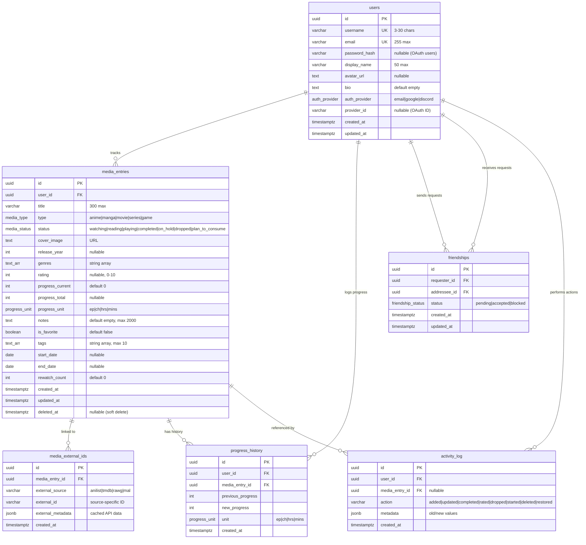

# ShinDB — Database Schema

> **Version**: 1.0.0-draft  
> **Last Updated**: 2026-06-14  
> **Status**: Draft  
> **ORM**: Prisma 6.x  
> **Database**: PostgreSQL 16+  
> **Companion Docs**: [PRD.md](file:///d:/02_CODE/04_TEST/VSHIN/imdb-gemini/src/notes/PRD.md) · [TechSpec.md](file:///d:/02_CODE/04_TEST/VSHIN/imdb-gemini/src/notes/TechSpec.md) · [SYS_Tracker.md](file:///d:/02_CODE/04_TEST/VSHIN/imdb-gemini/src/notes/SYS_Tracker.md)

---

## Table of Contents

1. [Architecture Overview](#1-architecture-overview)
2. [Entity Relationship Diagram](#2-entity-relationship-diagram)
3. [Enum Definitions](#3-enum-definitions)
4. [Table Specifications](#4-table-specifications)
5. [Relationships & Foreign Keys](#5-relationships--foreign-keys)
6. [Indexes](#6-indexes)
7. [Constraints & Validation Rules](#7-constraints--validation-rules)
8. [Soft Delete Strategy](#8-soft-delete-strategy)
9. [Data Retention Policy](#9-data-retention-policy)
10. [Prisma Schema](#10-prisma-schema)
11. [Seed Data](#11-seed-data)
12. [Migration Strategy](#12-migration-strategy)
13. [Query Patterns](#13-query-patterns)

---

## 1. Architecture Overview

### Single Database, Logical Separation

All microservices share **one PostgreSQL database** but access only their designated tables. Separation is enforced at the application layer (not DB-level permissions in v1.0).

| Service | Owned Tables | Read Access |
|---------|-------------|-------------|
| `auth-service` | `users` (credentials) | — |
| `tracker-service` | `media_entries`, `progress_history`, `activity_log` | `users.id` (FK reference) |
| `user-service` | `friendships` | `users` (profile columns) |
| `search-service` | — (Redis only) | — |

### Design Decisions

| Decision | Choice | Rationale |
|----------|--------|-----------|
| **Primary keys** | UUIDv4 | Non-sequential for security, globally unique across services |
| **Timestamps** | `timestamptz` (with timezone) | Consistent across time zones, stored as UTC |
| **Soft deletes** | `deletedAt` column on `media_entries` | Supports 5-second undo toast + data recovery |
| **Arrays vs. tables** | PostgreSQL `text[]` for `genres` and `tags` | Genres come from external APIs (no joins needed); tags are user-defined but low-cardinality per entry (max 10). Arrays avoid join overhead for simple filtering |
| **External IDs** | Separate `media_external_ids` table | Supports future multi-source linking (AniList + MAL for same anime) without schema changes |
| **Duplicate prevention** | Unique constraint on `(userId, externalSource, externalId)` in `media_external_ids` | Prevents adding the same external entry twice while allowing manual entries with no external link |
| **Progress history** | Separate `progress_history` table | Enables "When did I watch EP 5?" tracking without bloating `media_entries` |
| **Account deletion** | Not available in v1.0 | Admin handles manually; no cascade delete logic needed yet |

### Database Size Estimates (Target Scale: 5-20 Users)

| Table | Est. Rows (per user) | Est. Total (20 users) |
|-------|---------------------|----------------------|
| `users` | 1 | 20 |
| `media_entries` | 200-400 | 4,000-8,000 |
| `progress_history` | 1,000-5,000 | 20,000-100,000 |
| `activity_log` | 500-2,000 | 10,000-40,000 |
| `friendships` | 5-20 | 100-400 |
| `media_external_ids` | 200-400 | 4,000-8,000 |

---

## 2. Entity Relationship Diagram



---

## 3. Enum Definitions

### 3.1 `media_type`

Defines the five supported media categories.

| Value | Display Name | Progress Unit | External Source |
|-------|-------------|--------------|----------------|
| `anime` | Anime | `ep` (episodes) | AniList |
| `manga` | Manga | `ch` (chapters) | AniList |
| `movie` | Movie | N/A | TMDB |
| `series` | Series | `ep` (episodes) | TMDB |
| `game` | Game | `hrs` (hours) | RAWG |

### 3.2 `media_status`

Tracking status for a media entry. Status names are type-agnostic in the database but displayed with type-appropriate labels in the UI.

| Value | UI Label (Anime/Series) | UI Label (Manga) | UI Label (Games) | UI Label (Movies) |
|-------|------------------------|-------------------|-------------------|--------------------|
| `watching` | Watching | — | — | — |
| `reading` | — | Reading | — | — |
| `playing` | — | — | Playing | — |
| `completed` | Completed | Completed | Completed | Watched |
| `on_hold` | On-Hold | On-Hold | On-Hold | — |
| `dropped` | Dropped | Dropped | Dropped | Dropped |
| `plan_to_consume` | Plan to Watch | Plan to Read | Plan to Play | Plan to Watch |

> **Note**: Movies don't use `watching`, `reading`, `playing`, or `on_hold` statuses. The UI enforces this constraint; the database allows all values for flexibility.

### 3.3 `progress_unit`

| Value | Description | Used By |
|-------|-------------|---------|
| `ep` | Episodes | Anime, Series |
| `ch` | Chapters | Manga |
| `hrs` | Hours | Games |
| `mins` | Minutes | Movies (runtime) |

### 3.4 `friendship_status`

| Value | Description |
|-------|-------------|
| `pending` | Request sent, awaiting response |
| `accepted` | Friendship active |
| `blocked` | User blocked (reserved for future use) |

### 3.5 `auth_provider`

| Value | Description |
|-------|-------------|
| `email` | Registered with email + password |
| `google` | Registered/linked via Google OAuth |
| `discord` | Registered/linked via Discord OAuth |

---

## 4. Table Specifications

### 4.1 `users`

The core user table. Owned by `auth-service`, read by `user-service` and `tracker-service`.

| Column | Type | Nullable | Default | Constraints | Description |
|--------|------|----------|---------|-------------|-------------|
| `id` | `uuid` | ❌ | `gen_random_uuid()` | **PK** | Unique user identifier |
| `username` | `varchar(30)` | ❌ | — | **UNIQUE**, `CHECK(length >= 3)` | Public username (alphanumeric + underscores) |
| `email` | `varchar(255)` | ❌ | — | **UNIQUE** | User's email address |
| `password_hash` | `varchar(255)` | ✅ | `NULL` | — | Bcrypt hash (NULL for OAuth-only users) |
| `display_name` | `varchar(50)` | ❌ | — | — | Public display name |
| `avatar_url` | `text` | ✅ | `NULL` | — | Cloudinary CDN URL |
| `bio` | `text` | ❌ | `''` | — | User biography |
| `auth_provider` | `auth_provider` | ❌ | `'email'` | — | Registration method |
| `provider_id` | `varchar(255)` | ✅ | `NULL` | — | OAuth provider's user ID |
| `created_at` | `timestamptz` | ❌ | `now()` | — | Account creation timestamp |
| `updated_at` | `timestamptz` | ❌ | `now()` | Auto-update on modify | Last profile update |

**Username rules** (enforced at application layer):
- 3-30 characters
- Only `a-z`, `A-Z`, `0-9`, `_`
- Case-insensitive uniqueness (stored as-is, compared lowercase)

---

### 4.2 `media_entries`

The core tracking table. Each row represents one media item being tracked by one user.

| Column | Type | Nullable | Default | Constraints | Description |
|--------|------|----------|---------|-------------|-------------|
| `id` | `uuid` | ❌ | `gen_random_uuid()` | **PK** | Unique entry identifier |
| `user_id` | `uuid` | ❌ | — | **FK → users.id** | Owning user |
| `title` | `varchar(300)` | ❌ | — | — | Media title (English or original) |
| `type` | `media_type` | ❌ | — | — | anime, manga, movie, series, game |
| `status` | `media_status` | ❌ | `'plan_to_consume'` | — | Current tracking status |
| `cover_image` | `text` | ❌ | `''` | — | Cover image URL from external API |
| `release_year` | `int` | ✅ | `NULL` | `CHECK(1900..2100)` | Year of release |
| `genres` | `text[]` | ❌ | `'{}'` | — | Genre tags from external API |
| `rating` | `int` | ✅ | `NULL` | `CHECK(0..10)` | User rating (integer, 0-10) |
| `progress_current` | `int` | ❌ | `0` | `CHECK(>= 0)` | Current progress (episodes, chapters, hours) |
| `progress_total` | `int` | ✅ | `NULL` | `CHECK(>= 0)` | Total episodes/chapters/hours (NULL = unknown/ongoing) |
| `progress_unit` | `progress_unit` | ❌ | `'ep'` | — | Unit of progress measurement |
| `notes` | `text` | ❌ | `''` | — | User's personal notes (max 2000 chars, app-enforced) |
| `is_favorite` | `boolean` | ❌ | `false` | — | Favorited by user |
| `tags` | `text[]` | ❌ | `'{}'` | — | User-defined tags (max 10, app-enforced) |
| `start_date` | `date` | ✅ | `NULL` | — | When user started consuming |
| `end_date` | `date` | ✅ | `NULL` | — | When user finished |
| `rewatch_count` | `int` | ❌ | `0` | `CHECK(>= 0)` | Number of rewatches/rereads |
| `created_at` | `timestamptz` | ❌ | `now()` | — | When entry was added |
| `updated_at` | `timestamptz` | ❌ | `now()` | Auto-update | Last modification |
| `deleted_at` | `timestamptz` | ✅ | `NULL` | — | Soft delete timestamp (NULL = active) |

**Soft delete behavior**:
- All queries filter `WHERE deleted_at IS NULL` by default
- Deleted entries are recoverable via admin or undo action
- See [§8 Soft Delete Strategy](#8-soft-delete-strategy)

---

### 4.3 `media_external_ids`

Links a media entry to one or more external API sources. Designed for future multi-source support (e.g., same anime linked to both AniList and MAL).

| Column | Type | Nullable | Default | Constraints | Description |
|--------|------|----------|---------|-------------|-------------|
| `id` | `uuid` | ❌ | `gen_random_uuid()` | **PK** | Unique link identifier |
| `media_entry_id` | `uuid` | ❌ | — | **FK → media_entries.id**, CASCADE | Parent media entry |
| `external_source` | `varchar(20)` | ❌ | — | — | API source: `anilist`, `tmdb`, `rawg`, `mal` |
| `external_id` | `varchar(100)` | ❌ | — | — | ID from the external API |
| `external_metadata` | `jsonb` | ✅ | `NULL` | — | Cached metadata from API (title variants, description, scores) |
| `created_at` | `timestamptz` | ❌ | `now()` | — | When this link was created |

**Unique constraint**: `UNIQUE(media_entry_id, external_source)` — one link per source per entry.

**User-level uniqueness**: Application layer checks `(user_id, external_source, external_id)` before creating an entry to prevent duplicates. This is not a DB constraint because `user_id` lives on `media_entries`, not this table.

#### `external_metadata` JSONB Structure

```jsonc
{
  // Common fields (all sources)
  "titleEnglish": "Steins;Gate",
  "titleNative": "シュタインズ・ゲート",
  "titleRomaji": "Steins;Gate",
  "description": "A self-proclaimed mad scientist...",
  "averageScore": 90,

  // AniList-specific
  "anilistUrl": "https://anilist.co/anime/9253",
  "season": "SPRING",
  "seasonYear": 2011,
  "studios": ["White Fox"],

  // TMDB-specific
  "tmdbUrl": "https://www.themoviedb.org/movie/12345",
  "voteCount": 1234,
  "originalLanguage": "ja",

  // RAWG-specific
  "rawgUrl": "https://rawg.io/games/steins-gate",
  "platforms": ["PC", "PS4", "Switch"],
  "metacritic": 85
}
```

---

### 4.4 `progress_history`

Logs every progress change for detailed consumption tracking. Answers "When did I watch episode 5?"

| Column | Type | Nullable | Default | Constraints | Description |
|--------|------|----------|---------|-------------|-------------|
| `id` | `uuid` | ❌ | `gen_random_uuid()` | **PK** | Unique history record |
| `user_id` | `uuid` | ❌ | — | **FK → users.id** | User who made the change |
| `media_entry_id` | `uuid` | ❌ | — | **FK → media_entries.id**, CASCADE | Related media entry |
| `previous_progress` | `int` | ❌ | — | `CHECK(>= 0)` | Progress before change |
| `new_progress` | `int` | ❌ | — | `CHECK(>= 0)` | Progress after change |
| `unit` | `progress_unit` | ❌ | — | — | ep, ch, hrs, mins |
| `created_at` | `timestamptz` | ❌ | `now()` | — | When the progress change occurred |

**Created when**:
- User clicks [+1] on a card
- User manually sets progress in the edit modal
- NOT created for the initial entry creation (that's captured in `activity_log`)

**Example records**:

| previous_progress | new_progress | unit | created_at |
|-------------------|-------------|------|------------|
| 0 | 1 | ep | 2024-01-15 20:00 |
| 1 | 2 | ep | 2024-01-16 21:30 |
| 2 | 5 | ep | 2024-01-17 23:00 |
| 5 | 6 | ep | 2024-01-18 20:15 |

---

### 4.5 `friendships`

Bidirectional friendship model using a single row per relationship.

| Column | Type | Nullable | Default | Constraints | Description |
|--------|------|----------|---------|-------------|-------------|
| `id` | `uuid` | ❌ | `gen_random_uuid()` | **PK** | Unique friendship record |
| `requester_id` | `uuid` | ❌ | — | **FK → users.id**, CASCADE | User who sent the request |
| `addressee_id` | `uuid` | ❌ | — | **FK → users.id**, CASCADE | User who received the request |
| `status` | `friendship_status` | ❌ | `'pending'` | — | pending, accepted, blocked |
| `created_at` | `timestamptz` | ❌ | `now()` | — | When request was sent |
| `updated_at` | `timestamptz` | ❌ | `now()` | Auto-update | When status last changed |

**Unique constraint**: `UNIQUE(requester_id, addressee_id)` — prevents duplicate requests.

**Querying friends**: To get all friends of a user, query both directions:
```sql
WHERE (requester_id = $userId OR addressee_id = $userId)
  AND status = 'accepted'
```

**Querying pending requests**: Incoming requests for a user:
```sql
WHERE addressee_id = $userId AND status = 'pending'
```

---

### 4.6 `activity_log`

Audit trail of all user actions on media entries. Used for the activity log on the media detail page and (future) friend activity feeds.

| Column | Type | Nullable | Default | Constraints | Description |
|--------|------|----------|---------|-------------|-------------|
| `id` | `uuid` | ❌ | `gen_random_uuid()` | **PK** | Unique log entry |
| `user_id` | `uuid` | ❌ | — | **FK → users.id**, CASCADE | User who performed the action |
| `media_entry_id` | `uuid` | ✅ | `NULL` | **FK → media_entries.id**, SET NULL | Related entry (NULL if entry was hard-deleted) |
| `action` | `varchar(50)` | ❌ | — | — | Action type (see below) |
| `metadata` | `jsonb` | ✅ | `NULL` | — | Context-specific data |
| `created_at` | `timestamptz` | ❌ | `now()` | — | When the action occurred |

#### Action Types

| Action | Trigger | Metadata Example |
|--------|---------|-----------------|
| `added` | Entry created | `{ "title": "Steins;Gate", "type": "anime", "status": "plan_to_consume" }` |
| `updated` | Entry fields modified | `{ "changes": { "status": { "old": "plan_to_consume", "new": "watching" } } }` |
| `completed` | Status changed to `completed` | `{ "title": "Steins;Gate", "rating": 8, "totalProgress": "24/24 ep" }` |
| `rated` | Rating set or changed | `{ "title": "Steins;Gate", "old": null, "new": 8 }` |
| `dropped` | Status changed to `dropped` | `{ "title": "Zom 100", "progress": "3/12 ep" }` |
| `started` | Status changed to watching/reading/playing | `{ "title": "Dandadan", "type": "anime" }` |
| `deleted` | Entry soft-deleted | `{ "title": "Bad Anime", "type": "anime" }` |
| `restored` | Entry restored from soft delete (undo) | `{ "title": "Bad Anime", "type": "anime" }` |
| `progress` | Progress updated | `{ "title": "Steins;Gate", "old": 18, "new": 19, "unit": "ep" }` |
| `favorited` | Favorite toggled on | `{ "title": "Steins;Gate" }` |
| `unfavorited` | Favorite toggled off | `{ "title": "Steins;Gate" }` |

---

## 5. Relationships & Foreign Keys

### Relationship Map

```
users ──┬── 1:N ──── media_entries (user_id)
        │                 │
        │                 ├── 1:N ──── media_external_ids (media_entry_id)
        │                 ├── 1:N ──── progress_history (media_entry_id)
        │                 └── 1:N ──── activity_log (media_entry_id)
        │
        ├── 1:N ──── progress_history (user_id)
        ├── 1:N ──── activity_log (user_id)
        │
        ├── 1:N ──── friendships (requester_id)
        └── 1:N ──── friendships (addressee_id)
```

### Foreign Key Behaviors

| FK | On Delete | On Update | Rationale |
|----|-----------|-----------|-----------|
| `media_entries.user_id → users.id` | **RESTRICT** | CASCADE | Prevent user deletion without handling entries first (no account deletion in v1.0) |
| `media_external_ids.media_entry_id → media_entries.id` | **CASCADE** | CASCADE | External IDs are meaningless without the entry |
| `progress_history.media_entry_id → media_entries.id` | **CASCADE** | CASCADE | History belongs to the entry |
| `progress_history.user_id → users.id` | **RESTRICT** | CASCADE | Same as media_entries |
| `activity_log.media_entry_id → media_entries.id` | **SET NULL** | CASCADE | Keep log even if entry is permanently removed |
| `activity_log.user_id → users.id` | **RESTRICT** | CASCADE | Same as media_entries |
| `friendships.requester_id → users.id` | **CASCADE** | CASCADE | Remove friendship if user is removed |
| `friendships.addressee_id → users.id` | **CASCADE** | CASCADE | Same as above |

---

## 6. Indexes

### Performance-Critical Indexes

```sql
-- ═══ users ═══
-- Primary lookups
CREATE UNIQUE INDEX idx_users_username ON users (LOWER(username));  -- Case-insensitive
CREATE UNIQUE INDEX idx_users_email ON users (LOWER(email));        -- Case-insensitive
CREATE INDEX idx_users_provider ON users (auth_provider, provider_id) WHERE provider_id IS NOT NULL;

-- ═══ media_entries ═══
-- Core query patterns (all exclude soft-deleted)
CREATE INDEX idx_entries_user ON media_entries (user_id) WHERE deleted_at IS NULL;
CREATE INDEX idx_entries_user_type ON media_entries (user_id, type) WHERE deleted_at IS NULL;
CREATE INDEX idx_entries_user_status ON media_entries (user_id, status) WHERE deleted_at IS NULL;
CREATE INDEX idx_entries_user_type_status ON media_entries (user_id, type, status) WHERE deleted_at IS NULL;
CREATE INDEX idx_entries_user_favorite ON media_entries (user_id) WHERE is_favorite = true AND deleted_at IS NULL;
CREATE INDEX idx_entries_user_created ON media_entries (user_id, created_at DESC) WHERE deleted_at IS NULL;
CREATE INDEX idx_entries_user_rating ON media_entries (user_id, rating DESC NULLS LAST) WHERE deleted_at IS NULL;

-- Text search on title
CREATE INDEX idx_entries_title_trgm ON media_entries USING gin (title gin_trgm_ops) WHERE deleted_at IS NULL;

-- Soft delete cleanup
CREATE INDEX idx_entries_deleted ON media_entries (deleted_at) WHERE deleted_at IS NOT NULL;

-- ═══ media_external_ids ═══
CREATE UNIQUE INDEX idx_external_ids_entry_source ON media_external_ids (media_entry_id, external_source);
CREATE INDEX idx_external_ids_source_id ON media_external_ids (external_source, external_id);

-- ═══ progress_history ═══
CREATE INDEX idx_progress_entry ON progress_history (media_entry_id, created_at DESC);
CREATE INDEX idx_progress_user ON progress_history (user_id, created_at DESC);

-- ═══ friendships ═══
CREATE UNIQUE INDEX idx_friendships_pair ON friendships (requester_id, addressee_id);
CREATE INDEX idx_friendships_addressee ON friendships (addressee_id, status);
CREATE INDEX idx_friendships_requester ON friendships (requester_id, status);

-- ═══ activity_log ═══
CREATE INDEX idx_activity_user ON activity_log (user_id, created_at DESC);
CREATE INDEX idx_activity_entry ON activity_log (media_entry_id, created_at DESC) WHERE media_entry_id IS NOT NULL;
CREATE INDEX idx_activity_action ON activity_log (action, created_at DESC);
```

### Index Rationale

| Index | Supports Query |
|-------|---------------|
| `idx_entries_user_type` | `/anime`, `/manga` etc. — list all entries of a type for a user |
| `idx_entries_user_status` | Filter pills — "WATCHING", "COMPLETED", etc. |
| `idx_entries_user_type_status` | Combined filter — "All WATCHING ANIME" |
| `idx_entries_user_favorite` | Favorites section on profile/dashboard |
| `idx_entries_user_created` | Default sort (newest first) |
| `idx_entries_user_rating` | Sort by rating |
| `idx_entries_title_trgm` | Text search on media titles (requires `pg_trgm` extension) |
| `idx_friendships_pair` | Prevent duplicate requests + fast lookup |
| `idx_friendships_addressee` | "Pending requests for me" query |
| `idx_activity_user` | Activity feed on dashboard/profile |
| `idx_progress_entry` | Progress history timeline on media detail page |

---

## 7. Constraints & Validation Rules

### Database-Level Constraints

| Table | Constraint | Type | Rule |
|-------|-----------|------|------|
| `users` | `username` | UNIQUE | Case-insensitive (via `LOWER()` index) |
| `users` | `email` | UNIQUE | Case-insensitive |
| `users` | `username` length | CHECK | `length(username) >= 3 AND length(username) <= 30` |
| `media_entries` | `rating` | CHECK | `rating >= 0 AND rating <= 10` |
| `media_entries` | `progress_current` | CHECK | `progress_current >= 0` |
| `media_entries` | `progress_total` | CHECK | `progress_total >= 0` |
| `media_entries` | `release_year` | CHECK | `release_year >= 1900 AND release_year <= 2100` |
| `media_entries` | `rewatch_count` | CHECK | `rewatch_count >= 0` |
| `friendships` | `self_friend` | CHECK | `requester_id != addressee_id` |
| `friendships` | pair | UNIQUE | `(requester_id, addressee_id)` |
| `media_external_ids` | source-entry | UNIQUE | `(media_entry_id, external_source)` |

### Application-Level Validation (Zod)

These rules are enforced by the API layer, not the database:

| Field | Rule | Enforced By |
|-------|------|-------------|
| `username` format | `^[a-zA-Z0-9_]{3,30}$` | auth-service (Zod) |
| `password` strength | Min 8 chars, 1 uppercase, 1 number | auth-service (Zod) |
| `notes` length | Max 2000 characters | tracker-service (Zod) |
| `tags` count | Max 10 per entry | tracker-service (Zod) |
| `tags` item length | Max 50 characters each | tracker-service (Zod) |
| `bio` length | Max 200 characters | user-service (Zod) |
| `display_name` | 1-50 characters | auth-service / user-service (Zod) |
| Movie status restriction | Only `completed`, `plan_to_consume`, `dropped` | tracker-service (Zod) |
| Duplicate external entry | Check `(user_id, external_source, external_id)` before insert | tracker-service (logic) |

---

## 8. Soft Delete Strategy

### How It Works

Media entries use **soft deletes** via a nullable `deleted_at` timestamp column:

```
Active entry:     deleted_at = NULL     → visible in all queries
Deleted entry:    deleted_at = <timestamp> → hidden from all queries
```

### Query Pattern

All Prisma queries for media entries include the soft delete filter:

```typescript
// Prisma middleware automatically adds this filter
// (configured in @sys-tracker/db)

prisma.$use(async (params, next) => {
  if (params.model === 'MediaEntry') {
    // Reads: filter out soft-deleted
    if (params.action === 'findMany' || params.action === 'findFirst') {
      params.args.where = { ...params.args.where, deletedAt: null };
    }
    // Updates: don't allow updating soft-deleted
    if (params.action === 'update' || params.action === 'updateMany') {
      params.args.where = { ...params.args.where, deletedAt: null };
    }
    // Deletes: convert to soft delete
    if (params.action === 'delete') {
      params.action = 'update';
      params.args.data = { deletedAt: new Date() };
    }
  }
  return next(params);
});
```

### Delete & Undo Flow

```
1. User clicks DELETE → API call: PATCH /media/entries/:id/soft-delete
2. Server sets deleted_at = NOW()
3. Activity log: { action: "deleted", metadata: { title } }
4. Frontend shows undo toast (5 seconds)

If UNDO clicked within 5 seconds:
5. API call: PATCH /media/entries/:id/restore
6. Server sets deleted_at = NULL
7. Activity log: { action: "restored", metadata: { title } }

If NOT undone:
8. Entry remains soft-deleted (hidden from all queries)
```

### Permanent Deletion

Soft-deleted entries are permanently purged by a **scheduled cleanup**:
- Entries with `deleted_at` older than **30 days** are permanently deleted
- Cascade: `media_external_ids`, `progress_history` for that entry are also removed
- `activity_log` entries are preserved (FK set to NULL)

---

## 9. Data Retention Policy

### Retention Rules

| Data | Retention | Cleanup Method |
|------|-----------|---------------|
| Active media entries | Indefinite | No auto-cleanup |
| Soft-deleted media entries | 30 days | Scheduled task purges entries with `deleted_at < NOW() - 30 days` |
| Progress history | 1 year | Scheduled task purges records older than 1 year |
| Activity log | 1 year | Scheduled task purges records older than 1 year |
| Friendships | Indefinite | No auto-cleanup |
| User accounts | Indefinite | No auto-cleanup (no account deletion in v1.0) |
| Redis search cache | 1 hour TTL | Redis auto-eviction |
| Redis stats cache | 5 minute TTL | Redis auto-eviction |

### Cleanup Implementation

```sql
-- Run daily via cron job or scheduled task

-- 1. Permanently delete soft-deleted entries older than 30 days
DELETE FROM media_entries
WHERE deleted_at IS NOT NULL
  AND deleted_at < NOW() - INTERVAL '30 days';

-- 2. Purge old progress history (older than 1 year)
DELETE FROM progress_history
WHERE created_at < NOW() - INTERVAL '1 year';

-- 3. Purge old activity logs (older than 1 year)
DELETE FROM activity_log
WHERE created_at < NOW() - INTERVAL '1 year';
```

---

## 10. Prisma Schema

The complete Prisma schema definition, ready for use in `packages/db/prisma/schema.prisma`:

```prisma
// ═══════════════════════════════════════════════════════════════
// ShinDB — Prisma Schema
// Database: PostgreSQL 16+
// ═══════════════════════════════════════════════════════════════

generator client {
  provider        = "prisma-client-js"
  previewFeatures = ["postgresqlExtensions"]
}

datasource db {
  provider   = "postgresql"
  url        = env("DATABASE_URL")
  extensions = [pg_trgm]  // For trigram-based text search
}

// ─── ENUMS ─────────────────────────────────────────────────────

enum MediaType {
  anime
  manga
  movie
  series
  game

  @@map("media_type")
}

enum MediaStatus {
  watching
  reading
  playing
  completed
  on_hold
  dropped
  plan_to_consume

  @@map("media_status")
}

enum ProgressUnit {
  ep
  ch
  hrs
  mins

  @@map("progress_unit")
}

enum FriendshipStatus {
  pending
  accepted
  blocked

  @@map("friendship_status")
}

enum AuthProvider {
  email
  google
  discord

  @@map("auth_provider")
}

// ─── MODELS ────────────────────────────────────────────────────

/// User accounts — owned by auth-service
model User {
  id           String       @id @default(uuid()) @db.Uuid
  username     String       @unique @db.VarChar(30)
  email        String       @unique @db.VarChar(255)
  passwordHash String?      @map("password_hash") @db.VarChar(255)
  displayName  String       @map("display_name") @db.VarChar(50)
  avatarUrl    String?      @map("avatar_url") @db.Text
  bio          String       @default("") @db.Text
  authProvider AuthProvider @default(email) @map("auth_provider")
  providerId   String?      @map("provider_id") @db.VarChar(255)
  createdAt    DateTime     @default(now()) @map("created_at") @db.Timestamptz
  updatedAt    DateTime     @updatedAt @map("updated_at") @db.Timestamptz

  // Relations
  mediaEntries     MediaEntry[]
  progressHistory  ProgressHistory[]
  activityLogs     ActivityLog[]
  sentRequests     Friendship[]      @relation("FriendRequester")
  receivedRequests Friendship[]      @relation("FriendAddressee")

  @@map("users")
}

/// Media tracking entries — owned by tracker-service
model MediaEntry {
  id              String       @id @default(uuid()) @db.Uuid
  userId          String       @map("user_id") @db.Uuid
  title           String       @db.VarChar(300)
  type            MediaType
  status          MediaStatus  @default(plan_to_consume)
  coverImage      String       @default("") @map("cover_image") @db.Text
  releaseYear     Int?         @map("release_year")
  genres          String[]     @default([])
  rating          Int?
  progressCurrent Int          @default(0) @map("progress_current")
  progressTotal   Int?         @map("progress_total")
  progressUnit    ProgressUnit @default(ep) @map("progress_unit")
  notes           String       @default("") @db.Text
  isFavorite      Boolean      @default(false) @map("is_favorite")
  tags            String[]     @default([])
  startDate       DateTime?    @map("start_date") @db.Date
  endDate         DateTime?    @map("end_date") @db.Date
  rewatchCount    Int          @default(0) @map("rewatch_count")
  createdAt       DateTime     @default(now()) @map("created_at") @db.Timestamptz
  updatedAt       DateTime     @updatedAt @map("updated_at") @db.Timestamptz
  deletedAt       DateTime?    @map("deleted_at") @db.Timestamptz

  // Relations
  user            User                @relation(fields: [userId], references: [id], onDelete: Restrict)
  externalIds     MediaExternalId[]
  progressHistory ProgressHistory[]
  activityLogs    ActivityLog[]

  // Indexes
  @@index([userId])
  @@index([userId, type])
  @@index([userId, status])
  @@index([userId, type, status])
  @@index([userId, createdAt(sort: Desc)])
  @@index([deletedAt])

  @@map("media_entries")
}

/// External API ID links — owned by tracker-service
model MediaExternalId {
  id               String   @id @default(uuid()) @db.Uuid
  mediaEntryId     String   @map("media_entry_id") @db.Uuid
  externalSource   String   @map("external_source") @db.VarChar(20)
  externalId       String   @map("external_id") @db.VarChar(100)
  externalMetadata Json?    @map("external_metadata") @db.JsonB
  createdAt        DateTime @default(now()) @map("created_at") @db.Timestamptz

  // Relations
  mediaEntry MediaEntry @relation(fields: [mediaEntryId], references: [id], onDelete: Cascade)

  // Constraints
  @@unique([mediaEntryId, externalSource])
  @@index([externalSource, externalId])

  @@map("media_external_ids")
}

/// Progress change history — owned by tracker-service
model ProgressHistory {
  id               String       @id @default(uuid()) @db.Uuid
  userId           String       @map("user_id") @db.Uuid
  mediaEntryId     String       @map("media_entry_id") @db.Uuid
  previousProgress Int          @map("previous_progress")
  newProgress      Int          @map("new_progress")
  unit             ProgressUnit
  createdAt        DateTime     @default(now()) @map("created_at") @db.Timestamptz

  // Relations
  user       User       @relation(fields: [userId], references: [id], onDelete: Restrict)
  mediaEntry MediaEntry @relation(fields: [mediaEntryId], references: [id], onDelete: Cascade)

  // Indexes
  @@index([mediaEntryId, createdAt(sort: Desc)])
  @@index([userId, createdAt(sort: Desc)])

  @@map("progress_history")
}

/// Friend relationships — owned by user-service
model Friendship {
  id          String           @id @default(uuid()) @db.Uuid
  requesterId String          @map("requester_id") @db.Uuid
  addresseeId String          @map("addressee_id") @db.Uuid
  status      FriendshipStatus @default(pending)
  createdAt   DateTime         @default(now()) @map("created_at") @db.Timestamptz
  updatedAt   DateTime         @updatedAt @map("updated_at") @db.Timestamptz

  // Relations
  requester User @relation("FriendRequester", fields: [requesterId], references: [id], onDelete: Cascade)
  addressee User @relation("FriendAddressee", fields: [addresseeId], references: [id], onDelete: Cascade)

  // Constraints
  @@unique([requesterId, addresseeId])
  @@index([addresseeId, status])
  @@index([requesterId, status])

  @@map("friendships")
}

/// Audit trail — owned by tracker-service
model ActivityLog {
  id           String   @id @default(uuid()) @db.Uuid
  userId       String   @map("user_id") @db.Uuid
  mediaEntryId String?  @map("media_entry_id") @db.Uuid
  action       String   @db.VarChar(50)
  metadata     Json?    @db.JsonB
  createdAt    DateTime @default(now()) @map("created_at") @db.Timestamptz

  // Relations
  user       User        @relation(fields: [userId], references: [id], onDelete: Restrict)
  mediaEntry MediaEntry? @relation(fields: [mediaEntryId], references: [id], onDelete: SetNull)

  // Indexes
  @@index([userId, createdAt(sort: Desc)])
  @@index([mediaEntryId, createdAt(sort: Desc)])
  @@index([action, createdAt(sort: Desc)])

  @@map("activity_log")
}
```

---

## 11. Seed Data

### Development Seed Script

A seed script (`packages/db/prisma/seed.ts`) populates the database with sample data for development:

#### Seed Users

| Username | Display Name | Auth Provider | Role |
|----------|-------------|---------------|------|
| `SENPAI_09` | Senpai | email | Primary dev user |
| `SAKURA_CHAN` | Sakura | email | Test friend |
| `NARUTO_FAN` | Naruto | email | Test friend |

#### Seed Media Entries (for SENPAI_09)

| Title | Type | Status | Rating | Progress |
|-------|------|--------|--------|----------|
| Steins;Gate | anime | completed | 9 | 24/24 ep |
| Attack on Titan | anime | completed | 8 | 87/87 ep |
| Dandadan | anime | watching | — | 5/12 ep |
| One Piece | manga | reading | 9 | 1102/??? ch |
| Chainsaw Man | manga | completed | 8 | 97/97 ch |
| The Dark Knight | movie | completed | 10 | — |
| Breaking Bad | series | completed | 10 | 62/62 ep |
| Elden Ring | game | playing | 9 | 120/??? hrs |
| Zelda: TotK | game | completed | 10 | 85/85 hrs |

#### Seed Friendships

| Requester | Addressee | Status |
|-----------|-----------|--------|
| SENPAI_09 | SAKURA_CHAN | accepted |
| NARUTO_FAN | SENPAI_09 | pending |

### Running the Seed

```bash
pnpm --filter @sys-tracker/db prisma db seed
```

---

## 12. Migration Strategy

### Workflow

```bash
# Development: Create and apply migration
pnpm --filter @sys-tracker/db prisma migrate dev --name <descriptive_name>

# Production: Apply pending migrations
pnpm --filter @sys-tracker/db prisma migrate deploy

# Reset database (dev only — drops all data)
pnpm --filter @sys-tracker/db prisma migrate reset

# Generate Prisma client after schema changes
pnpm --filter @sys-tracker/db prisma generate
```

### Migration Naming Convention

```
YYYYMMDDHHMMSS_<description>

Examples:
20260614120000_init
20260615090000_add_progress_history
20260616100000_add_soft_delete_to_entries
20260617110000_add_media_external_ids
```

### Required PostgreSQL Extension

The `pg_trgm` extension must be enabled for trigram text search:

```sql
-- Run once on database creation
CREATE EXTENSION IF NOT EXISTS pg_trgm;
```

---

## 13. Query Patterns

### Common Query Patterns and Expected Performance

#### Dashboard Stats

```sql
-- Expected: < 50ms for 400 entries per user
SELECT
  type,
  COUNT(*) FILTER (WHERE deleted_at IS NULL) as total,
  COUNT(*) FILTER (WHERE status = 'completed' AND deleted_at IS NULL) as completed,
  COUNT(*) FILTER (WHERE status IN ('watching','reading','playing') AND deleted_at IS NULL) as active,
  COUNT(*) FILTER (WHERE status = 'plan_to_consume' AND deleted_at IS NULL) as backlog,
  COUNT(*) FILTER (WHERE status = 'on_hold' AND deleted_at IS NULL) as on_hold,
  COUNT(*) FILTER (WHERE status = 'dropped' AND deleted_at IS NULL) as dropped,
  ROUND(AVG(rating) FILTER (WHERE rating IS NOT NULL AND deleted_at IS NULL), 2) as mean_score,
  SUM(progress_current) FILTER (WHERE deleted_at IS NULL) as total_progress
FROM media_entries
WHERE user_id = $1
GROUP BY type;
```

#### Media List with Filters

```sql
-- Expected: < 100ms for 400 entries with filters
SELECT * FROM media_entries
WHERE user_id = $1
  AND type = $2            -- optional
  AND status = $3          -- optional
  AND deleted_at IS NULL
ORDER BY created_at DESC
LIMIT $4 OFFSET $5;
```

#### Title Search (Trigram)

```sql
-- Expected: < 200ms with pg_trgm index
SELECT * FROM media_entries
WHERE user_id = $1
  AND title ILIKE '%' || $2 || '%'
  AND deleted_at IS NULL
ORDER BY similarity(title, $2) DESC
LIMIT 20;
```

#### Recent Activity

```sql
-- Expected: < 50ms
SELECT al.*, me.title, me.type, me.cover_image
FROM activity_log al
LEFT JOIN media_entries me ON al.media_entry_id = me.id
WHERE al.user_id = $1
ORDER BY al.created_at DESC
LIMIT 20;
```

#### Pending Friend Requests Count (for navbar badge)

```sql
-- Expected: < 10ms
SELECT COUNT(*) FROM friendships
WHERE addressee_id = $1 AND status = 'pending';
```

#### Progress History for Entry

```sql
-- Expected: < 20ms
SELECT * FROM progress_history
WHERE media_entry_id = $1
ORDER BY created_at DESC
LIMIT 50;
```

#### Check Duplicate Before Adding

```sql
-- Application-level check via Prisma
-- Expected: < 10ms
SELECT me.id FROM media_entries me
JOIN media_external_ids mei ON me.id = mei.media_entry_id
WHERE me.user_id = $1
  AND mei.external_source = $2
  AND mei.external_id = $3
  AND me.deleted_at IS NULL
LIMIT 1;
```

---

> **This Schema document is the single source of truth for ShinDB's data architecture. All table structures, relationships, constraints, and query patterns are defined here. When making schema changes, update this document first, then generate migrations.**
